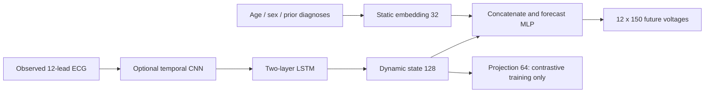

# Class presentation and speaker notes

**Small-data pilot: preliminary results; see the active-cohort table in the assignment report.**

The results table contains completed runs for the configured cohort only. Check the assignment report
and TRAINING_STATUS.md for unfinished models before presenting final comparisons.

1. **Question and task:** forecast twelve cardiac voltage streams from 0.6 s observed to
   the next 0.3 s. Explain why patient context might help; improvement is an empirical question.
2. **Dataset and data integrity:** PTB-XL v1.0.3, 500 Hz, mV, official patient folds. Show
   the audit and train-only preprocessing. Explain why random window splitting leaks patients.
3. **Conditioning:** age/sex/masks -> 4 features; plus five prior diagnosis indicators and
   history mask -> 10. Show strict chronological construction and limited history coverage.
4. **LSTM shapes:** [B,12,300] -> transpose [B,300,12] -> two-layer LSTM -> final [B,128].
   Static [B,10] -> [B,32]; concatenate -> [B,160] -> 256 -> 1800 -> [B,12,150].
5. **LSTM gates:** z_t=[h_(t-1),x_t]. Forget f_t=sigmoid(W_f z_t+b_f), input
   i_t=sigmoid(W_i z_t+b_i), candidate g_t=tanh(W_g z_t+b_g), memory
   c_t=f_t*c_(t-1)+i_t*g_t, output o_t=sigmoid(W_o z_t+b_o), h_t=o_t*tanh(c_t).
   Sigmoid gates control flow in [0,1]; tanh supplies signed content; * is elementwise.
6. **Memory and BPTT:** unroll across 300 samples and backpropagate through both layers.
   The direct memory path contains products of forget gates; it helps but does not eliminate
   vanishing gradients. Exploding gradients motivate norm clipping at 1.0.
7. **CNN operation:** Y[o,t]=b[o]+sum_c sum_k W[o,c,k] X[c,t+k-padding]. PyTorch uses
   cross-correlation. Filters span input leads and local time, share weights across time,
   and learn morphology. Explain padding, stride, channels, ReLU and average pooling.
8. **CNN-LSTM shapes:** [B,12,300] -> conv [B,32,300] -> [B,64,300] -> pool
   [B,64,150] -> conv [B,64,150] -> transpose [B,150,64] -> LSTM [B,128].
   The forecast/static head is shared in design with LSTM; recurrent input size differs.
9. **Contrastive learning:** augment only observed voltage; clean input drives forecast.
   Two views -> shared dynamic encoder -> projection -> normalized vectors. Pull paired
   views together, distinguish different patients, and mask same-patient false negatives.
   Static covariates do not enter the contrastive representation.
10. **Loss and optimization:** MSE + 0.1 NT-Xent (temperature 0.1); AdamW lr 0.001,
    weight decay 0.0001, batch 64, dropout 0.2. Show zero_grad -> forward -> loss ->
    backward -> clip -> optimizer.step. Validation uses forecast MSE without augmentation.
11. **Experiment design:** two architectures x four variants = eight runs, same seed/folds,
    plus persistence/repeated-window baselines. Best validation epoch, patience 3,
    maximum 5. Explain why comparing total contrastive loss with plain MSE is misleading.
12. **Results:** insert the table below, learning curves and paired-patient intervals.
    Explain mV/mV^2, MAE/RMSE, R2 and correlation. Negative R2 is possible and meaningful.
13. **Forecasts:** show lowest-ID, median-error and worst-error twelve-lead plots. The
    vertical boundary is forecast origin. Discuss attenuated peaks and timing errors.
14. **Patient strata:** show age/sex/diagnosis/history panels with counts. Diagnostic groups
    overlap; a small group is not evidence of a stable clinical difference.
15. **Literature:** explain Table 1 versus abstract conflicts and protocol/scaling differences.
    Do not rank unaligned numerical errors. The paper remains local.
16. **Conclusions:** state only measured changes. One seed, sparse history and short context
    limit conclusions. Future work: longer contexts, repeated seeds, verified history and
    clinical evaluation before claims about false alarms.

## Architecture diagram

## Measured test results

| run | mae | rmse | patient_macro_mae | best_epoch |
| --- | --- | --- | --- | --- |
| cnn_lstm_demographics | 0.155650 | 0.434724 | 0.152838 | 5.000000 |
| cnn_lstm_ecg_only | 0.154296 | 0.433948 | 0.151576 | 4.000000 |
| cnn_lstm_patient_history | 0.154251 | 0.433902 | 0.151215 | 5.000000 |
| cnn_lstm_patient_history_contrastive | 0.155719 | 0.435588 | 0.152772 | 5.000000 |
| lstm_demographics | 0.151759 | 0.431238 | 0.148413 | 5.000000 |
| lstm_ecg_only | 0.151706 | 0.430543 | 0.148435 | 4.000000 |
| lstm_patient_history | 0.150113 | 0.430582 | 0.146684 | 5.000000 |
| lstm_patient_history_contrastive | 0.151782 | 0.431546 | 0.148438 | 4.000000 |
| persistence | 0.141546 | 0.358149 | 0.129724 | undefined |
| repeat_window | 0.168642 | 0.336686 | 0.161466 | undefined |
