# 100 Hz ECG forecasting research report

Measured development results only. Official fold 10 remains reserved unless an explicit final-evaluation record is present. Legacy 500 Hz / 0.6-to-0.3-second results are a separate protocol and are not numerically ranked against this study.

## Protocol and cohort

Native 100 Hz, 5.0 s observed / 3.0 s future, all twelve leads. Training stride: 1.0 s. One validation/test window per recording. Time-first batches are [B,500,12] and [B,300,12] for the primary geometry. Caches are channel-first memory maps. No waveforms are preloaded into GPU memory.

| split | patients | records | windows |
| --- | --- | --- | --- |
| train | 64 | 76 | 228 |
| val | 24 | 25 | 25 |
| test | 16 | 19 | 19 |

Sampling is by patient inside official folds 1-8/9/10 with independent seed-42 streams. All records of selected patients remain. Custom development cohorts are not final official test results. Training windows overlap; inference and bootstrap units are not treated as independent patients.

## Leakage controls

See ../DATA_LEAKAGE_AUDIT.md and the machine-generated leakage_audit.json. Imputation and scaling fit training inputs only. Prior classes exclude current/equal timestamps. RR features use only observed voltage. Causal SOS filtering never reads target samples. mRMR uses training future summaries as supervised targets; permutation ranking uses validation errors; no method selection uses new test results.

## Preprocessing ablation

| run | patient_macro_mae | mae | rmse | qrs_f1 | peak_timing_mae_ms | best_epoch | actual_epochs | runtime_seconds | parameters |
| --- | --- | --- | --- | --- | --- | --- | --- | --- | --- |
| p3_lstm | 0.107931 | 0.106496 | 0.232205 | 0.000000 | undefined | 1.000000 | 8 | 3.589851 | 978384 |
| p0_lstm | 0.110098 | 0.108642 | 0.231653 | 0.000000 | undefined | 4.000000 | 8 | 3.460657 | 978384 |
| p1_lstm | 0.110172 | 0.108718 | 0.231972 | 0.000000 | undefined | 3.000000 | 8 | 3.494776 | 978384 |
| p2_lstm | 0.110180 | 0.108725 | 0.231968 | 0.000000 | undefined | 3.000000 | 8 | 3.499953 | 978384 |

P0: no filter + z-score. P1: causal high-pass 0.5 Hz + z-score. P2: causal bandpass 0.5-40 Hz + z-score. P3: no filter + training median/IQR. SciPy Butterworth prototype order 4 yields a fourth-order high-pass or eighth-order bandpass, in SOS form. Initialize each observed window from its first sample with sosfilt_zi, reset state per window, retain nonzero phase/group delay and boundary transients. Target voltages always remain unfiltered. Inverse scaling restores mV; it does not invert the filter.

P4 follows the measured best-filter and best-scaler decision in preprocessing_selection.json. If it equals an already measured configuration, report that alias without pretending a duplicate training run occurred. Filtering usefulness is judged on validation voltage errors and detector/morphology outcomes, not aesthetic smoothness. Removed components are not proven noise.

Preprocessing figures: raw_filtered_12lead.png, removed_components.png, fft_welch.png, stft.png and qrs_before_after.png under outputs/<run>/preprocessing. Raw-vs-filtered examples use training records only.

## Feature selection

| run | patient_macro_mae | mae | rmse | qrs_f1 | peak_timing_mae_ms | best_epoch | actual_epochs | runtime_seconds | parameters |
| --- | --- | --- | --- | --- | --- | --- | --- | --- | --- |
| p3_lstm | 0.107931 | 0.106496 | 0.232205 | 0.000000 | undefined | 1.000000 | 8 | 3.589851 | 978384 |
| lstm_mrmr | 0.107940 | 0.106499 | 0.232202 | 0.000000 | undefined | 1.000000 | 8 | 3.506799 | 982592 |
| lstm_history | 0.107972 | 0.106535 | 0.232202 | 0.000000 | undefined | 1.000000 | 8 | 3.558322 | 982656 |
| lstm_permutation | 0.107973 | 0.106533 | 0.232196 | 0.000000 | undefined | 1.000000 | 8 | 3.461556 | 982560 |
| lstm_expanded | 0.107998 | 0.106558 | 0.232204 | 0.000000 | undefined | 1.000000 | 8 | 3.474043 | 982848 |
| lstm_demographics | 0.108005 | 0.106564 | 0.232198 | 0.000000 | undefined | 1.000000 | 8 | 3.608765 | 982560 |

Feature sets: ECG only (0 static); demographics (4); prior-history conditioning (10); expanded (22). Expanded features add height, weight, BMI, observed-window heart rate, mean RR and RR standard deviation, each with a missing flag. Keep all twelve leads. mRMR is grouped mutual-information difference with eight-bin training quantiles. Relevance averages MI with 24 training-only future per-lead RMS/first-difference-RMS targets. These are forecasting proxies, not clinical outcomes. Redundancy averages pairwise MI against selected groups. Group flags with their variables.

Grouped permutation shuffles joint groups between validation-patient donors, using the first donor record. Repeats measure importance variability, not causal effects. Correlated variables may substitute for each other, and tiny importances should not be read as robust clinical associations. Fixed top-group counts are declared in the selection CLI and are not test-tuned.

mrmr selected: age_scaled, age_missing, height, height_missing, rr_mean, rr_mean_missing.

| group | rank | relevance_MI | redundancy_MI | mrmr_score |
| --- | --- | --- | --- | --- |
| age | 1 | 0.175223 | 0.000000 | 0.175223 |
| height | 2 | 0.089441 | 0.060283 | 0.029157 |
| rr_mean | 3 | 0.147375 | 0.085810 | 0.061565 |
| history | 4 | 0.055660 | 0.042499 | 0.013161 |
| rr_std | 5 | 0.125565 | 0.093484 | 0.032081 |
| weight | 6 | 0.094649 | 0.078805 | 0.015844 |
| sex | 7 | 0.028436 | 0.020648 | 0.007788 |
| heart_rate | 8 | 0.147833 | 0.139988 | 0.007846 |
| bmi | 9 | 0.082494 | 0.108375 | -0.025880 |

permutation selected: age_scaled, age_missing, rr_mean, rr_mean_missing.

| group | importance_mV | repeat_std_mV | repeats | rank |
| --- | --- | --- | --- | --- |
| age | 0.000005 | 0.000003 | 5 | 1 |
| rr_mean | 0.000004 | 0.000003 | 5 | 2 |
| history | -0.000000 | 0.000000 | 5 | 3 |
| bmi | -0.000002 | 0.000002 | 5 | 4 |
| sex | -0.000004 | 0.000003 | 5 | 5 |
| height | -0.000008 | 0.000002 | 5 | 6 |
| weight | -0.000008 | 0.000002 | 5 | 7 |
| rr_std | -0.000008 | 0.000003 | 5 | 8 |
| heart_rate | -0.000012 | 0.000008 | 5 | 9 |

## Static fusion and morphology-oriented changes

| run | patient_macro_mae | mae | rmse | qrs_f1 | peak_timing_mae_ms | best_epoch | actual_epochs | runtime_seconds | parameters |
| --- | --- | --- | --- | --- | --- | --- | --- | --- | --- |
| lstm_huber | 0.107852 | 0.106420 | 0.232142 | 0.000000 | undefined | 2.000000 | 8 | 3.969752 | 982656 |
| cnn_kernels | 0.107900 | 0.106462 | 0.232251 | 0.000000 | undefined | 1.000000 | 8 | 4.778924 | 1027744 |
| cnn_early | 0.107904 | 0.106471 | 0.232226 | 0.000000 | undefined | 1.000000 | 8 | 3.990203 | 1020832 |
| lstm_early | 0.107924 | 0.106488 | 0.232209 | 0.000000 | undefined | 1.000000 | 8 | 3.616201 | 982656 |
| lstm_derivative | 0.107943 | 0.106506 | 0.232202 | 0.000000 | undefined | 1.000000 | 8 | 3.838422 | 982656 |
| cnn_history | 0.107952 | 0.106515 | 0.232217 | 0.000000 | undefined | 1.000000 | 8 | 3.963501 | 1021344 |
| cnn_pool1 | 0.107955 | 0.106518 | 0.232219 | 0.000000 | undefined | 1.000000 | 8 | 6.497240 | 1021344 |
| lstm_history | 0.107972 | 0.106535 | 0.232202 | 0.000000 | undefined | 1.000000 | 8 | 3.558322 | 982656 |
| lstm_spectral | 0.108054 | 0.106617 | 0.232211 | 0.000000 | undefined | 1.000000 | 8 | 3.766416 | 982656 |
| lstm_residual | 0.152295 | 0.149844 | 0.321649 | 0.000000 | undefined | 8.000000 | 8 | 3.575988 | 982656 |

Late fusion joins final dynamic state with a static embedding. Early LSTM broadcasts that embedding to every observed step before the LSTM. Early CNN-LSTM concatenates it as channels before the CNN. The dynamic contrastive branch supplies zero context, avoiding metadata shortcuts. Configurable kernels, pooling, hidden size, depth, head width and persistence-residual output preserve the old architecture as a baseline. Derivative loss compares first differences in standardized units, weight 0.1; spectral loss compares unnormalized rFFT magnitudes in standardized units, weight 0.01. Huber delta is 1 standardized unit. These loss weights are initial ablation choices, not independently optimized optima.

## Hyperparameter search and full epoch budgets

Selection objective: lowest validation patient-macro MAE in original mV. Secondary criteria are validation RMSE, detector performance, stability and computational cost. The 0.0005 mV near-equivalence heuristic was declared during development, before choosing the 60/100-epoch finalists; it was not preregistered before all screening. Report nominal minima alongside simplicity-based selections. Short one-factor screening holds all other settings fixed within a matched reference. It is not an exhaustive grid or a claim of global optimality. A plateau scheduler is a declared separate comparison.

| run | model | variant | lr | hidden | depth | dropout | batch_size | epoch_budget | actual_epochs | best_epoch | patient_macro_mae | rmse | runtime_seconds | parameters |
| --- | --- | --- | --- | --- | --- | --- | --- | --- | --- | --- | --- | --- | --- | --- |
| training_center | baseline | ecg_only | undefined | undefined | undefined | undefined | undefined | 0 | 0 | undefined | 0.107705 | 0.232299 | 0.000000 | 0 |
| cnn_100 | cnn_lstm | ecg_only | 0.001000 | 64.000000 | 1.000000 | 0.200000 | 64.000000 | 100 | 100 | 1.000000 | 0.107849 | 0.232210 | 55.876948 | 1017072 |
| cnn_60 | cnn_lstm | ecg_only | 0.001000 | 64.000000 | 1.000000 | 0.200000 | 64.000000 | 60 | 60 | 1.000000 | 0.107849 | 0.232210 | 33.001629 | 1017072 |
| cnn_ecg | cnn_lstm | ecg_only | 0.001000 | 64.000000 | 1.000000 | 0.200000 | 64.000000 | 8 | 8 | 1.000000 | 0.107849 | 0.232210 | 3.959186 | 1017072 |
| lstm_huber | lstm | patient_history | 0.001000 | 64.000000 | 1.000000 | 0.200000 | 64.000000 | 8 | 8 | 2.000000 | 0.107852 | 0.232142 | 3.969752 | 982656 |
| hidden_256 | lstm | patient_history | 0.001000 | 256.000000 | 1.000000 | 0.200000 | 64.000000 | 8 | 8 | 1.000000 | 0.107861 | 0.232219 | 16.296878 | 1312896 |
| original_lstm | lstm | ecg_only | 0.001000 | 128.000000 | 2.000000 | 0.200000 | 64.000000 | 8 | 8 | 1.000000 | 0.107866 | 0.232271 | 18.956242 | 1187792 |
| original_cnn_lstm | cnn_lstm | ecg_only | 0.001000 | 128.000000 | 2.000000 | 0.200000 | 64.000000 | 8 | 8 | 1.000000 | 0.107876 | 0.232247 | 1088.208896 | 1239792 |
| cnn_hidden_256 | cnn_lstm | patient_history | 0.001000 | 256.000000 | 1.000000 | 0.200000 | 64.000000 | 8 | 8 | 1.000000 | 0.107885 | 0.232233 | 13.468026 | 1391520 |
| hidden_128 | lstm | patient_history | 0.001000 | 128.000000 | 1.000000 | 0.200000 | 64.000000 | 8 | 8 | 1.000000 | 0.107886 | 0.232217 | 7.327745 | 1059968 |
| cnn_hidden_128 | cnn_lstm | patient_history | 0.001000 | 128.000000 | 1.000000 | 0.200000 | 64.000000 | 8 | 8 | 1.000000 | 0.107890 | 0.232258 | 6.363857 | 1111968 |
| cnn_lr_0001 | cnn_lstm | patient_history | 0.000100 | 64.000000 | 1.000000 | 0.200000 | 64.000000 | 8 | 8 | 1.000000 | 0.107893 | 0.232360 | 4.289379 | 1021344 |
| embedding_8 | lstm | patient_history | 0.001000 | 64.000000 | 1.000000 | 0.200000 | 64.000000 | 8 | 8 | 1.000000 | 0.107899 | 0.232146 | 3.478079 | 980520 |
| cnn_kernels | cnn_lstm | patient_history | 0.001000 | 64.000000 | 1.000000 | 0.200000 | 64.000000 | 8 | 8 | 1.000000 | 0.107900 | 0.232251 | 4.778924 | 1027744 |
| depth_2 | lstm | patient_history | 0.001000 | 64.000000 | 2.000000 | 0.200000 | 64.000000 | 8 | 8 | 1.000000 | 0.107901 | 0.232227 | 11517.269960 | 1015936 |
| cnn_early | cnn_lstm | patient_history | 0.001000 | 64.000000 | 1.000000 | 0.200000 | 64.000000 | 8 | 8 | 1.000000 | 0.107904 | 0.232226 | 3.990203 | 1020832 |
| cnn_lr_0005 | cnn_lstm | patient_history | 0.000500 | 64.000000 | 1.000000 | 0.200000 | 64.000000 | 8 | 8 | 1.000000 | 0.107910 | 0.232289 | 3.919919 | 1021344 |
| depth_3 | lstm | patient_history | 0.001000 | 64.000000 | 3.000000 | 0.200000 | 64.000000 | 8 | 8 | 1.000000 | 0.107914 | 0.232226 | 13.185678 | 1049216 |
| lstm_early | lstm | patient_history | 0.001000 | 64.000000 | 1.000000 | 0.200000 | 64.000000 | 8 | 8 | 1.000000 | 0.107924 | 0.232209 | 3.616201 | 982656 |
| lstm_100 | lstm | ecg_only | 0.001000 | 64.000000 | 1.000000 | 0.200000 | 64.000000 | 100 | 100 | 1.000000 | 0.107931 | 0.232205 | 48.218873 | 978384 |
| lstm_60 | lstm | ecg_only | 0.001000 | 64.000000 | 1.000000 | 0.200000 | 64.000000 | 60 | 60 | 1.000000 | 0.107931 | 0.232205 | 29.359135 | 978384 |
| p3_lstm | lstm | ecg_only | 0.001000 | 64.000000 | 1.000000 | 0.200000 | 64.000000 | 8 | 8 | 1.000000 | 0.107931 | 0.232205 | 3.589851 | 978384 |
| lstm_mrmr | lstm | mrmr | 0.001000 | 64.000000 | 1.000000 | 0.200000 | 64.000000 | 8 | 8 | 1.000000 | 0.107940 | 0.232202 | 3.506799 | 982592 |
| lstm_derivative | lstm | patient_history | 0.001000 | 64.000000 | 1.000000 | 0.200000 | 64.000000 | 8 | 8 | 1.000000 | 0.107943 | 0.232202 | 3.838422 | 982656 |
| lr_0005 | lstm | patient_history | 0.000500 | 64.000000 | 1.000000 | 0.200000 | 64.000000 | 8 | 8 | 1.000000 | 0.107950 | 0.232300 | 3.596326 | 982656 |
| lr_0001 | lstm | patient_history | 0.000100 | 64.000000 | 1.000000 | 0.200000 | 64.000000 | 8 | 8 | 3.000000 | 0.107951 | 0.232349 | 3.513698 | 982656 |
| cnn_history | cnn_lstm | patient_history | 0.001000 | 64.000000 | 1.000000 | 0.200000 | 64.000000 | 8 | 8 | 1.000000 | 0.107952 | 0.232217 | 3.963501 | 1021344 |
| cnn_pool1 | cnn_lstm | patient_history | 0.001000 | 64.000000 | 1.000000 | 0.200000 | 64.000000 | 8 | 8 | 1.000000 | 0.107955 | 0.232219 | 6.497240 | 1021344 |
| dropout_03 | lstm | patient_history | 0.001000 | 64.000000 | 1.000000 | 0.300000 | 64.000000 | 8 | 8 | 1.000000 | 0.107966 | 0.232213 | 3.988717 | 982656 |
| lstm_history | lstm | patient_history | 0.001000 | 64.000000 | 1.000000 | 0.200000 | 64.000000 | 8 | 8 | 1.000000 | 0.107972 | 0.232202 | 3.558322 | 982656 |
| scheduler_plateau | lstm | patient_history | 0.001000 | 64.000000 | 1.000000 | 0.200000 | 64.000000 | 8 | 8 | 1.000000 | 0.107972 | 0.232202 | 3.624242 | 982656 |
| weight_decay_0 | lstm | patient_history | 0.001000 | 64.000000 | 1.000000 | 0.200000 | 64.000000 | 8 | 8 | 1.000000 | 0.107972 | 0.232202 | 3.719766 | 982656 |
| lstm_permutation | lstm | permutation | 0.001000 | 64.000000 | 1.000000 | 0.200000 | 64.000000 | 8 | 8 | 1.000000 | 0.107973 | 0.232196 | 3.461556 | 982560 |
| cnn_contrastive | cnn_lstm | patient_history_contrastive | 0.001000 | 64.000000 | 1.000000 | 0.200000 | 64.000000 | 8 | 8 | 1.000000 | 0.107976 | 0.232227 | 13.961998 | 1021344 |
| lstm_contrastive | lstm | patient_history_contrastive | 0.001000 | 64.000000 | 1.000000 | 0.200000 | 64.000000 | 8 | 8 | 1.000000 | 0.107977 | 0.232203 | 14.266884 | 982656 |
| dropout_01 | lstm | patient_history | 0.001000 | 64.000000 | 1.000000 | 0.100000 | 64.000000 | 8 | 8 | 1.000000 | 0.107979 | 0.232194 | 4.017041 | 982656 |
| lstm_expanded | lstm | expanded | 0.001000 | 64.000000 | 1.000000 | 0.200000 | 64.000000 | 8 | 8 | 1.000000 | 0.107998 | 0.232204 | 3.474043 | 982848 |
| lstm_demographics | lstm | demographics | 0.001000 | 64.000000 | 1.000000 | 0.200000 | 64.000000 | 8 | 8 | 1.000000 | 0.108005 | 0.232198 | 3.608765 | 982560 |
| batch_32 | lstm | patient_history | 0.001000 | 64.000000 | 1.000000 | 0.200000 | 32.000000 | 8 | 8 | 1.000000 | 0.108014 | 0.232130 | 4.610311 | 982656 |
| lstm_spectral | lstm | patient_history | 0.001000 | 64.000000 | 1.000000 | 0.200000 | 64.000000 | 8 | 8 | 1.000000 | 0.108054 | 0.232211 | 3.766416 | 982656 |
| cnn_lr_01 | cnn_lstm | patient_history | 0.010000 | 64.000000 | 1.000000 | 0.200000 | 64.000000 | 8 | 8 | 1.000000 | 0.109164 | 0.231987 | 4.569156 | 1021344 |
| lr_01 | lstm | patient_history | 0.010000 | 64.000000 | 1.000000 | 0.200000 | 64.000000 | 8 | 8 | 1.000000 | 0.109374 | 0.231800 | 3.538990 | 982656 |
| p0_lstm | lstm | ecg_only | 0.001000 | 64.000000 | 1.000000 | 0.200000 | 64.000000 | 8 | 8 | 4.000000 | 0.110098 | 0.231653 | 3.460657 | 978384 |
| p1_lstm | lstm | ecg_only | 0.001000 | 64.000000 | 1.000000 | 0.200000 | 64.000000 | 8 | 8 | 3.000000 | 0.110172 | 0.231972 | 3.494776 | 978384 |
| p2_lstm | lstm | ecg_only | 0.001000 | 64.000000 | 1.000000 | 0.200000 | 64.000000 | 8 | 8 | 3.000000 | 0.110180 | 0.231968 | 3.499953 | 978384 |
| lstm_residual | lstm | patient_history | 0.001000 | 64.000000 | 1.000000 | 0.200000 | 64.000000 | 8 | 8 | 8.000000 | 0.152295 | 0.321649 | 3.575988 | 982656 |
| repeat_window | baseline | ecg_only | undefined | undefined | undefined | undefined | undefined | 0 | 0 | undefined | 0.157527 | 0.295983 | 0.000000 | 0 |
| persistence | baseline | ecg_only | undefined | undefined | undefined | undefined | undefined | 0 | 0 | undefined | 0.162705 | 0.329791 | 0.000000 | 0 |

Complete 60/100-epoch runs have early_stopping=false. best.pt is validation-selected; last.pt retains final weights, optimizer and RNG states. final_val_patient_macro_mae in the CSV describes the last epoch, distinct from the best checkpoint. Some epoch wall times contain large pauses; raw times are retained. Later runs also log process CPU seconds, which can exceed elapsed time with multiple CPU threads. These are observations, not controlled hardware speed benchmarks.

## QRS and waveform evaluation

Use WFDB XQRS on lead II. Prepend the common observed prefix independently to actual and predicted futures, then retain only forecast-region peaks. Ordered dynamic programming maximizes one-to-one matches, then minimizes timing error within a fixed 100 ms tolerance. Report precision, recall, F1, matched timing/amplitude MAE, missed peaks, false detections and failures. If neither signal has peaks, precision/recall/F1 are undefined; if true peaks exist and none are predicted, recall and F1 are zero. Failed detector windows are counted and excluded from peak scoring rather than silently treated as empty beats.

These are detector-derived reference peaks, not expert beat annotations. XQRS has its own filtering, rate/refractory assumptions and possible edge/low-amplitude errors; its use here does not validate it clinically at 100 Hz on predicted traces. Visual inspection of ECG 20131 shows some reference markers offset from the large positive R deflection. Therefore matched timing/amplitude are detector-location errors, not validated anatomical R-apex errors. No P/Q/S/T landmark claims are made. Voltage regression and peak morphology must be interpreted separately. R2 uses one global target mean; Pearson is aggregated per lead and undefined leads are counted. Patient-macro MAE weights patients equally.

## Baselines and final-evaluation status

| run | patient_macro_mae | mae | rmse | qrs_f1 | peak_timing_mae_ms | best_epoch | actual_epochs | runtime_seconds | parameters |
| --- | --- | --- | --- | --- | --- | --- | --- | --- | --- |
| training_center | 0.107705 | 0.106275 | 0.232299 | 0.000000 | undefined | undefined | 0 | 0.000000 | 0 |
| cnn_100 | 0.107849 | 0.106417 | 0.232210 | 0.000000 | undefined | 1.000000 | 100 | 55.876948 | 1017072 |
| cnn_60 | 0.107849 | 0.106417 | 0.232210 | 0.000000 | undefined | 1.000000 | 60 | 33.001629 | 1017072 |
| original_lstm | 0.107866 | 0.106429 | 0.232271 | 0.000000 | undefined | 1.000000 | 8 | 18.956242 | 1187792 |
| original_cnn_lstm | 0.107876 | 0.106443 | 0.232247 | 0.000000 | undefined | 1.000000 | 8 | 1088.208896 | 1239792 |
| lstm_100 | 0.107931 | 0.106496 | 0.232205 | 0.000000 | undefined | 1.000000 | 100 | 48.218873 | 978384 |
| lstm_60 | 0.107931 | 0.106496 | 0.232205 | 0.000000 | undefined | 1.000000 | 60 | 29.359135 | 978384 |
| repeat_window | 0.157527 | 0.156596 | 0.295983 | 0.429688 | 58.181818 | undefined | 0 | 0.000000 | 0 |
| persistence | 0.162705 | 0.160769 | 0.329791 | 0.000000 | undefined | undefined | 0 | 0.000000 | 0 |

Persistence and repetition use original observed voltages, even for filtered-input studies. A third diagnostic baseline holds each lead at its training-input median to expose apparent gains from flat predictions. Full-data official-test models are pending unless test_metrics files and a frozen selection record exist. Do not present these validation results as final generalization estimates. Run final configurations on official training patients, select with fold 9, freeze checkpoint hashes, then explicitly enable full fold-10 evaluation.

## Observation-window comparisons

Context recipes use one training window per record. For aligned comparisons, aligned_3_1 and context_5_1 both predict seconds 5-6; aligned_5_3 and context_7_3 both predict seconds 7-10. Earlier start-zero context runs target different future intervals and remain descriptive, not evidence for the effect of history length. The 8-to-2 study also has a different horizon. Other protocols are excluded from the primary ranked table.

## Uncertainty and limits

Patient-bootstrap intervals use 1,000 paired resamples with differences B minus A; negative favors B. Validation intervals are conditional descriptive checks after repeated model selection and have no multiplicity adjustment. One seed and 24 validation patients do not establish broad superiority. External test performance, repeated-seed stability, verified historical availability and clinical false-alarm reduction remain unestablished.

## Reproducibility and sources

Each completed model has a saved configuration, seed, feature order, software versions, manifest fingerprint, checkpoint, epoch history and predictions with IDs. Newer runs also save source-file hashes and tensor dimensions. See val_comparison.csv, val_paired_bootstrap.csv and selection artifacts under the configured outputs directory. Historical results are protected by legacy_integrity.json.

- PTB-XL: https://physionet.org/content/ptb-xl/1.0.3/
- Causal filtering: https://docs.scipy.org/doc/scipy/reference/generated/scipy.signal.sosfilt.html
- WFDB XQRS: https://wfdb.readthedocs.io/en/latest/processing.html
- Peng, Long and Ding (2005), mRMR: https://doi.org/10.1109/TPAMI.2005.159
- Contrastive learning: https://proceedings.mlr.press/v119/chen20j.html
- The supplied private TFT manuscript is not uploaded or embedded; its existing local literature comparison remains in the legacy assignment report.

## Concise answers to the acceptance questions

| Question | Measured answer |
| --- | --- |
| 1. Leakage-safe? | Implemented isolation, train-only fitting and future-mutation checks pass; see audit and remaining limitations. This is bounded evidence, not an absolute guarantee. |
| 2. Configurable 100 Hz pipeline? | Working on real selected patients; pilot/medium/full/custom selection, seconds-based windows, time-first batches and streamed caches are implemented. Full model training remains pending. |
| 3. Best preprocessing? | P3 no filter + robust scaling: MAE 0.107931 vs P0 0.110098. P3 RMSE 0.232205 vs P0 0.231653; the primary MAE improves but RMSE does not. |
| 4. Is filtering worthwhile? | No demonstrated benefit: high-pass MAE 0.110172; bandpass 0.110180. Retain no additional filter. P4 aliases P3. |
| 5. Best feature selector? | mRMR MAE 0.107940, permutation 0.107973, expanded 0.107998. mRMR is nominally lower and uses six static values; permutation uses four. Changes are tiny, not a robust clinical result. |
| 6. Does early fusion help? | LSTM late/early: 0.107972/0.107924. CNN late/early: 0.107952/0.107904. Differences are below the declared near-equivalence tolerance; no strong advantage established. |
| 7. Longer history? | See target-aligned comparisons below. Both forecasts in a pair use the same actual future. Unaligned start-zero results cannot answer this question directly. |
| 8. Better QRS predictions? | Best neural-by-MAE QRS F1=0.000000; repeated-window F1=0.429688. Better voltage error does not establish morphology preservation. |
| 9. Best learning rate? | Matched conditioned LSTM screening nominally favors 0.0005; CNN screening 0.0001. Differences are small; these are not global optima. |
| 10. Preferred model dimensions? | Near-equivalent screening favors the simpler ECG-only hidden-64, depth-1, dropout-0.2, batch-64 candidates. Other dimension/depth/dropout/batch measurements remain in the CSV; static embedding is inactive in ECG-only. |
| 11. 60 or 100 epochs? | LSTM selected MAE: 0.107931/0.107931; CNN: 0.107849/0.107849. Best selected checkpoints remain early; complete budgets are recorded. Equal best performance favors the smaller execution budget, not a claim that 100 epochs improves accuracy. |
| 12. Improved LSTM vs original? | Selected LSTM-60 MAE 0.107931; original architecture eight-epoch MAE 0.107866. No convincing improvement; budgets differ and full-data matched-budget evaluation is pending. |
| 13. Improved CNN-LSTM vs original? | Selected CNN-60 MAE 0.107849; original architecture eight-epoch MAE 0.107876. Tiny descriptive difference; full-data matched-budget evaluation is pending. |
| 14. Neural vs baselines? | Nominal best neural cnn_100 MAE 0.107849; persistence 0.162705, repeat-window 0.157527, training-median constant 0.107705. Neural models beat the two required voltage baselines, but not the diagnostic constant baseline. |
| 15. Which complexity is justified? | No large architecture/conditioning benefit is established. Robust scaling improves the primary metric modestly; filtering adds distortion/cost without a demonstrated gain. Sparse feature selection reduces only a small part of total model parameters. |
| 16. Negative results? | Residual head MAE 0.152295; auxiliary losses, extra capacity, contrastive learning and prolonged training did not demonstrate robust benefits. Report all rows and final-epoch metrics, not only favorable runs. |
| 17. Final configuration? | Development candidates: no filter, robust scaling, 100 Hz 5-to-3 seconds, ECG-only hidden 64/depth 1/dropout 0.2/batch 64/lr 0.001. Full-data validation selection and official testing remain pending. The lower-MAE constant median reference must remain in the final benchmark. |

## Target-aligned history controls

| run | history_s | horizon_s | forecast_origin_s | patient_macro_mae | rmse | qrs_f1 |
| --- | --- | --- | --- | --- | --- | --- |
| aligned_3_1 | 3.000000 | 1.000000 | 5.000000 | 0.116391 | 0.252962 | 0.000000 |
| aligned_5_3 | 5.000000 | 3.000000 | 7.000000 | 0.107513 | 0.211772 | 0.000000 |
| context_3_1 | 3.000000 | 1.000000 | 3.000000 | 0.104743 | 0.220832 | 0.000000 |
| context_5_1 | 5.000000 | 1.000000 | 5.000000 | 0.116230 | 0.252882 | 0.000000 |
| context_5_3 | 5.000000 | 3.000000 | 5.000000 | 0.107971 | 0.232272 | 0.000000 |
| context_7_3 | 7.000000 | 3.000000 | 7.000000 | 0.107382 | 0.211661 | 0.000000 |
| context_8_2 | 8.000000 | 2.000000 | 8.000000 | 0.110576 | 0.217329 | 0.000000 |

| A | B | delta_patient_macro_mae_mV | ci95_low | ci95_high | patients | bootstrap_samples |
| --- | --- | --- | --- | --- | --- | --- |
| aligned_3_1 | context_5_1 | -0.000162 | -0.000369 | 0.000035 | 24 | 1000 |
| aligned_5_3 | context_7_3 | -0.000132 | -0.000238 | -0.000016 | 24 | 1000 |

## Selected figures

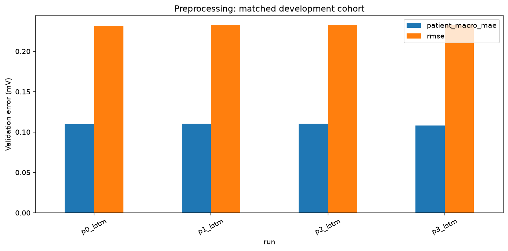

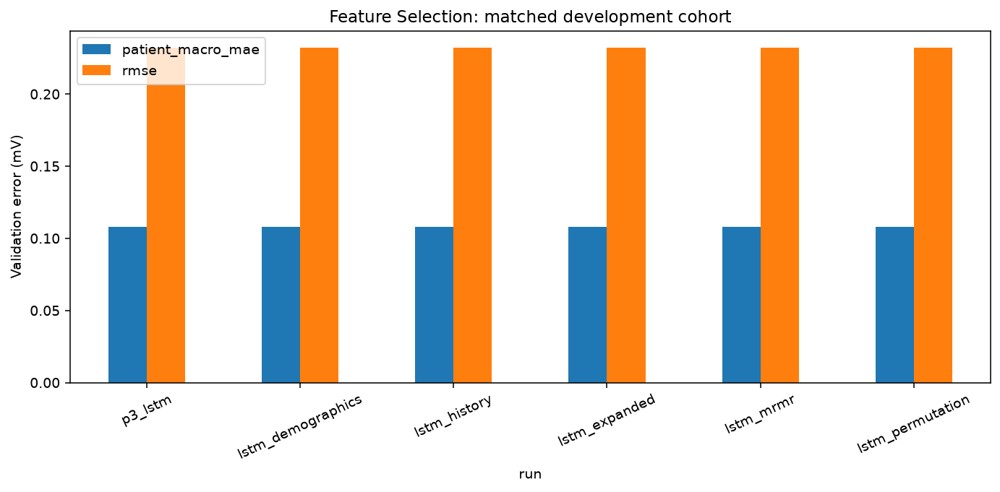

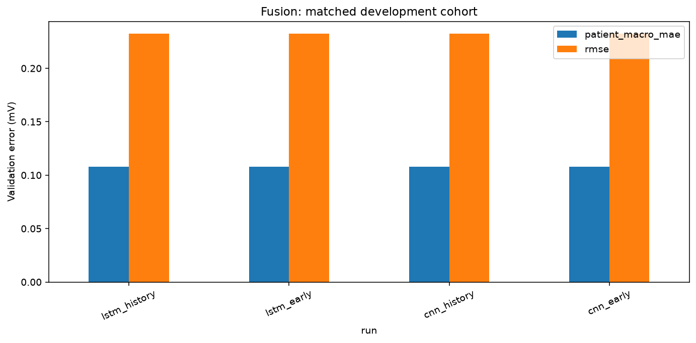

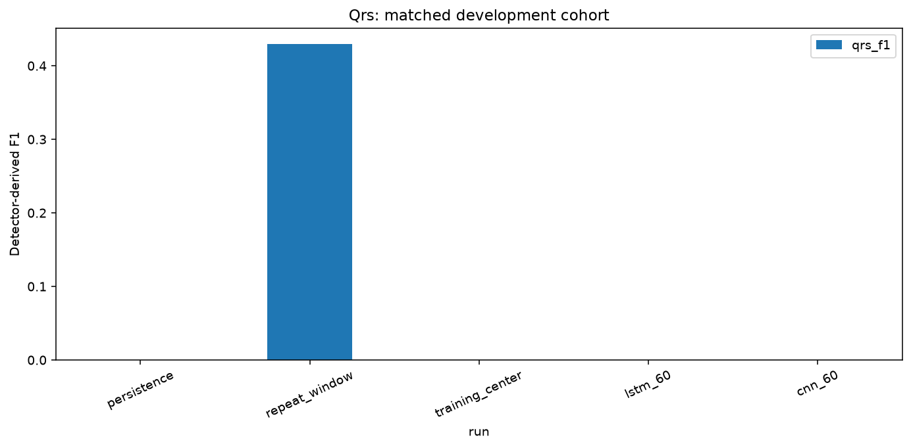

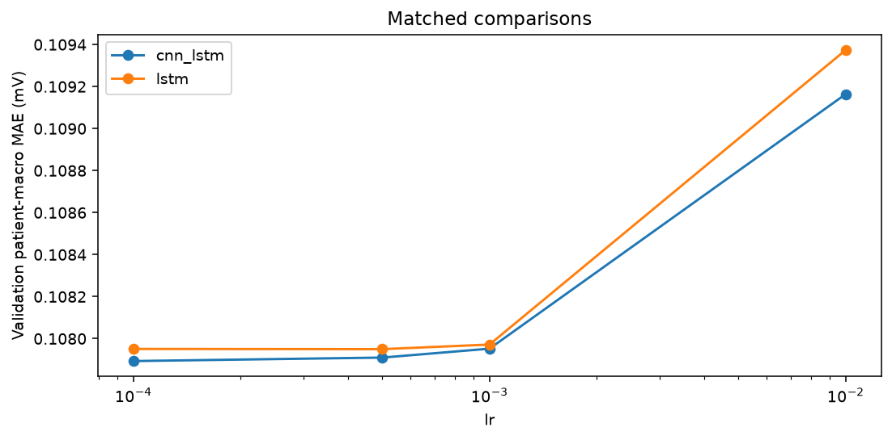

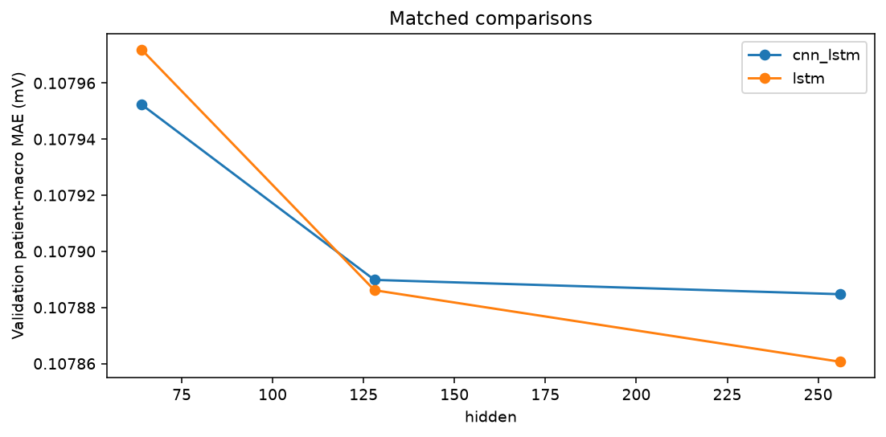

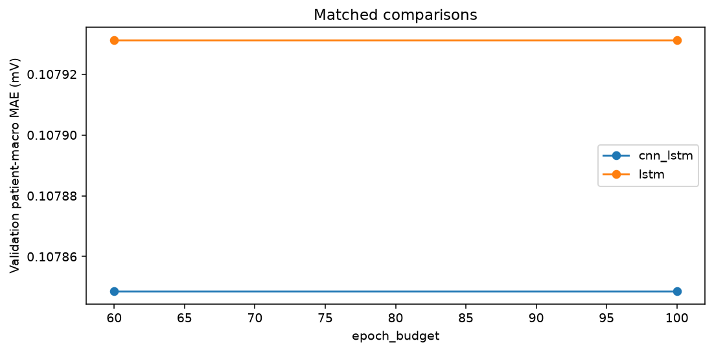

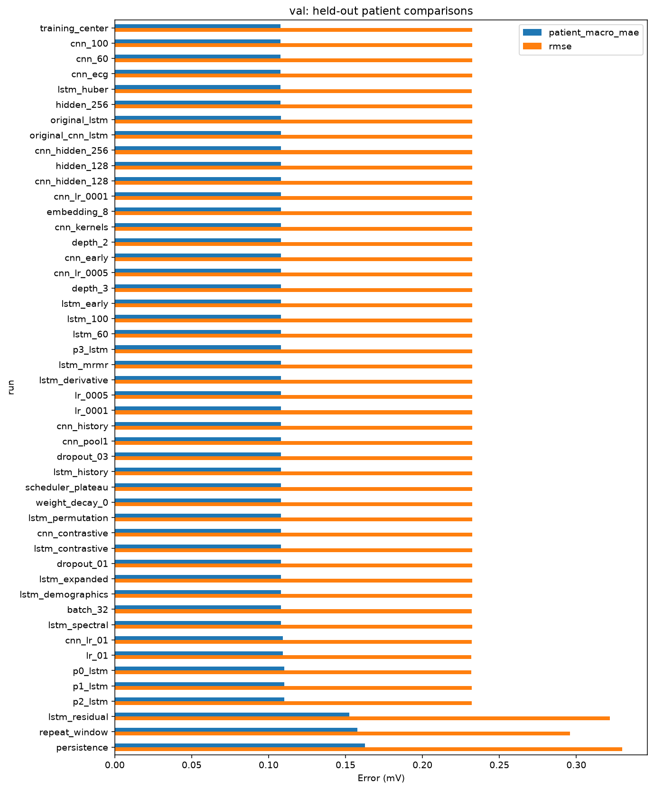

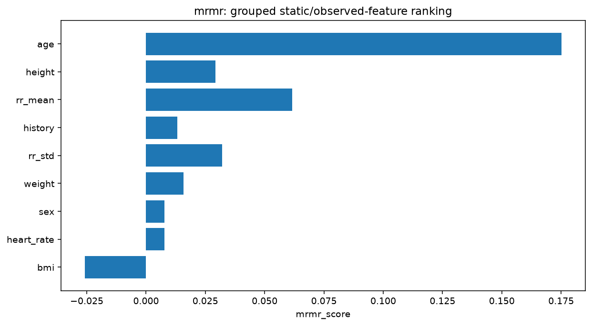

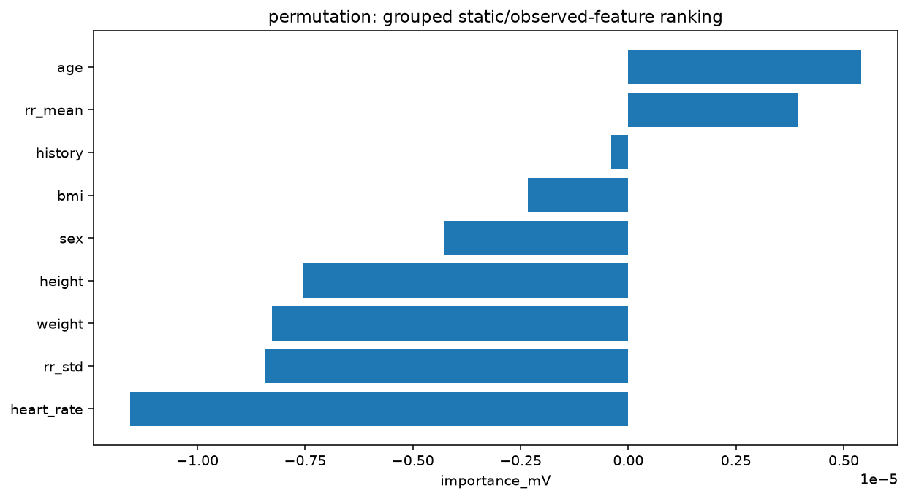

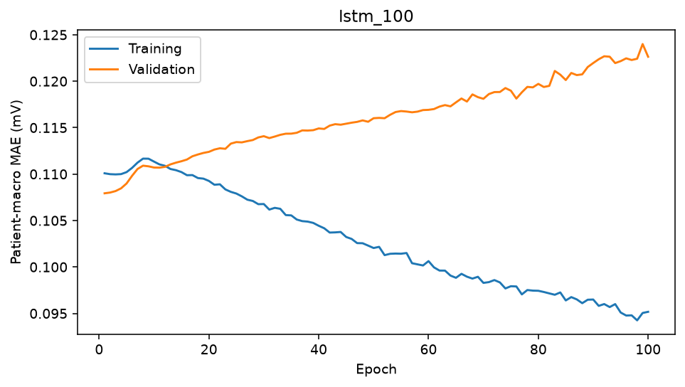

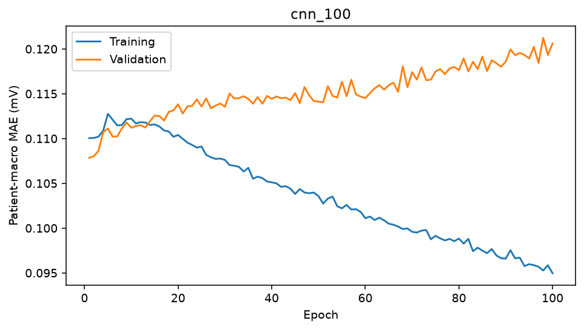

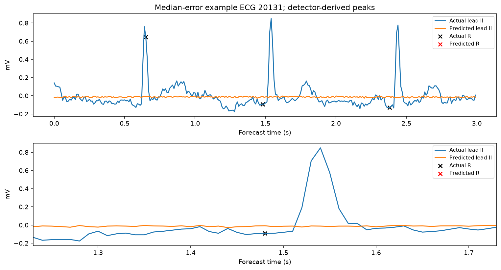

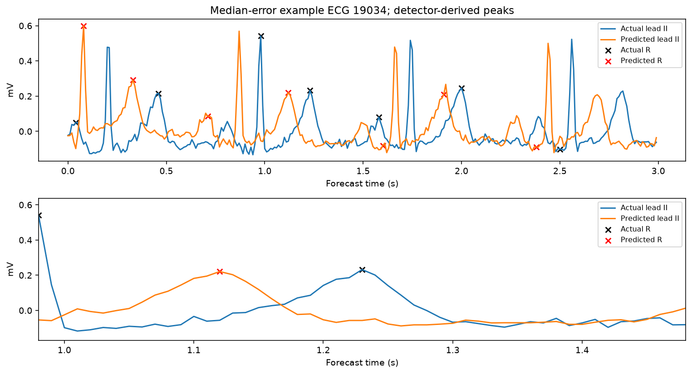

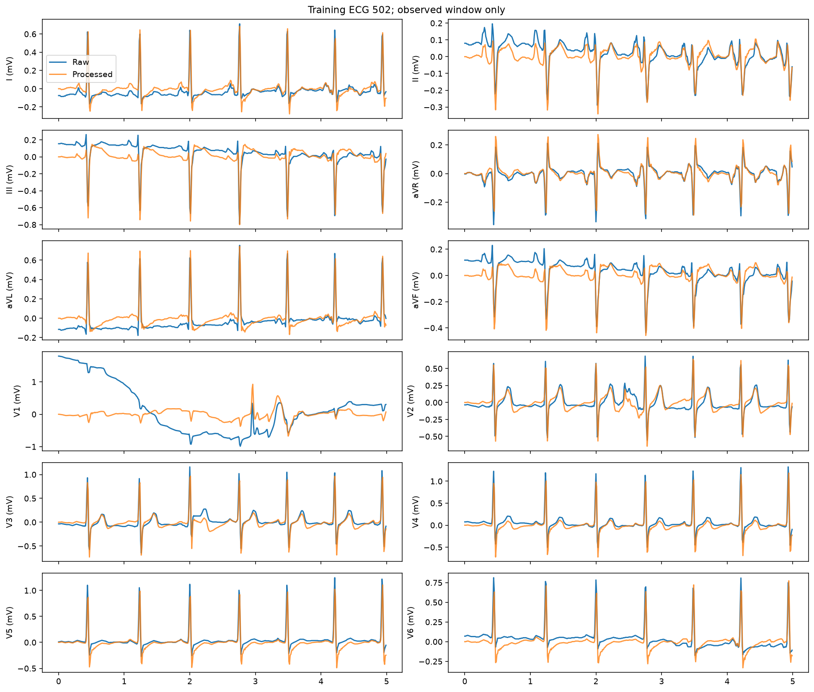

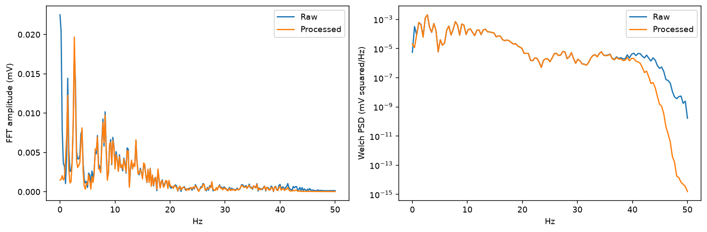

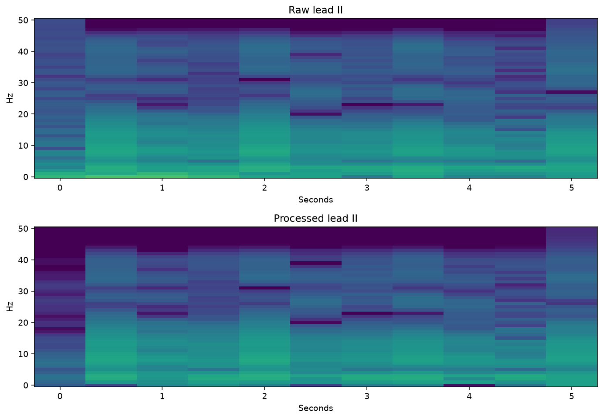

## Exact pending full-data experiments

All rows below are pending, not measured. The full raw-data audit passed; full preprocessing, model training, feature selection and official testing still require execution. Follow the full-data section of CONFIGURATION_AND_RUN_GUIDE.md in dependency order. Runtime estimates are rough CPU extrapolations, not benchmarks.

| run | epochs | state | command |
| --- | --- | --- | --- |
| full_lstm_60 | 60 | PENDING: full-data training not executed | python src/train.py --config configs/final_full.yaml --experiment full_lstm_60 |
| full_lstm_100 | 100 | PENDING: full-data training not executed | python src/train.py --config configs/final_full.yaml --experiment full_lstm_100 |
| full_original_lstm_60 | 60 | PENDING: full-data training not executed | python src/train.py --config configs/final_full.yaml --experiment full_original_lstm_60 |
| full_lstm_history_60 | 60 | PENDING: full-data training not executed | python src/train.py --config configs/final_full.yaml --experiment full_lstm_history_60 |
| full_lstm_early_60 | 60 | PENDING: full-data training not executed | python src/train.py --config configs/final_full.yaml --experiment full_lstm_early_60 |
| full_cnn_60 | 60 | PENDING: full-data training not executed | python src/train.py --config configs/final_full.yaml --experiment full_cnn_60 |
| full_cnn_100 | 100 | PENDING: full-data training not executed | python src/train.py --config configs/final_full.yaml --experiment full_cnn_100 |
| full_original_cnn_60 | 60 | PENDING: full-data training not executed | python src/train.py --config configs/final_full.yaml --experiment full_original_cnn_60 |
| full_cnn_history_60 | 60 | PENDING: full-data training not executed | python src/train.py --config configs/final_full.yaml --experiment full_cnn_history_60 |
| full_cnn_early_60 | 60 | PENDING: full-data training not executed | python src/train.py --config configs/final_full.yaml --experiment full_cnn_early_60 |
| full_lstm_expanded_60 | 60 | PENDING: full-data training not executed | python src/train.py --config configs/final_full.yaml --experiment full_lstm_expanded_60 |
| full_lstm_mrmr_60 | 60 | PENDING: full-data training not executed | python src/train.py --config configs/final_full.yaml --experiment full_lstm_mrmr_60 |
| full_lstm_permutation_60 | 60 | PENDING: full-data training not executed | python src/train.py --config configs/final_full.yaml --experiment full_lstm_permutation_60 |
| full_lstm_p0_60 | 60 | PENDING: full-data training not executed | python src/train.py --config configs/final_full.yaml --experiment full_lstm_p0_60 |

