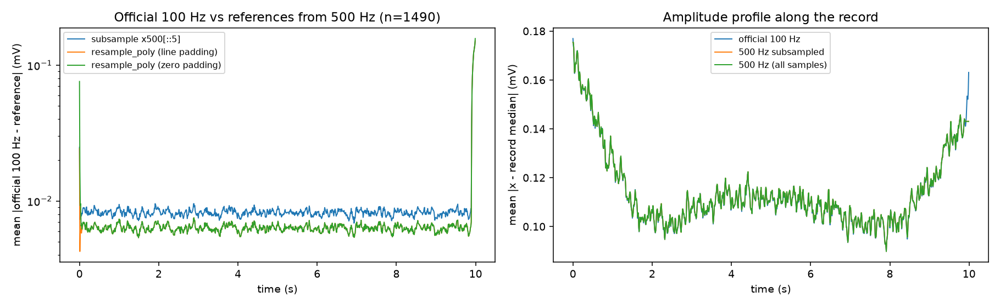
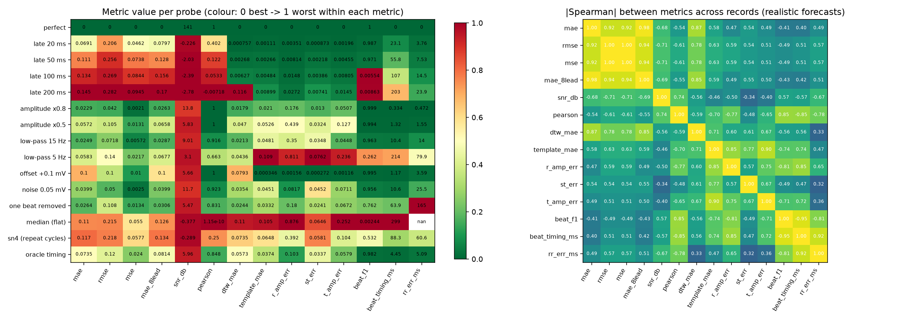
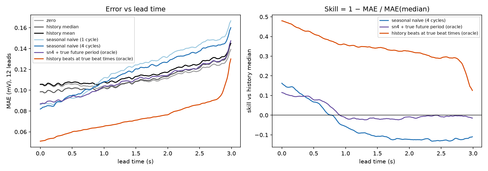
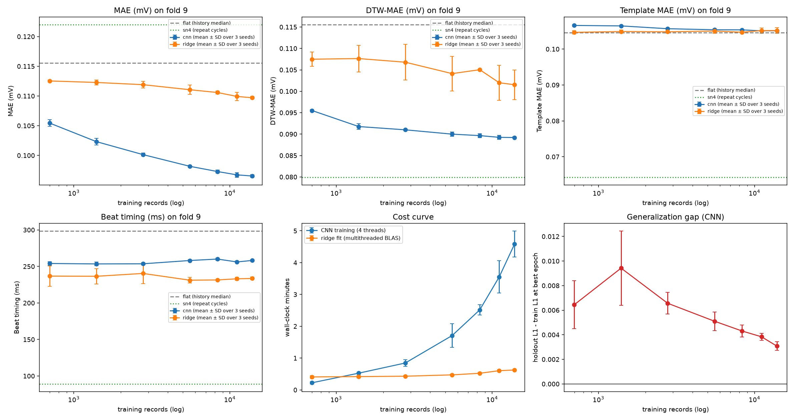
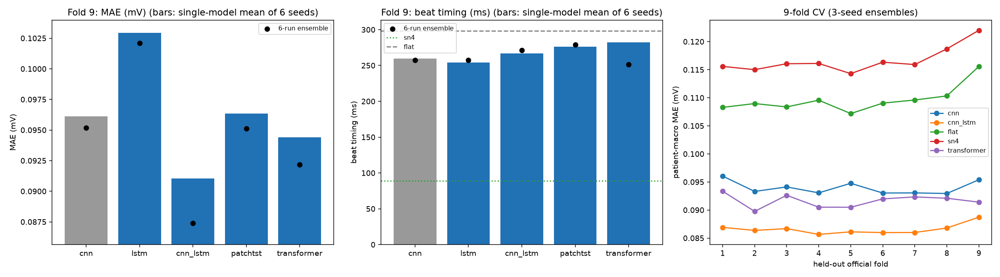
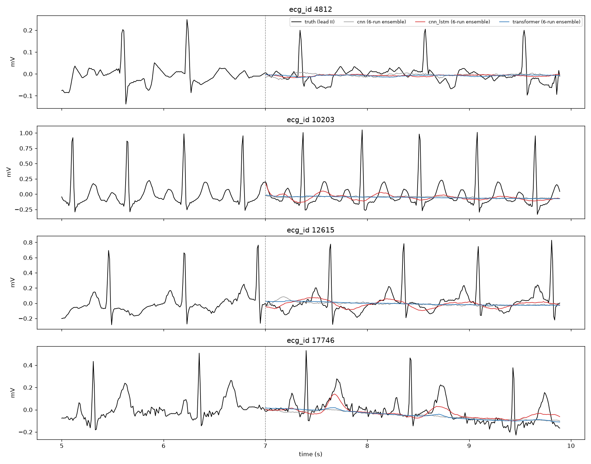

# Forecasting the 12-lead ECG on PTB-XL: a leakage-controlled study of what can be predicted, and how to measure it

*Final report, Phases 0–19 · 2026-11-24 · includes the one-time fold-10 test (§8)*

## Abstract

**Task.** We study multi-step forecasting of the 12-lead ECG on PTB-XL v1.0.3: given
the first 7 s of a native 100 Hz recording, forecast the next 2.9 s.

**Methods.**
- **Data and splits.** The data were verified file by file, defect records were
  excluded by fixed rules, and every split is patient-level. The official test fold
  (fold 10) was **sealed until the final model was frozen** and then evaluated once;
  all other numbers are from validation (fold 9) or 9-fold cross-validation over
  folds 1–9.
- **Evaluation.** Pointwise error alone **ranks a flat line above a perfectly shaped
  ECG that is only 50 ms late**. We therefore built a metric suite: MAE as the primary
  metric, plus three gatekeepers (timing-tolerant shape via DTW-MAE, beat-template
  morphology, and beat timing).
- **Comparisons.** A model only "beats" another if it improves MAE without being
  significantly worse on any gatekeeper. Run-to-run training variance is included in
  the inference: the naive patient-only bootstrap produced false-positive "wins" in
  41% of identical-model comparisons.

**Results.**
- **Morphology is highly predictable; beat timing is not.** Copying history beats to
  the *true* future beat times cuts MAE by 34–38%. Timing skill from the history
  alone vanishes after about 1 s.
- **Under an L1 objective, no architecture forecasts QRS complexes.** We compared a
  CNN, LSTM, CNN-LSTM, PatchTST and an encoder-decoder Transformer. The CNN-LSTM was
  most accurate: 9-fold mean MAE 0.0866 mV vs 0.0940 (CNN) and 0.1097 (flat line),
  better in 9/9 folds, and its DTW-MAE nearly matched a repeat-the-last-beats
  baseline (0.0757 vs 0.0735 mV).
- **The accuracy gain comes from slow waves.** The CNN-LSTM's gains come from
  forecasting T waves and baseline swings. Its beat morphology is worse than a flat
  line, and its beat timing (≈ 270 ms error) is far worse than the repeat-beats
  baseline (88 ms).
- **What doesn't help.** Preprocessing barely matters: one input transform helps by
  0.4% of MAE. More data saturates: 80% of the training patients reach the full-data
  MAE.

- **Conditioning on the repeat-beats forecast is what helps (Phases 10–18).** A
  CNN-LSTM that learns a per-step, per-lead gate on the `sn4` repeat-beats forecast,
  plus a correction, beats the flat line and the L1 CNN-LSTM on MAE *and* every
  gatekeeper in 9/9 folds (MAE 0.0850 mV, template 0.088 mV, timing 109 ms vs L1
  0.0866 / 0.131 / 270). It still does **not** beat `sn4` on beat morphology or
  timing: it forecasts damped copies of the repeated beats (≈ 28% of true
  amplitude). Its gain over L1 comes entirely from the most periodic 40% of records;
  in AF/flutter it is no better than L1.
- **Held-out test (fold 10, run once).** The frozen model reproduced the CV result:
  MAE 0.0850 mV (L1 CNN-LSTM 0.0861, flat 0.1207, `sn4` 0.1239), template MAE 0.090,
  timing 110 ms. It beats flat and the L1 CNN-LSTM on MAE and every gatekeeper, and
  is worse than `sn4` on template MAE (+27 µV) and timing (+32 ms).

**Conclusion.** The learning objective, not data, preprocessing or architecture, was
the bottleneck under L1; passing a causal repeat-beats forecast through a learned
gate is the first change that improves accuracy and plausibility together, and the
improvement held on unseen patients. Forecasting beats that are both accurate and as
faithful as the history itself remains unsolved.

---

## 1. Problem and design principles

**Task.** Observe 7 s (700 samples × 12 leads, 100 Hz, raw mV) and forecast the next
2.9 s (290 samples × 12 leads), a direct multi-step forecast.

**Principles that governed every phase:**

1. **Pre-registration.** Hypotheses, thresholds and decision rules were written
   before each phase's computation. Post-hoc analyses and every deviation are marked
   and disclosed.
2. **No test-set use.** Fold 10 is sealed in code: loading it raises an error unless
   explicitly enabled. Not even its metadata were examined.
3. **Patient-level everything.** Splits, averaging ("patient-macro") and confidence
   intervals (patient-cluster bootstrap) all work at the patient level.
4. **Every decision is recorded** with alternatives, evidence and status in
   [DECISION_LOG.md](DECISION_LOG.md), and each phase ended with an explicit
   go/no-go.

## 2. Data and cleaning

| Step | Result | Phase |
|---|---|---|
| Download and verification | 43,604 files checked by SHA-256; 21,799 records, 18,869 patients; all signals finite, none saturated. The upstream `RECORDS` index is malformed, so records are always indexed via `ptbxl_database.csv` | [1.5](phase1_5_data/REPORT.md) |
| Development data | Folds 1–9: 19,601 records, 16,965 patients; 23% of records come from patients with repeat recordings | [2](phase2_dataset/REPORT.md) |
| Defect exclusion (fixed rules, applied to all folds) | 30 records (0.15%): 4 signal dropouts, 8 clipped plateaus, 18 limb-lead formula violations (61% paced) | [3](phase3_quality/REPORT.md) |
| **End-of-record artifact** | The last 10 samples of every official 100 Hz file are a 500→100 Hz conversion artifact (up to 0.15 mV; shown against the 500 Hz originals). They were trimmed, so the task is **7 s → 2.9 s** | [3](phase3_quality/REPORT.md) |
| Duplicates | None (validated search: 0 exact, 0 near-duplicate pairs ≥ 0.99 correlation) | [3](phase3_quality/REPORT.md) |
| Final development set | **19,571 records, 16,945 patients**; training folds 1–8: 17,392; validation fold 9: 2,179 | [3](phase3_quality/REPORT.md) |



**Dataset properties that shaped the study:**
- **Only 8 of 12 leads are independent:** III, aVR, aVL and aVF are exact functions
  of I and II.
- **The recording device largely determines forecastability.** Devices with little
  low-frequency content are about 2× more predictable.
- **Fold 9 differs by design.** It is 100% human-validated and therefore almost
  CS100-free. Fold 10 is documented to be human-validated too, so it is expected to
  resemble fold 9 (Phase 8; fold 10 itself was not inspected).
- **Human quality flags are poor proxies for 100 Hz signal quality.** Signal-derived
  baseline wander is the strongest driver of forecast difficulty (ρ = 0.63).

## 3. Methods

### 3.1 Leakage control ([Phase 4](phase4_leakage/REPORT.md))

Five leakage channels were measured, and each now has a tested code-level guard:

| Channel | Evidence | Guard |
|---|---|---|
| Patient overlap | Record-level splits put about 20% of validation records alongside their own patient in training (memorization probe: those records score 3.2% better) | Only patient-level splitters exist; disjointness asserted |
| Labels / reports as inputs | Extra-beat annotations are 11.6× more frequent when the irregularity lies only in the *forecast* window | Input allow-list (age, sex, height, weight, device) |
| Non-causal preprocessing | A zero-phase filter predicts the future signal level 22% better than its causal twin | Every per-record transform must be history-only (automated causality test) |
| Fitted statistics | – | Fitted transforms record and check their training IDs |
| Test fold | – | Sealed in code |

### 3.2 Evaluation ([Phase 6](phase6_evaluation/REPORT.md))

**Why MAE alone fails.** Candidate metrics were scored on controlled probe forecasts.
**Every pointwise metric (MAE, RMSE, MSE, SNR) rates a perfect ECG delayed by 50 ms as
worse than a flat line.**



**Adopted suite:**

| Role | Metric |
|---|---|
| **Primary** | MAE over 12 leads, patient-macro |
| **Gatekeepers** | DTW-MAE (±100 ms band), median-beat template MAE, beat-timing error (ms; capped symmetric distance between forecast and true R peaks) |
| Reported | share of records with timing ≤ 50 ms, R/ST/T amplitude errors, Pearson, SNR, RMSE |

**Comparison rule.** A beats B only if the 95% CI of ΔMAE lies entirely below zero
**and** no gatekeeper's CI lies entirely on the worse side.

**Inference ([Phase 8](phase8_validation/REPORT.md)).** We calibrated five protocols
on 18 independently seeded runs per configuration:

| Protocol | False-positive rate (identical models) | Power for a −1.8 µV effect |
|---|---:|---:|
| Patient bootstrap on 3-seed ensembles (common practice) | **41%** | 100% |
| **Adopted:** 6 independently seeded runs per arm, bootstrap over runs and patients | **2.8%** | 100% |

The adopted protocol applies to MAE and to all gatekeepers.

### 3.3 Validation strategy ([Phase 8](phase8_validation/REPORT.md))

**Model selection uses fold 9.** It ranked six models exactly as 9-fold
cross-validation over folds 1–9 did (Kendall τ = 1.0; 15 of 15 pairs agree), at 1/9 of
the cost.

**Finalists are confirmed by 9-fold CV** (D8.6). Nested CV was not used, because the
sealed fold 10 provides the unbiased final estimate.

### 3.4 Reproducibility ([Phase 1](phase1_foundation/REPORT.md))

- **Environment:** locked with `uv` (Linux/Windows/macOS; CPU and CUDA builds); typed
  configuration and a config hash for every run; provenance manifest per run.
- **Determinism:** bitwise-reproducible training at a fixed thread count; 98
  automated tests.
- **Seeding defect, found and fixed:** a pre-registered bitwise check exposed that
  model initialization was not seeded ([Phase 7](phase7_data_efficiency/REPORT.md)).
  It was fixed with a regression test, and all affected experiments were re-run.

## 4. Results

### 4.1 What is predictable? ([Phase 0](phase0_feasibility/REPORT.md))

Non-learned baselines and oracles on 19,489 records:

| Forecast | MAE (mV) | DTW-MAE (mV) |
|---|---:|---:|
| History median (flat line) | 0.110 | 0.110 |
| Repeat the last 4 beats (`sn4`) | 0.118 | 0.074 |
| Oracle: history beats placed at the *true* future beat times | **0.074** | **0.058** |

- **Beat shape is highly predictable:** perfect timing cuts MAE by about 34%.
- **Timing is the bottleneck.** Timing skill vanishes after about 1 s. Knowing only
  the true *mean* future heart rate helps 7%, while knowing the individual beat times
  helps 38%.
- **Under pointwise error, a flat line beats repeating real beats.** This is the
  mechanism that pushes MAE/MSE-trained models towards blurred, flat forecasts.



### 4.2 Preprocessing ([Phase 5](phase5_preprocessing/REPORT.md))

Candidates tested: 7 filters, 6 scalers, 4 feature sets, PCA, 8-lead input and 7
augmentations, with a ridge learner and a CNN.
- **No filter preserves ECG morphology** (none reaches a template correlation of
  0.99).
- **Only one candidate passed the rule and a pre-specified replication:** feeding the
  input as a causal 0.67 Hz baseline plus residual (−0.34 µV, i.e. 0.4% of MAE;
  better in 8 of 9 CV folds). It was adopted.
- **Everything else, including all augmentations, was rejected.**

### 4.3 Data efficiency ([Phase 7](phase7_data_efficiency/REPORT.md))

- **MAE saturates with data:** 60% of training patients are within 0.6% of the
  full-data MAE, and 80% are within 0.12%.
- **The fitted MAE floor is about 0.094 mV** for the CNN.
- **Beat timing stays near 258 ms at every data size.** More data does not fix rhythm.



### 4.4 Model families ([Phase 9](phase9_models/REPORT.md))

**Setup.** The input is the adopted baseline-plus-residual decomposition (24
channels). All models use the same L1 training loss, AdamW, early stopping on a
patient-level internal holdout (up to 100 epochs), and a learning rate chosen per
family on that holdout.

**Fold 9, 6 seeds per family:**

| Family | Parameters | MAE: single model (6-run ensemble) | DTW-MAE | Template MAE | Beat timing (ms) |
|---|---:|---|---:|---:|---:|
| CNN | 1.85 M | 0.0961 (0.0952) | 0.0900 | 0.1050 | 259 |
| LSTM | 0.25 M | 0.1030 (0.1021) | 0.0978 | 0.1045 | 254 |
| **CNN-LSTM** | 0.72 M | **0.0911 (0.0874)** | **0.0781** | 0.1288 | 267 |
| PatchTST (reduced for CPU) | 0.74 M | 0.0963 (0.0951) | 0.0844 | 0.1160 | 276 |
| Transformer (encoder-decoder) | 1.18 M | 0.0944 (0.0922) | 0.0911 | 0.1090 | 283 |
| *Flat line* | – | 0.1161 | 0.1161 | 0.1048 | 298 |
| *`sn4` (repeat beats)* | – | 0.1218 | 0.0796 | **0.0642** | **89** |

**9-fold cross-validation of the shortlist** (3-seed ensembles; mean over folds):

| Family | MAE | DTW-MAE | Template MAE | Beat timing (ms) | Records ≤ 50 ms |
|---|---:|---:|---:|---:|---:|
| **CNN-LSTM** | **0.0866** | 0.0757 | 0.1310 | 270 | 0.2% |
| Transformer | 0.0916 | 0.0890 | 0.1080 | 272 | 0.2% |
| CNN | 0.0940 | 0.0889 | 0.1050 | 258 | 0.2% |
| *Flat line* | 0.1097 | 0.1097 | 0.1049 | 299 | 0.3% |
| *`sn4`* | 0.1167 | **0.0735** | **0.0648** | **88** | **44%** |



**Comparison verdicts:**
- **CNN-LSTM vs CNN:** MAE is better in 9 of 9 folds (−7.4 µV, p < 0.001), but
  template MAE is worse (+26 µV) and so is timing (+12 ms).
- **Transformer vs CNN:** MAE is better (−2.4 µV), but template MAE is worse (+3 µV,
  p = 0.04).
- **Under the pre-registered rule, no family is declared best.**
- **No family beats `sn4`** on morphology or rhythm.
- **8-lead output** (deriving III/aVR/aVL/aVF) costs +2.9 µV MAE for the CNN-LSTM and
  was not adopted. The CNN-LSTM's 12-lead forecasts already respect the limb-lead
  formulas in 98% of records.



**What the models learn (above):**
- **CNN and Transformer forecast the level and little else.**
- **The CNN-LSTM forecasts the slow waves** (T waves, baseline) of the first one or two
  beats in phase, then fades towards the mean.
- **No model forecasts a QRS complex.**

## 5. Discussion

1. **The objective is the bottleneck.** Five lines of evidence converge:
   - the flat-line optimum of pointwise error (Phase 0);
   - the axiom failure of MAE (Phase 6);
   - the blurred reference CNN (Phase 5);
   - flat beat timing across all data sizes (Phase 7);
   - L1-trained models of every family failing to forecast QRS (Phase 9).

   Because beat timing is uncertain beyond about 1 s, an L1-optimal forecast averages
   over possible beat positions, and averaging erases the QRS.
2. **Architecture matters more than expected for MAE, but not for rhythm.** The
   CNN-LSTM's 8% MAE gain is real and consistent across folds. It comes from slow,
   phase-predictable components, while its morphology is penalized.
3. **The metric design changed the conclusions.** Without the gatekeepers, the
   CNN-LSTM would be reported as a clear winner. Without run-aware inference, several
   sub-µV preprocessing effects would have been reported as significant.
4. **What a useful model must do.** It must beat the flat line on MAE without being
   worse than repeating the last beats on DTW, morphology and timing. No model reaches
   that yet. The target for beat-level timing skill is at least 57% of records within
   50 ms; that share is achieved by a forecaster that knows the true future mean heart
   rate.

## 6. Limitations

- **One held-out fold.** Fold 10 was opened once, for the final model only (§8). The
  numbers for every other model are development numbers, which can be optimistic for
  the selected models; 9-fold CV limits this for the finalists.
- **CPU-only compute.**
  - PatchTST was run in a reduced configuration.
  - Each family used one configuration (only the learning rate was checked).
  - 2 of the CV runs used reached the 100-epoch cap.
- **Detector-dependent metrics.** The beat-based metrics depend on R-peak detection
  in lead II (NeuroKit2). At 100 Hz, QRS duration and QT interval cannot be resolved.
- **Single dataset (PTB-XL),** with known device and validation differences between
  folds. External validity is untested.
- **Point forecasts only.** Probabilistic forecasting may suit the inherent timing
  uncertainty better.

## 7. Conclusion (Phases 0–9)

**Morphology is forecastable; timing beyond about 1 s mostly is not.** With an L1
objective, every model trades beats for blur. The CNN-LSTM is the most accurate
family on pointwise and timing-tolerant error, but no model yet produces
physiologically plausible beats. The next step is the training objective, not more
data, preprocessing or capacity.

## 8. Phases 10–19, including the fold-10 test (2026-11-24)

| Phase | Result | Report |
|---|---|---|
| 10 Objectives (CNN-LSTM only, D10.0) | `sn4`-gated CNN-LSTM beats flat and L1 on MAE and all gatekeepers (9/9 folds); spectral loss improves shape but costs MAE; derivative loss no effect; nothing beats `sn4` on template/timing | [10](phase10_objectives/REPORT.md) |
| 11 Hyperparameters | LSTM hidden 256 adopted on fold 9 (−0.77 µV MAE, gatekeepers n.s.) | [11](phase11_tuning/REPORT.md) |
| 12 Robustness | OOF MAE 0.0840 mV (fold SD 0.0009); beats flat in every stratum, L1 in all but AF/flutter; robust to history noise; not to a missing lead II. **9-fold CV shows hidden 256 is worse than hidden 128 on template (+1.3 µV) and timing (+5 ms)** | [12](phase12_robustness/REPORT.md) |
| 13 Plausibility | Correct beat count, 34% of records ≤ 50 ms, but beats damped to ≈ 28% amplitude; limb-lead relations broken in 19% of records (L1: 3%) by the per-lead gate | [13](phase13_plausibility/REPORT.md) |
| 14 Patient factors | After adjustment, error rises with AF/flutter (+27%), hypertrophy (+24%), pacing (+23%) and baseline wander; device effects mostly vanish | [14](phase14_patient_errors/REPORT.md) |
| 15 Signal factors | Gain over L1 only in the most periodic 40% of records (+15 µV in the top quintile; −1.5 µV in the bottom); the gate tracks periodicity (ρ 0.47) and fades with horizon (0.36 → 0.16) | [15](phase15_signal_errors/REPORT.md) |
| 16 Final model | First frozen with hidden 256; **reverted to hidden 128 (D12.1)** after the CV finding, before fold 10 was opened; 6 seeds on folds 1–9, hashed in `MANIFEST.json`; L1 reference likewise | [16](phase16_final/REPORT.md) |
| 17 Test (fold 10, once) | MAE 0.0850 mV; beats flat (−32.4 µV) and L1 (−1.7 µV [−2.6, −0.9], every gatekeeper better); worse than `sn4` on template (+27 µV) and timing (+32 ms). Matches CV expectations | [17](phase17_test/REPORT.md) |
| 18 Ablations | Skip path essential (`sn4` as input only = no `sn4`); removing the gate restores `sn4`-quality shape/timing at +16 µV MAE; **raw input beats the adopted decomposition** (−1.1 µV MAE) | [18](phase18_ablations/REPORT.md) |

**Decisions before the test (D12.1, D18.1, user):** Phase 12's CV favoured hidden
128 over the fold-9 choice of 256, so the final model reverted to 128. Phase 18 found
raw input better than the adopted decomposition on fold 9 only; the decomposition was
kept. Phases 12–15 and 18 analysed hidden 256, which differs from the final model by
≈ 1 µV MAE.

**Additional limitations (Phases 10–18).** One family (CNN-LSTM) for the objectives;
selection on fold 9 with confirmation only partly multi-fold; gate applied per lead
(breaks lead relations); detector-dependent timing metric; a single held-out fold
from the same dataset (no external validation).

## 9. Reproducing this report

```sh
uv sync --locked --extra cpu --extra tracking      # environment
uv run python scripts/download_ptbxl.py            # data (SHA-256 verified)
uv run pytest -q                                   # 103 tests
# then each phase's script as listed in its report, e.g.
uv run python research/phase9_models.py --stage A  # ... B, C, D, report
```

Per-phase reports, pre-registrations and tables are in `reports/phase*/`, and every
decision is in [DECISION_LOG.md](DECISION_LOG.md). Phases 0–9 take about one day of CPU
time on a 40-core machine and Phases 10–18 about another day (`research/phase10_objectives.py`,
`phase11_tuning.py`, `run_12_18.py`); caches make reruns cheap.
