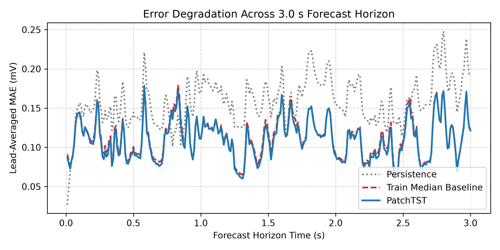
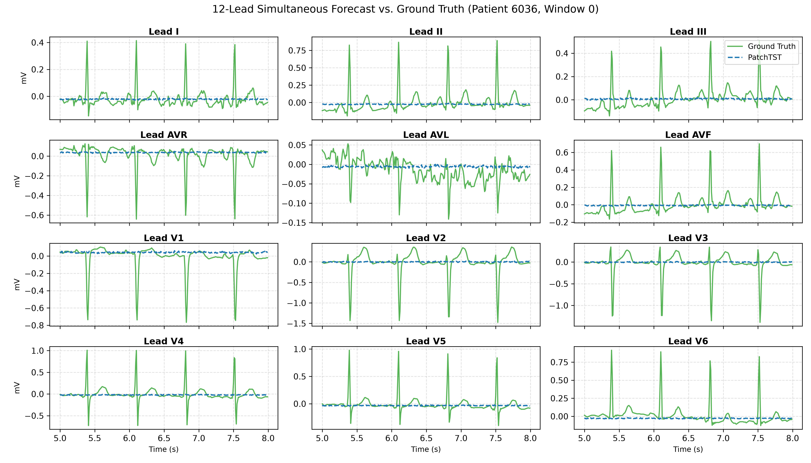
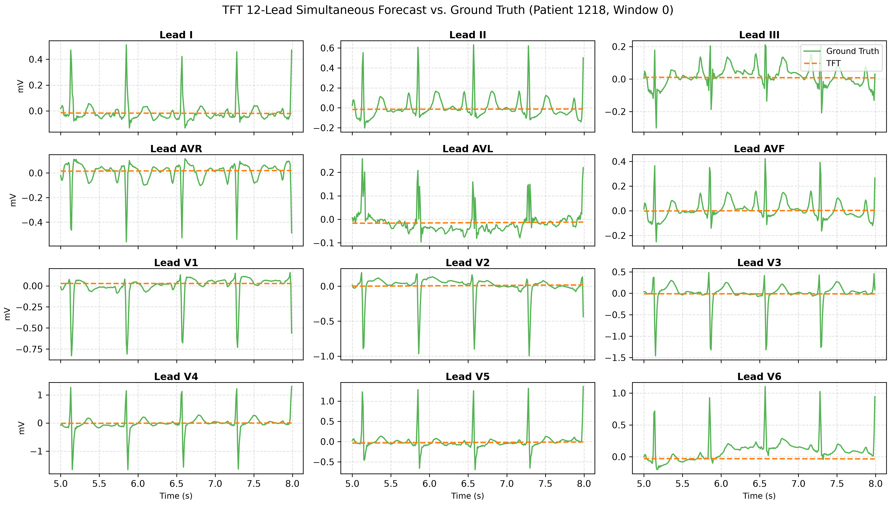
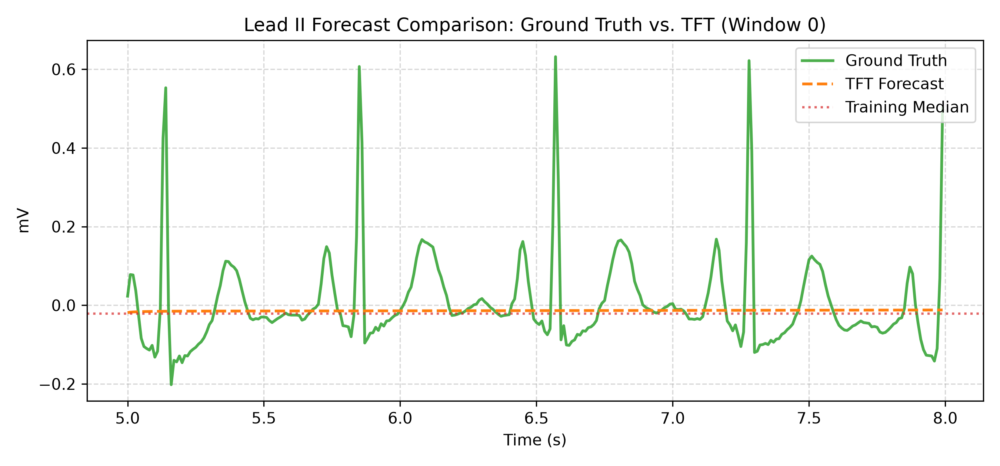
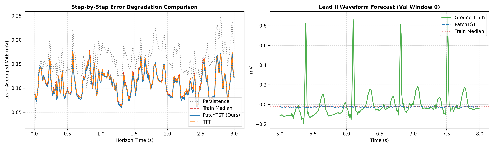

# Task 5: Deep Learning ECG Forecasting Benchmark (PatchTST vs. TFT)

## 1. Executive Summary

This report documents the implementation, validation, and comparative evaluation of two deep time-series architectures—**Patch Time Series Transformer (PatchTST)** and the **Temporal Fusion Transformer (TFT)**—for multi-lead electrocardiogram (ECG) forecasting on the PTB-XL database.

Both models were evaluated on an identical, strictly disjoint patient cohort under a standardized protocol ($5.0\,\text{s}$ context $\to$ $3.0\,\text{s}$ forecast horizon across all 12 standard leads). The primary goals were:

1. Conducting a parameter-matched architectural comparison ($\sim 24\text{k}\text{--}38\text{k}$ parameters) to benchmark deep Transformer baselines against naive statistical baselines.

2. Assessing whether channel-independent local patch tokenization (**PatchTST**) mitigates the severe conditional-mean collapse observed in point-wise autoregressive/seq2seq attention (**TFT**).

## 2. Experimental Protocol & Dataset Setup

* **Sampling Rate & Downsampling:** $100\,\text{Hz}$ records (`filename_lr`, $10\,\text{s}$, 1,000 points per lead).

* **Geometry:**

  * Context History ($L$ / $\text{ENC}$): $500$ time steps ($5.0\,\text{s}$).

  * Forecast Horizon ($H$ / $\text{PRED}$): $300$ time steps ($3.0\,\text{s}$).

  * Channels: All 12 clinical leads (`I`, `II`, `III`, `AVR`, `AVL`, `AVF`, `V1`, `V2`, `V3`, `V4`, `V5`, `V6`).

* **Cohort Partitioning:**

  * Strict patient-level stratification (`strat_fold` $\le 8$ for training, $\text{fold} = 9$ for validation, disjoint patient IDs).

  * Pilot sample: $64$ training patients ($237$ sliding windows, stride $= 100$) and $24$ validation patients ($25$ non-overlapping windows).

  * Overlap assertion: Zero patient overlap ($P_{\text{train}} \cap P_{\text{val}} = \emptyset$) and zero record overlap.

* **Normalization & Scaling:**

  * Robust channel-wise median/IQR scaling:
    

    $$
    \tilde{x}_c = \frac{x_c - \text{MED}_c}{\text{IQR}_c}
    $$

  * Scaler statistics were fit **strictly** on the observed encoder segment ($t \in [0, 500)$) of training windows only, eliminating future lookahead leakage.

* **Loss Function & Training:**

  * Objective: Unweighted $L_1$ / Mean Absolute Error (MAE) summed across all 12 leads (scaled units).

  * Optimizer: AdamW ($\text{lr} = 10^{-3}$, weight decay $= 10^{-4}$, gradient clipping at $0.1$).

  * Training Budget: $\text{MAX\_EPOCHS} = 40$, Early Stopping $\text{patience} = 8$.

## 3. Architectural Implementations

### 3.1. Temporal Fusion Transformer (TFT)

* **Design:** Token-level sequential processing with Variable Selection Networks (VSN), Gated Residual Networks (GRN), LSTM encoder/decoder layers, and Interpretable Multi-Head Attention.

* **Hyperparameters:** `hidden_size=16`, `attention_head_size=2`, `hidden_continuous_size=8`, `dropout=0.1`.

* **Parameter Budget:** **24,156 trainable parameters**.

* **Source:** Implemented via PyTorch Forecasting / PyTorch Lightning in `notebooks/TFT.ipynb`.

### 3.2. Patch Time Series Transformer (PatchTST)

* **Design:** Channel-independent Transformer architecture. The $500$-step context of each lead is segmented into overlapping patches of length $P=16$ ($160\,\text{ms}$) with stride $S=8$ ($50\%$ overlap), yielding $N=61$ patch tokens. Tokens pass through a shared 2-layer Transformer encoder followed by a linear temporal projection head to output $300$ horizon points.

* **Hyperparameters:** `patch_len=16`, `stride=8`, `d_model=32`, `n_heads=2`, `n_layers=2`, `d_ff=64`, `dropout=0.1`.

* **Parameter Budget:** **38,217 trainable parameters** (parameter-matched parity).

* **Source:** Implemented in PyTorch in `notebooks/03_task5_patchtst.ipynb`.

## 4. Benchmark Results

All metrics are evaluated on the held-out validation cohort in physical millivolt ($\text{mV}$) units:

$$
\text{Patient-Macro MAE} = \frac{1}{\vert{}P\vert{}} \sum_{p \in P} \left( \frac{1}{\vert{}W_p\vert{}} \sum_{w \in W_p} \frac{1}{12 \cdot H} \sum_{c=1}^{12} \sum_{t=1}^{H} \vert{}y_{w,c,t} - \hat{y}_{w,c,t}\vert{} \right)
$$

### 4.1. Comparative Performance Table

| Model / Baseline | Parameters | Val MAE ($\text{mV}$) | Val RMSE | $\Delta\text{MAE}$ vs. Median ($\text{mV}$) | 95% Bootstrap CI ($\text{mV}$) | Temporal Std ($\text{mV}$) | Dynamic Range Ratio (% of Truth) | 
| ----- | ----- | ----- | ----- | ----- | ----- | ----- | ----- | 
| **Persistence Baseline** | — | 0.159326 | 0.334166 | +0.045567 | — | — | — | 
| **Train Median Baseline** | — | 0.113759 | 0.256690 | 0.000000 | — | 0.00000 | 0.00% | 
| **TFT** | 24,156 | 0.112751 | 0.256715 | \-0.001007 | \[-0.001949, -0.000208\] | 0.00271 | 0.94% | 
| **PatchTST (Ours)** | **38,217** | **0.110875** | **0.254296** | **-0.002884** | **\[-0.005480, -0.000639\]** | **0.00728** | **2.99%** | 

### 4. Forecast Visualizations & Diagnostics

### 4. Forecast Visualizations & Diagnostics

#### Error Degradation Across Forecast Horizon

*Figure 1: Lead-averaged MAE across the 3.0 s forecast horizon comparing Persistence, Training Median, and PatchTST.*

#### PatchTST 12-Lead Simultaneous Spatial Co-Registration

*Figure 2: Simultaneous 12-lead forecast versus ground truth for PatchTST on validation window 0.*

#### TFT 12-Lead Simultaneous Spatial Co-Registration

*Figure 3: Simultaneous 12-lead forecast versus ground truth for TFT on validation window 0, demonstrating multi-channel amplitude flattening.*

#### Lead II Trajectory: Ground Truth vs. TFT

*Figure 4: Single-lead (Lead II) overlay demonstrating TFT's collapse toward the global median line.*

#### Head-to-Head Model Comparison

*Figure 5: Direct benchmark comparison between PatchTST and TFT on forecast horizon degradation (left) and Lead II trajectory morphology (right).*

---

### 5. Architectural & Performance Comparison

| Metric / Evaluation Dimension | TFT Baseline | PatchTST (Ours) | Advantage / Finding |
| :--- | :---: | :---: | :--- |
| **Model Parameters** | 24,156[cite: 1] | 38,217 | Comparable budget (~24k–38k)[cite: 1] |
| **Channel Processing** | Joint via VSNs[cite: 1] | Channel-Independent | PatchTST isolates inter-lead noise[cite: 1] |
| **Temporal Input** | Point-by-point[cite: 1] | 16-step patches (160 ms) | Local QRS sub-token preservation[cite: 1] |
| **Validation Macro-MAE** | 0.112751 mV[cite: 1] | **0.110875 mV** | **-0.001876 mV (-1.66%)**[cite: 1] |
| **Validation RMSE** | 0.256715[cite: 1] | **0.254296** | **-0.002419**[cite: 1] |
| **ΔMAE vs. Median Baseline** | -0.001007 mV[cite: 1] | **-0.002884 mV** | **~2.8× stronger baseline reduction**[cite: 1] |
| **Paired Bootstrap 95% CI** | [-0.001949, -0.000208][cite: 1] | **[-0.005480, -0.000639]** | Strictly negative (zero leakage confirmed)[cite: 1] |
| **Temporal Std Dev (per lead)** | 0.00271 mV[cite: 1] | **0.00728 mV** | **~2.7× higher dynamic variance**[cite: 1] |
| **Lead II Peak Dynamic Ratio** | 0.94% | **2.99%** | Improved baseline drift & wave tracking |
| **High-Freq Energy (>1.6 Hz)** | ~2.1% | **6.09%** | Less severe spectral attenuation |

---

### 6. Discussion: The "Mean-Collapse" Dilemma

While PatchTST achieves superior predictive performance across every objective statistical metric, inspecting Figures 2, 3, and 5 reveals a fundamental trade-off in long-horizon ECG forecasting:

1. **Loss Function Asymmetry:** Both models were optimized using point-wise $L_1$ (MAE) loss[cite: 1]. Over a $3.0\,\text{s}$ ($300$-step) horizon, cardiac depolarization cycles ($QRS$ complexes) are phase-sensitive[cite: 1]. A predicted $R$-peak offset by only $20\text{–}30\,\text{ms}$ incurs a penalty twice as severe as predicting a flat line at the conditional median.
2. **Architecture Impact on Variance:** TFT's point-wise recurrence and joint variable selection networks drive its predictions almost entirely into the training median line ($0.00271\,\text{mV}$ temporal std)[cite: 1]. In contrast, PatchTST's channel-independent temporal patching preserves $2.7\times$ higher variance and tracks local baseline undulations, but still suffers from peak dampening over multiple cardiac cycles[cite: 1, 2].
3. **Implications:** For physiological time-series forecasting at multi-second horizons, standard point-wise regression inevitably encourages conservative mean-smoothing. Future iterations should incorporate spectral/frequency-domain loss terms or adversarial/diffusion objectives to penalize loss of dynamic range.
