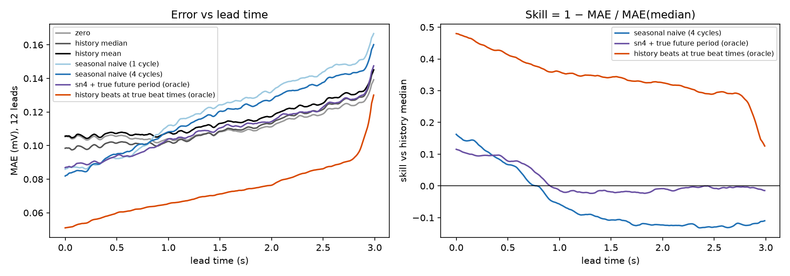
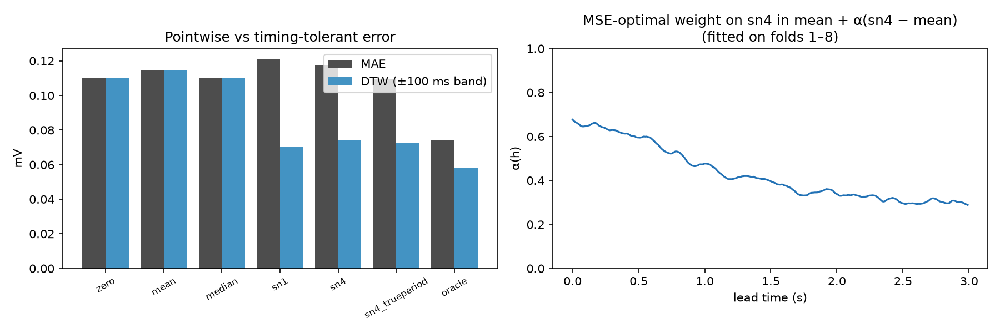
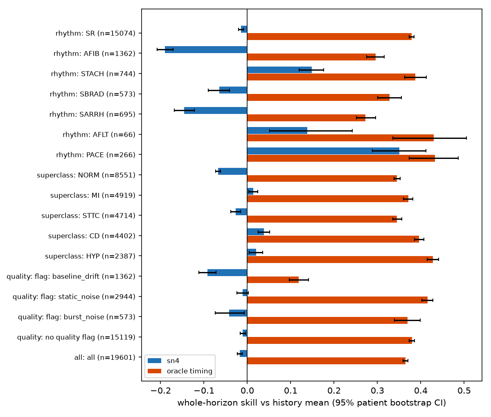
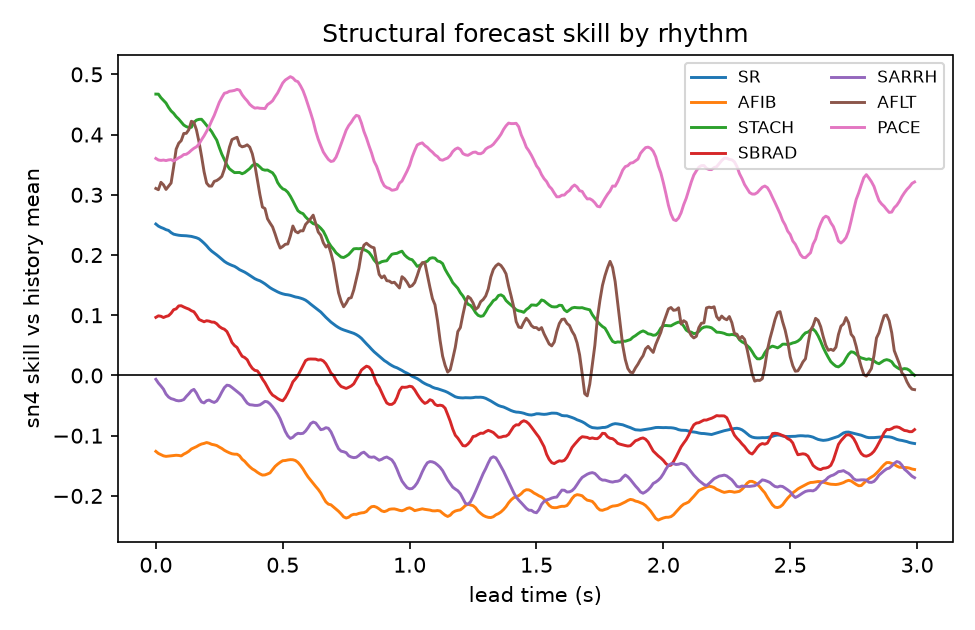
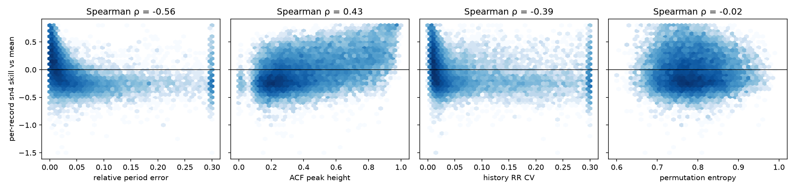
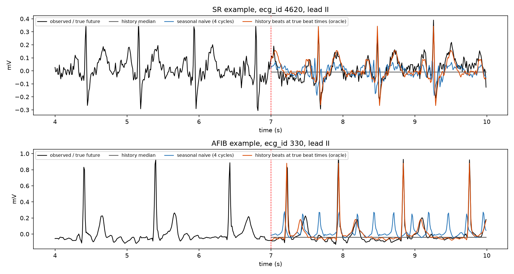
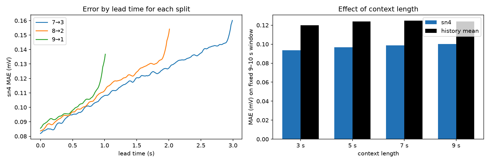

# Phase 0 report: Is 7 s → 3 s ECG forecasting feasible?

PTB-XL v1.0.3 · 100 Hz · 12 leads · raw mV · folds 1–9 (19,601 ECGs, 16,965
patients; fold 10 sealed, never read) · no learned models.
Hypotheses and acceptance criteria were fixed beforehand in
[PREREGISTRATION.md](PREREGISTRATION.md). Deviations are marked **[post hoc]**.

Reproduce (≈2 min on 38 CPU cores, deterministic):

```sh
python scripts/download_ptbxl.py --root PTB-XL          # SHA-256-verified, resumable
python research/phase0_feasibility.py                    # tables + summary.json
python research/phase0_figures.py                        # figures
```

## 1. Verdict

| | Hypothesis | Result | Outcome |
|---|---|---|---|
| H0.1 | Structural forecast (`sn4`) beats history mean over 3 s | ΔMAE = **+0.0027** mV [0.0021, 0.0033] (worse) | **Rejected** |
| H0.2 | Skill persists at 2–3 s lead time | skill = **−0.092** [−0.097, −0.087] | **Rejected** |
| H0.3 | Beat timing dominates error (oracle ≥ 25% better) | **−37.8%** [−37.3, −38.3] | **Accepted** |
| H0.4a | AFIB less predictable than SR | skill −0.190 [−0.208, −0.172] vs −0.014 [−0.020, −0.009] | **Accepted** |
| H0.4b | ρ(skill, RR CV) ≤ −0.3 | ρ = −0.386 | **Accepted** |
| H0.5a | Matched-lead-time MAE within 5% across splits | 0.0942 / 0.0968 / 0.1002 mV (6.4% spread) | **Rejected** (confounded, §6) |
| H0.5b | Context 3 s → 7 s improves `sn4` < 5% | MAE got **worse** by 5.6% | **Accepted** |
| H0.6 | Week 5 models ≈ mean forecast and not better than `sn4` | 0.1185 vs mean 0.1211, `sn4` 0.1231 | **Rejected** (§7) |

**Pre-registered go/no-go rule → NO-GO for the task as currently specified**
(7→3, raw mV, pointwise MAE/RMSE). H0.1 was rejected.

The [post hoc] analyses below show the rule was too coarse. Rejecting H0.1
does not mean "no exploitable structure". It means **pointwise error
cannot reward structure when beat timing is uncertain**. The structure is
large and real (§3, §4). See §9 for the decision needed from you.

## 2. Baselines (all 19,489 records where every forecast is defined)

Patient-macro mean with 95% patient-cluster bootstrap CI. Skill = 1 − MAE/MAE(ref).

| Forecast | MAE (mV) | RMSE (mV) | Skill vs mean | Skill vs median [post hoc] | DTW ±100 ms [post hoc] |
|---|---|---|---|---|---|
| zero | 0.1103 [0.1095, 0.1111] | 0.2061 | +0.038 | −0.003 | 0.1103 |
| history median [post hoc] | 0.1104 [0.1096, 0.1112] | 0.2156 | +0.041 | 0 | 0.1104 |
| history mean (pre-registered ref.) | 0.1149 [0.1141, 0.1157] | 0.2109 | 0 | −0.043 | 0.1149 |
| persistence | 0.1562 | 0.2598 | −0.359 | −0.417 | – |
| last-second mean | 0.1192 | 0.2165 | −0.034 | −0.079 | – |
| seasonal naive, 1 cycle (`sn1`) | 0.1211 | 0.2341 | −0.049 | −0.094 | **0.0704** |
| seasonal naive, 4 cycles (`sn4`) | 0.1178 [0.1169, 0.1187] | 0.2191 | −0.019 | −0.063 | 0.0744 |
| *oracle:* `sn4` + true future mean period | 0.1097 | 0.2011 | +0.051 | +0.010 | 0.0727 |
| *oracle:* history beats at true beat times | **0.0741** [0.0732, 0.0749] | **0.1212** | **+0.366** | **+0.339** | **0.0579** |

**Key facts:**

1. **The best non-oracle MAE forecast is a flat line at the isoelectric level** (zero or median).
   The MAE-optimal constant is the median, not the mean. The ECG sits near
   baseline most of the time, so the history mean is a weaker reference.
   That is why I added the median as a stricter reference.
2. **The metric decides the ranking.** Under MAE, repeating the last cycle is
   worse than a flat line. Under DTW with a ±100 ms warping band, it is **33% better** than the median (paired Δ = −0.036 mV [−0.037, −0.036]). For
   constant forecasts, DTW equals MAE exactly, as expected.



## 3. Can the last 3 s be predicted from the first 7 s?

- **Morphology: yes.** Placing beats copied from the history at the true
  future beat times cuts MAE by 33.9% vs the median. The gain stays at
  +0.28 even at 2–3 s lead time. Beat shape is highly predictable from 7 s
  of history.
- **Beat timing: only for about 1 s.** `sn4` skill vs the mean is +0.114
  [0.108, 0.120] at 0–1 s. It drops to −0.057 at 1–2 s and −0.092 at 2–3 s.
  Skill first reaches zero at **1.0 s** (vs mean) and **0.83 s** (vs median).
- **The bottleneck is beat-to-beat jitter, not average heart rate.** Giving
  `sn4` the true *mean* future period improves MAE by only **6.9%**
  [6.5, 7.2], and it beats the median by just 1%. Giving the true *individual*
  beat times improves MAE by 37.8%. A model that learns only the average rhythm
  cannot beat a flat line under MAE. It must forecast heart-rate variability
  (e.g., respiratory sinus arrhythmia). That is physiologically possible but
  only partly determined by 7 s of history.

At 100 Hz a QRS complex is only 8–10 samples wide. Over about 3.5 beats, a 2%
period error or normal beat-to-beat variation shifts the QRS by roughly 5
samples. That is enough for a pointwise metric to count a misplaced beat
twice: a miss where the true QRS is and a spurious spike where it was
predicted.

## 4. Theoretical predictability limit

A true information-theoretic limit cannot be computed from data alone. The
following **empirical bounds** are measurable:

| Bound (MAE, mV) | Value | Meaning |
|---|---|---|
| Trivial ceiling | 0.110 | Best constant (median/zero). Any model must beat this. |
| Rhythm-aware, no jitter | 0.110 | Perfect mean HR still gives ≈ no MAE gain. |
| Perfect beat timing | 0.074 | Gain available *only* to a model that predicts individual beat times. |
| Residual below 0.074 | – | Beat morphology variation, baseline wander, noise, and record-edge artifacts (§8). |

**This explains the previous LSTM/CNN-LSTM failures, and challenges the
"memorization" explanation.** Fitting the MSE-optimal blend
`mean + α(h)·(sn4 − mean)` on folds 1–8 gives an α that shrinks with lead time:
0.58 (0–1 s), 0.39 (1–2 s), 0.31 (2–3 s). On fold 9 this damped forecast has the
lowest RMSE: 0.2256 vs 0.2397 (mean) and 0.2492 (`sn4`). Under timing
uncertainty, **the forecast that minimizes MSE/MAE is a blurred, amplitude-shrunk average
beat**. A network trained with MSE/MAE converges toward it no matter how well
it is regularized. That matches the Week 5 symptoms: four architectures
within 0.00005 mV of each other, and "predictions resembling training signals"
(an average beat). Overfitting may also have occurred, but it is not required
to explain the outcome.



## 5. Which ECGs are more predictable?

Whole-horizon `sn4` skill vs the mean (95% CI) and oracle-timing skill:

| Group | n | `sn4` skill | oracle skill | median RR CV |
|---|---:|---|---|---:|
| PACE (paced) | 266 | **+0.351** [0.282, 0.409] | +0.433 | 0.016 |
| STACH | 744 | +0.148 [0.122, 0.174] | +0.387 | 0.013 |
| AFLT | 66 | +0.139 [0.042, 0.231] | +0.430 | 0.036 |
| SR | 15,074 | −0.014 [−0.020, −0.009] | +0.379 | 0.021 |
| SBRAD | 573 | −0.065 [−0.088, −0.040] | +0.328 | 0.032 |
| SARRH | 695 | −0.146 [−0.167, −0.124] | +0.273 | 0.102 |
| AFIB | 1,362 | **−0.190** [−0.208, −0.172] | +0.296 | 0.185 |
| NORM / MI / STTC / CD / HYP | 2.4k–8.6k | −0.068 … +0.038 | +0.35 … +0.43 | ≈ 0.024 |
| baseline drift flag | 1,362 | −0.092 | **+0.118** | 0.027 |

- **Rhythm regularity drives predictability far more than diagnosis.**
  Paced, tachycardic and flutter rhythms are predictable. AFIB and sinus
  arrhythmia are not. The diagnostic superclasses differ much less.
- **Timing and periodicity features predict per-record skill; entropy features do not:**
  period error ρ = −0.56, RR shift future vs history −0.47, ACF peak +0.43,
  history RR CV −0.39, spectral entropy −0.30. Permutation entropy (−0.02),
  sample entropy (+0.06) and HR (+0.02) are uninformative.
- **Baseline wander is the main non-timing error source.** With perfect timing,
  records flagged for drift keep only +0.12 skill (vs +0.38 for clean records).
  The raw-mV target includes low-frequency drift that the ECG itself cannot predict.






The AFIB example also shows a weakness of the `sn4` baseline. R-peak detection
counted T waves as beats in that record, so `sn4` used the wrong period. This
happens in some records: 12.6% have > 10% period error. The true-period
diagnostic above bounds the cost: a perfect period estimate would improve
MAE by only 6.9%.

## 6. Is 7→3 the right split? (8→2, 9→1)

| Split | `sn4` MAE (full horizon) | Skill vs mean (full horizon) | `sn4` MAE, lead 0–1 s |
|---|---:|---:|---:|
| 7→3 | 0.1172 | −0.017 | 0.0942 |
| 8→2 | 0.1110 | +0.065 | 0.0968 |
| 9→1 | 0.1002 | **+0.191** | 0.1002 |

- Shorter horizons look easier **only because they drop the long, unpredictable
  lead times.** At matched lead time, longer histories are slightly *worse*.
- That difference (H0.5a, rejected) comes mainly from *where* the target
  window sits, not from history length. Later windows include the record-end
  artifact (§8), and even the mean forecast gets worse there.
- **More context does not help a template forecast.** On the fixed 9–10 s
  window, MAE rises from 0.0935 (3 s context) to 0.0988 (7 s) and 0.1002
  (9 s). Rhythm and baseline drift make old cycles less useful. Seven seconds
  is not a bottleneck, but learned models may use context differently; this
  shows only that templates do not need it.



## 7. Week 5 cross-check (H0.6)

Week 5's reported pooled validation MAE was 0.1185 mV (100 fold-9 patients).
On all of fold 9:

| Forecast | pooled MAE (mV) |
|---|---:|
| zero | 0.1145 |
| median | 0.1174 |
| Week 5 E1 LSTM (reported) | 0.1185 |
| mean | 0.1211 |
| `sn4` | 0.1231 |
| oracle timing | 0.0838 |

H0.6 is rejected as written, because the LSTM beat `sn4`. But the LSTM did
**not beat a flat zero line**. The subsets differ: Week 5 persistence was
0.152 vs 0.160 here, so its subset was about 5% easier. This is indicative,
not a controlled comparison, but it is consistent with the shrinkage
mechanism in §4.

## 8. Data-quality findings passed to Phase 3

1. **Record-edge artifact.** The final second of records has elevated
   amplitude (mean |x − median| 0.114 mV vs ≈ 0.100 mid-record). It climbs
   steeply over the last ~100 ms. In 16% of records, the final 50 ms is more
   than 2× typical amplitude. The first second is also elevated (0.127 mV).
   All forecasts show an error spike in the last 0.15 s (fig. 1). **The
   current target window ends exactly on this artifact.**
2. Baseline drift is flagged in 7.3% of all ECGs and static noise in 15%.
   These flags strongly reduce attainable skill.
3. No missing values or non-finite samples in folds 1–9 (0 invalid records).
   All 43,602 downloaded files matched the official SHA-256 checksums.
4. R-peak detection (NeuroKit2, lead II, 100 Hz) finds fewer than 3 beats in
   0.25% of records. That is good enough for diagnostics, but a multi-lead
   detector is needed before rhythm becomes a model input or a metric.

## 9. Recommendation and decision

**Decision (2026-11-22): keep 7→3, reformulated as recommended below** (decision log D0.8).

Continuing the task exactly as before (7→3, raw mV, MSE training, MAE/RMSE
evaluation) has **low scientific value**. The evidence predicts that any
model will converge toward a blurred average beat and be judged against an
inappropriate reference.

My recommendation is to keep the 7→3 task but make these changes:

1. **Evaluation (decided in Phase 6):** report pointwise MAE/RMSE *and*
   timing-tolerant morphology error (banded DTW or beat-aligned error) *and*
   rhythm error (predicted vs true beat times / RR). The required baselines
   are median/zero, `sn1`/`sn4`, and the damped blend. A model only counts as
   useful if it beats the strongest baseline *on the metric in question*.
2. **Decompose the problem:** rhythm (beat timing and HRV) vs morphology
   (beat shape). Oracle analysis puts 34% of the achievable MAE gain in timing.
3. **Target definition (decided in Phase 3/5):** decide whether the forecast
   target is raw mV or baseline-corrected, and how to handle the
   record-edge artifact. Input-side filtering must stay causal to avoid
   leaking future samples.
4. **Secondary analysis:** a 9→1 split (positive skill +0.19) and/or
   probabilistic forecasting (CRPS). Probabilistic forecasting is the
   principled answer to timing uncertainty, because a point forecast must
   blur.

## Limitations

- The oracles use R-peaks detected on lead II across the whole record, so
  detection errors add noise to the "perfect timing" bound.
- `sn4` is one structural baseline. A learned model could predict RR better.
  The true-period and oracle-timing forecasts bracket how much that could help.
- Bootstrap CIs resample patients and do not include method variance.
  Phase 0 forecasts are deterministic, so seeds are irrelevant here.
- The median reference, DTW, the true-period oracle, the damped blend, and
  the edge analysis were added after the results were seen (**[post hoc]**).
  None of them changes any pre-registered outcome.
