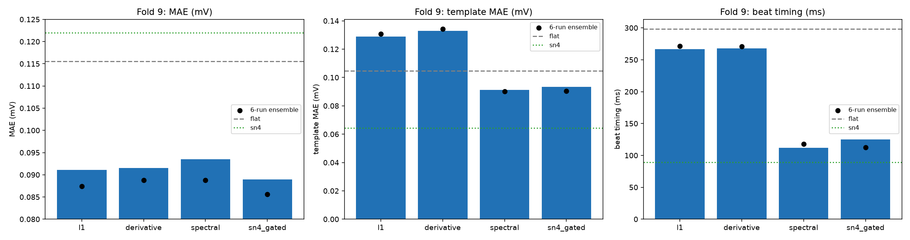
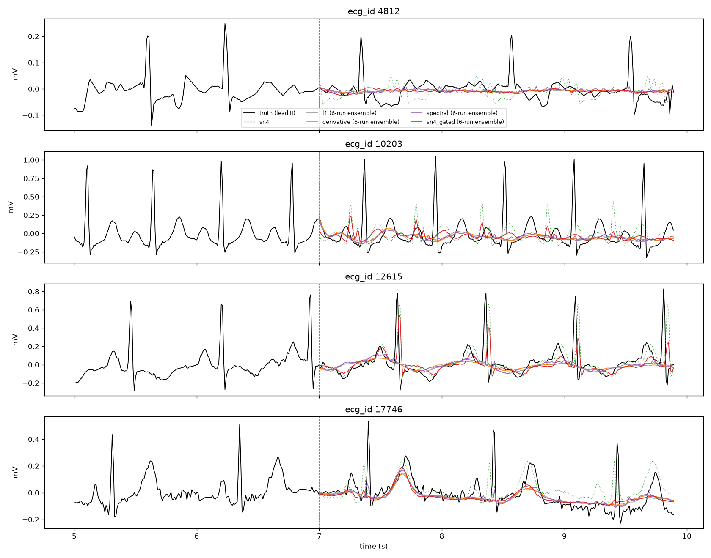

# Phase 10: training objectives (CNN-LSTM)

*2026-11-24 · pre-registered in [PREREGISTRATION.md](PREREGISTRATION.md) (committed
`3f349d8` before any run) · fold 10 sealed*

Reproduce (CPU, 40 cores; ≈ 9 h wall-clock, cached):

```sh
uv run --locked python research/phase10_objectives.py --stage sn4
uv run --locked python research/phase10_objectives.py --stage A
uv run --locked python research/phase10_objectives.py --stage B
uv run --locked python research/phase10_objectives.py --stage C
uv run --locked python research/phase10_objectives.py --stage report
```

## Summary

- **Conditioning CNN-LSTM on the `sn4` forecast (`sn4_gated`) is the first learned
  model in this study that beats both flat and the L1 CNN-LSTM on MAE *and* every
  gatekeeper.** It holds on fold 9 (6 vs 6 runs) and in 9/9 folds of the 9-fold CV:
  MAE 0.0850 vs 0.0866 mV, template MAE 0.088 vs 0.131 mV, beat timing 109 vs 270 ms.
- **The spectral loss also fixes morphology and timing** (template 0.092 mV, timing
  118 ms), but costs MAE relative to L1 (+0.7 µV CV, +2.5 µV fold 9). It beats flat,
  not L1.
- **The derivative loss does nothing useful** (template +4 µV vs L1).
- **Still no learned model beats `sn4`.** `sn4_gated` is 32 µV better on MAE but
  worse on template MAE (+23 µV) and beat timing (+21 ms), in 9/9 folds. Its forecasts
  are damped copies of the repeated beats, not better beats.
- **Adopted for Phase 11:** `sn4_gated` CNN-LSTM (pre-registered rule; spectral also
  passes the rule but is dominated by `sn4_gated` on every metric).

## 1. Setup

As Phase 9 (data, splits, decomposed 24-channel input, raw-mV 12-lead target, AdamW
lr 1e-3, batch 64, ≤ 100 epochs, patience 5, 4 threads, deterministic). Early stopping
uses each run's own objective on the internal holdout. Family: **CNN-LSTM only** (user
decision D10.0; deviation from D9.4, the Transformer was not tested).

| Objective | Loss / model |
|---|---|
| `l1` | Phase 9 CNN-LSTM (cached runs) |
| `derivative` | L1 + λ·c·L1 of first differences |
| `spectral` | L1 + λ·c·multi-resolution STFT magnitude L1 (n_fft 16/32/64) |
| `sn4_gated` | L1; forecast = σ(gate(h)) ⊙ `sn4` + correction(h); `sn4` from the history only |

**Checks before results:** cached `sn4` forecasts equal Phase 6's (max |ΔMAE|
7×10⁻⁸ mV); the modified training loop reproduces the Phase 9 L1 run **bitwise**
(fold 9, seed 42), so the Phase 9 runs serve as the L1 reference.

## 2. Stage A: loss weight (internal holdout, seed 42)

| Objective | λ | MAE | DTW-MAE | Template MAE | Timing (ms) | Best epoch |
|---|---:|---:|---:|---:|---:|---:|
| `l1` (rerun) | – | 0.0887 | 0.0757 | 0.1284 | 266 | 79 |
| `derivative` | **0.3** | 0.0895 | 0.0783 | 0.1297 | 271 | 59 |
| | 1 | 0.0893 | 0.0778 | 0.1344 | 269 | 82 |
| | 3 | 0.0917 | 0.0824 | 0.1308 | 262 | 80 |
| `spectral` | **0.3** | 0.0909 | 0.0709 | 0.0911 | 107 | 58 |
| | 1 | 0.0984 | 0.0670 | 0.0966 | 80 | 58 |
| | 3 | 0.1095 | 0.0714 | 0.1092 | 78 | 47 |
| `sn4_gated` | – | 0.0865 | 0.0691 | 0.0912 | 119 | 45 |

- `derivative`: λ = 0.3 by the rule (lowest template MAE within the 2% MAE tolerance).
- `spectral`: **no λ met the tolerance** (limit 0.0905; λ = 0.3 gave 0.0909), so the
  fallback picked the lowest MAE, λ = 0.3. Larger λ buys better timing (78–80 ms, close
  to `sn4`) at a large MAE cost.

## 3. Stage B: fold-9 screening (6 seeds each)



| Objective | Params | MAE single (± SD) | MAE 6-run ens. | DTW-MAE | Template MAE | Timing (ms) | ≤ 50 ms | Min/run |
|---|---:|---|---:|---:|---:|---:|---:|---:|
| `l1` | 0.72 M | 0.0911 ± 0.0006 | 0.0874 | 0.0781 | 0.1288 | 267 | 0.4% | 53 |
| `derivative` | 0.72 M | 0.0915 ± 0.0005 | 0.0887 | 0.0796 | 0.1328 | 268 | 0.3% | 63 |
| `spectral` | 0.72 M | 0.0935 ± 0.0021 | 0.0888 | 0.0733 | **0.0913** | **112** | 16% | 59 |
| **`sn4_gated`** | 1.17 M | **0.0890 ± 0.0006** | **0.0856** | **0.0710** | 0.0934 | 125 | **30%** | 43 |
| *flat* | – | 0.1156 | – | 0.1156 | 0.1048 | 298 | 0.5% | – |
| *`sn4`* | – | 0.1218 | – | 0.0796 | 0.0642 | 89 | 43% | – |

Single-model values are seed means of patient-macro scores; no run reached the
100-epoch cap.

`compare_runs`, Δ in µV (timing in ms), 95% CI:

| Objective | vs | ΔMAE | ΔDTW | ΔTemplate | ΔTiming | Beats? |
|---|---|---|---|---|---|:-:|
| `derivative` | `l1` | +0.5 [−0.2, +1.1] | +1.5 | **+4.1** [+1.6, +6.4] | +0.8 (n.s.) | ✗ |
| `spectral` | `l1` | **+2.5** [+1.1, +4.2] | −4.8 | −37.4 | −155 | ✗ (MAE worse) |
| `sn4_gated` | `l1` | **−2.1** [−3.1, −1.2] | −7.2 | −35.4 | −142 | **✓** |
| `spectral` | flat | −22.0 | −42.3 | −13.2 | −187 | **✓** |
| `sn4_gated` | flat | −26.6 | −44.6 | −11.2 | −174 | **✓** |
| `sn4_gated` | `sn4` | −33.1 | −8.9 | **+29.2** [+26.9, +31.6] | **+35.6** [+31.6, +40.3] | ✗ |
| `spectral` | `sn4` | −28.5 | −6.6 | +27.1 | +22.7 | ✗ |

Eligible (beat flat): `spectral`, `sn4_gated` → both are finalists.

## 4. Stage C: 9-fold CV of the finalists (D8.6)

3 seeds per fold (42/123/999), 3-seed ensembles; 54 new runs.

| Arm | MAE | DTW-MAE | Template MAE | Timing (ms) | ≤ 50 ms |
|---|---:|---:|---:|---:|---:|
| **`sn4_gated`** | **0.0850** | **0.0676** | 0.0881 | 109 (102–115) | 36% |
| `spectral` | 0.0873 | 0.0703 | 0.0917 | 118 (111–134) | 14% |
| `l1` (Phase 9) | 0.0866 | 0.0757 | 0.1310 | 270 | 0.2% |
| *flat* | 0.1097 | 0.1097 | 0.1049 | 299 | 0.3% |
| *`sn4`* | 0.1167 | 0.0735 | **0.0648** | **88** | **44%** |

Per-fold differences (mean; one-sample t-test across folds; folds better):

| Pair | ΔMAE (µV) | ΔDTW (µV) | ΔTemplate (µV) | ΔTiming (ms) | Verdict |
|---|---|---|---|---|---|
| `sn4_gated` − flat | −24.7 (9/9) | −42.0 (9/9) | −16.8 (9/9) | −190 (9/9) | **beats** |
| `sn4_gated` − `l1` | −1.6 (9/9, p < 0.001) | −8.0 (9/9) | −42.9 (9/9) | −161 (9/9) | **beats** |
| `sn4_gated` − `sn4` | −31.7 (9/9) | −5.9 (9/9) | **+23.4 (0/9)** | **+20.6 (0/9)** | does not beat |
| `spectral` − flat | −22.4 (9/9) | −39.4 (9/9) | −13.2 (9/9) | −181 (9/9) | **beats** |
| `spectral` − `l1` | **+0.7 (0/9, p = 0.001)** | −5.4 (9/9) | −39.3 (9/9) | −152 (9/9) | does not beat |
| `spectral` − `sn4` | −29.4 (9/9) | −3.2 (9/9) | +26.9 (0/9) | +29.9 (0/9) | does not beat |

All listed p-values are < 0.002. *Post hoc* (not pre-registered): `sn4_gated` −
`spectral` is −2.3 µV MAE, −2.7 µV DTW, −3.6 µV template (8/9 folds) and −9.4 ms timing,
all p < 0.005. Fold 9 agrees with the CV on every verdict.

**Result:** `sn4_gated` and `spectral` both meet the pre-registered adoption rule
(beat flat on fold 9 and in the CV). `sn4_gated` also beats L1 and is better than
`spectral` on every metric, so it is carried forward.

| Hypothesis | Result |
|---|---|
| H10.1 derivative and spectral lower template MAE vs L1 | **Partly rejected:** spectral −37 µV; derivative +4 µV (worse) |
| H10.2 `sn4_gated` beats flat and has better timing than L1 | **Accepted** (fold 9 and CV) |
| H10.3 no objective beats `sn4` on every gatekeeper | **Accepted** (template and timing worse in 9/9 folds) |

## 5. What the models predict



- **`sn4_gated`** places QRS complexes where `sn4` does (e.g. ecg_id 12615), at
  reduced amplitude, and follows the slow waves like L1. Where `sn4` is out of phase
  it damps the beats further but still copies some of them at the wrong time
  (ecg_id 10203).
- **`spectral`** produces smaller, smoothed beat-like oscillations; its timing varies
  more between seeds (single-model SD 2.1 µV MAE vs 0.6 µV).
- **`derivative`** and **`l1`** forecast slow waves only.

The model therefore learned *when to trust* the repeated cycles, not to forecast beats
itself: its timing skill comes from `sn4`. Its share of records within 50 ms (36%)
stays below `sn4` (44%) and below the D6.6 reference target (57%).

## 6. Disclosures and limitations

- **CNN-LSTM only** (D10.0); whether the Transformer responds differently is untested.
- **`sn4_gated` has 1.62× the parameters** of the L1 CNN-LSTM (an extra linear head).
  Capacity was not controlled, so the gain is not separated from the extra head.
- **λ grid is coarse** (3 values, one seed, internal holdout). Spectral's λ was
  picked by the fallback rule. Combinations (e.g. spectral loss on `sn4_gated`) and
  soft-DTW were not tested.
- **The comparison metrics and `sn4` share the same R-peak detector**, and the model
  receives `sn4` as input; timing gains are relative to that detector.
- **CV p-values are approximate** (overlapping training sets, 3-seed ensembles).
- **Selection used folds 1–9 only.** Nothing here is a test-set result.

## 7. Implications

| Phase | Implication |
|---|---|
| 11 Hyperparameters | Tune `sn4_gated` CNN-LSTM (capacity, learning rate; optionally a spectral term as a pre-registered candidate). The gap to `sn4` on template and timing is the target |
| 12 Robustness | Check per device, rhythm (AFIB: `sn4` 159 ms) and quality stratum; the gated model should fall back to the L1 behaviour where `sn4` is poor |
| 13 Plausibility | Report beat amplitude: forecasts are damped copies of `sn4` beats |
| Cost | `sn4_gated` ≈ 43 min/run on CPU (fewer epochs than L1). Stage A 172 min, B 75 min, C 303 min |
