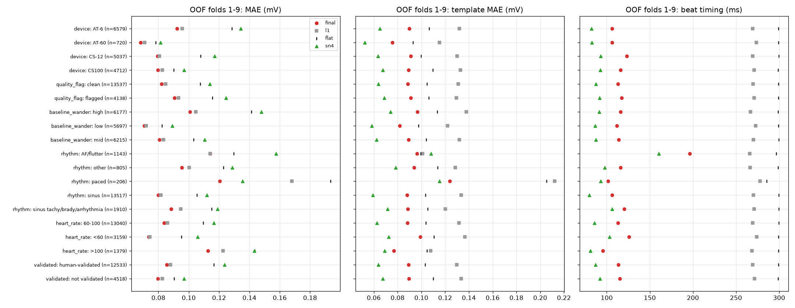

# Phase 12: robustness

*2026-11-24 · pre-registered in [PREREGISTRATION.md](PREREGISTRATION.md) · fold 10 sealed*

Final configuration (Phase 11): `sn4`-gated CNN-LSTM, LSTM hidden 256.
Reproduce: `uv run --locked python research/run_12_18.py` (trains, then runs this
analysis via `research/phase12_robustness.py`).

## Summary

- **9-fold CV (OOF, 3-seed ensembles):** MAE 0.0840 mV (fold range 0.0834–0.0858,
  SD 0.0009), better than L1 CNN-LSTM (−2.6 µV), flat (−25.7 µV) and `sn4` (−32.7 µV)
  in 9/9 folds; template MAE 0.089 mV and timing 114 ms, better than L1 and flat in
  9/9 folds and worse than `sn4` in 9/9 folds.
- **Finding against the Phase 11 choice:** compared with the Phase 10 base
  (hidden 128), hidden 256 is better on MAE (−1.0 µV, 9/9 folds, p < 0.001) but
  **worse on template MAE (+1.3 µV, p = 0.013, better in 1/9 folds) and timing
  (+5.2 ms, p = 0.002, 0/9 folds)**. Under the multi-fold rule used for family
  selection (D8.6), hidden 256 would **not** beat the base. Fold 9 alone (Phase 11)
  did not detect this. See §5.
- **Strata:** final beats flat in every stratum (H12.1 ✓) and beats L1 in every
  stratum except **AF/flutter** (ΔMAE +0.0 µV, n.s.; H12.2 ✗). It beats `sn4` in none.
- **AF/flutter:** timing 197 ms vs `sn4` 161 ms (H12.3 ✗): when the rhythm is
  irregular, the model is worse than repeating the last beats.
- **Perturbations:** robust to history noise (0.05 mV: MAE +0.7 µV). With **lead II
  missing**, MAE stays far better than flat but template MAE (0.118) becomes worse
  than flat (0.105), so it no longer beats flat (H12.4 ✗).

## 1. Overall (OOF, folds 1–9)

| Arm | MAE | DTW-MAE | Template MAE | Timing (ms) |
|---|---:|---:|---:|---:|
| **final** (hidden 256) | **0.0840** | **0.0664** | 0.0894 | 114 |
| Phase 10 base (hidden 128) | 0.0850 | 0.0676 | 0.0881 | 109 |
| L1 CNN-LSTM | 0.0866 | 0.0757 | 0.1310 | 270 |
| flat | 0.1097 | 0.1097 | 0.1049 | 299 |
| `sn4` | 0.1167 | 0.0735 | **0.0648** | **88** |

Per-fold means of patient-macro scores. Final − reference, mean over folds (folds
better; one-sample t-test): vs L1: MAE −2.6 µV (9/9), template −41.6 µV (9/9),
timing −156 ms (9/9); vs `sn4`: MAE −32.7 µV (9/9), DTW −7.1 µV (9/9), template
+24.7 µV (0/9), timing +25.7 ms (0/9); all p < 0.001.

## 2. Strata (OOF ensemble; patient-cluster bootstrap, D6.2)

| Stratum | Patients | Final MAE | L1 MAE | `sn4` MAE | Final timing | `sn4` timing | Beats flat / L1 / `sn4` |
|---|---:|---:|---:|---:|---:|---:|:-:|
| AT-6 | 6,579 | 0.0923 | 0.0958 | 0.1343 | 106 | 82 | ✓ / ✓ / ✗ |
| AT-60 | 720 | 0.0683 | 0.0709 | 0.0814 | 106 | 83 | ✓ / ✓ / ✗ |
| CS-12 | 5,037 | 0.0795 | 0.0807 | 0.1170 | 123 | 93 | ✓ / ✓ / ✗ |
| CS100 | 4,712 | 0.0796 | 0.0825 | 0.0969 | 116 | 93 | ✓ / ✓ / ✗ |
| quality flagged | 4,138 | 0.0906 | 0.0931 | 0.1246 | 117 | 92 | ✓ / ✓ / ✗ |
| high baseline wander | 6,177 | 0.1008 | 0.1047 | 0.1478 | 116 | 91 | ✓ / ✓ / ✗ |
| sinus | 13,517 | 0.0800 | 0.0816 | 0.1119 | 106 | 80 | ✓ / ✓ / ✗ |
| sinus tachy/brady/arrh. | 1,910 | 0.0883 | 0.0947 | 0.1190 | 120 | 106 | ✓ / ✓ / ✗ |
| **AF/flutter** | 1,143 | 0.1141 | 0.1141 | 0.1575 | **197** | 161 | ✓ / **✗** / ✗ |
| paced | 206 | 0.1205 | **0.1680** | 0.1355 | 102 | 93 | ✓ / ✓ / ✗ |
| HR > 100 bpm | 1,379 | 0.1126 | 0.1227 | 0.1433 | 96 | 81 | ✓ / ✓ / ✗ |
| HR < 60 bpm | 3,159 | 0.0735 | 0.0742 | 0.1058 | 126 | 103 | ✓ / ✓ / ✗ |

Full table, including clean/mid/low-wander and validation strata:
`table_strata.csv`. Largest gains over L1: paced (−47.5 µV), HR > 100 (−10.0 µV),
sinus tachy/brady (−6.4 µV), i.e. regular, fast or pacing-driven rhythms where `sn4`
is informative.

## 3. Perturbations (fold 9, 6 saved models; scored against the clean truth)

The 6 retrained fold-9 models reproduced the earlier runs **bitwise**.

| History | Final MAE | Final template | Final timing | `sn4` MAE | `sn4` timing | Beats flat | ΔMAE vs flat (µV) |
|---|---:|---:|---:|---:|---:|:-:|---:|
| clean | 0.0882 | 0.0934 | 126 | 0.1220 | 89 | ✓ | −27.4 |
| noise σ 0.02 mV | 0.0884 | 0.0936 | 127 | 0.1225 | 89 | ✓ | −27.1 |
| noise σ 0.05 mV | 0.0889 | 0.0944 | 128 | 0.1245 | 91 | ✓ | −26.5 |
| lead II = 0 | 0.0892 | **0.1179** | **262** | 0.1222 | 298 | **✗** | −26.1 |

Lead II drives both `sn4`'s period search and the metric's beat detection, so losing it
removes most of the timing skill (the metric detects beats on the forecast's lead II).

## 4. Hypotheses

| ID | Result |
|---|---|
| H12.1 beats flat in every stratum (≥ 200 patients) | **Accepted** |
| H12.2 beats L1 in every stratum | **Rejected** (AF/flutter: no difference) |
| H12.3 AF/flutter timing not worse than `sn4` | **Rejected** (+36 ms [+32, +40]) |
| H12.4 beats flat under every perturbation | **Rejected** (lead II missing: template worse) |

## 5. Implication for the final model (decision needed before Phase 17)

Phase 11 selected hidden 256 on fold 9 (6 vs 6 runs, gatekeepers n.s.). The 9-fold CV
shows a consistent morphology/timing cost (template worse in 8/9 folds, timing in
9/9). The pre-registered Phase 11 rule was followed; but the user's multi-fold
requirement (D8.6) was written for family selection, and applying its spirit here
would keep the **Phase 10 base (hidden 128)**. Phase 16 froze hidden 256. Because fold
10 is still sealed, switching is legitimate now. It is left to the user (D12.1).

## Limitations

Stratum comparisons use one OOF ensemble per record (no run-to-run variance); CV
p-values are approximate (overlapping training sets); perturbations are synthetic
and on fold 9 only; rhythm labels are PTB-XL statements, not adjudicated.
