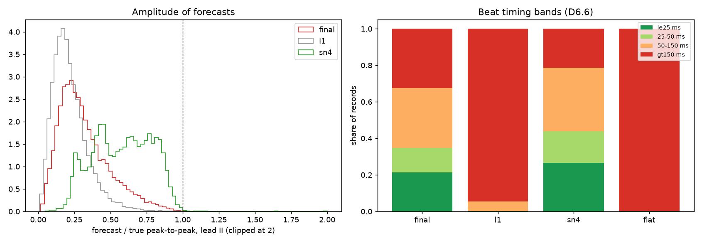

# Phase 13: physiological plausibility

*2026-11-24 · pre-registered in [PREREGISTRATION.md](PREREGISTRATION.md) · OOF forecasts, folds 1–9*

Reproduce: `uv run --locked python research/phase13_15_analysis.py`.

| Measure | Truth | **Final** | L1 | `sn4` | Flat |
|---|---:|---:|---:|---:|---:|
| Limb-relation violation, median (mV) | 0.0005 | 0.0069 | 0.0038 | 0.0003 | 0.0075 |
| Records with violation > 0.01 mV | 0.0% | **19.0%** | 3.0% | 0.0% | 35.6% |
| Lead-II peak-to-peak / truth, median (IQR) | 1.00 | **0.28** (0.19–0.41) | 0.20 (0.13–0.28) | 0.59 (0.42–0.75) | 0 |
| Power > 15 Hz, lead II (median share) | 17.8% | 3.7% | 0.6% | 11.0% | 0 |
| Records > 0.5 mV outside history range | 3.4% | 0.15% | 0.13% | 0.01% | 0 |
| R amplitude error (mV) | – | 0.758 | 0.849 | **0.392** | 0.876 |
| ST level error (mV) | – | **0.054** | 0.083 | 0.058 | 0.065 |
| T amplitude error (mV) | – | 0.190 | 0.291 | **0.104** | 0.252 |
| Timing ≤ 25 / 25–50 / 50–150 / > 150 ms | – | 21 / 13 / 33 / 32% | 0 / 0 / 5 / 95% | 27 / 17 / 35 / 21% | 0 / 0 / 0 / 100% |
| No beat detected in forecast | – | 3.9% | 42.2% | 1.4% | 100% |
| Detected / true beat count (median) | – | 1.00 | 0.25 | 1.00 | 0 |

**Hypotheses**

| ID | Result |
|---|---|
| H13.1 limb violations ≤ L1's | **Rejected:** 19.0% vs 3.0% |
| H13.2 forecasts damped (p2p ratio < 0.8) | **Accepted:** 0.28 |
| H13.3 < 1% out of range | **Accepted:** 0.15% |

## Interpretation

- **Beats are present and roughly in place, but small.** The final model produces the
  right number of beats (median ratio 1.0; L1: 0.25) with 34% of records within 50 ms,
  but at about a quarter of the true amplitude (R amplitude error 0.76 mV vs `sn4` 0.39).
  It is a damped mixture of `sn4` and the L1 mean forecast.
- **Lead consistency got worse.** The gate is applied per lead independently, so the
  12 outputs mix `sn4` in different proportions and break Einthoven/Goldberger
  relations in 19% of records (L1: 3%). The violations are small (median 7 µV) but
  systematic. A shared gate for the limb leads, or 8-lead output with derived limb
  leads (D9.5), would remove them by construction — not tested.
- **ST level is the one wave measure where the model beats `sn4`** (0.054 vs
  0.058 mV), consistent with its slow-wave tracking.
- **No implausible values:** forecasts stay inside the history's range more often
  than the truth does.

These are signal-level checks, not a clinical validation.
