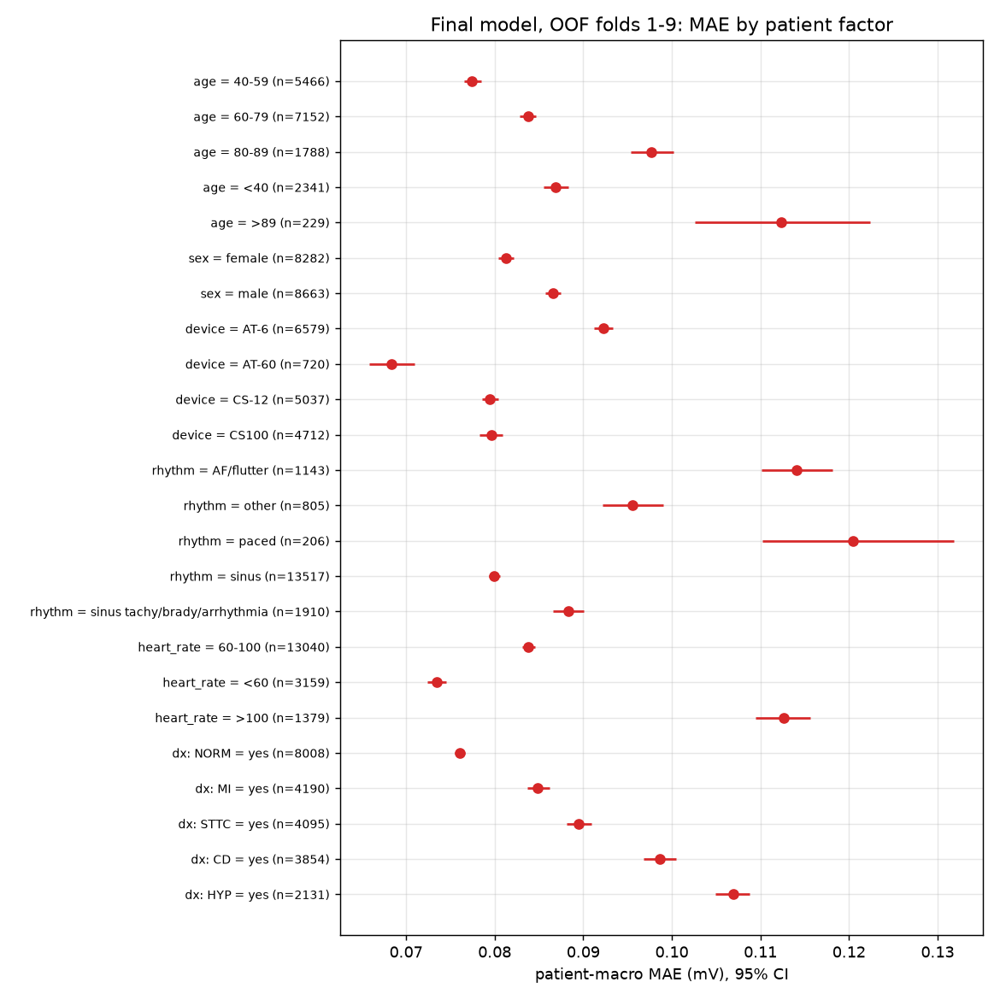

# Phase 14: error analysis by patient factors

*2026-11-24 · pre-registered in [PREREGISTRATION.md](PREREGISTRATION.md) · OOF, folds 1–9 · exploratory*

Reproduce: `uv run --locked python research/phase13_15_analysis.py`.

## Final model by factor (patient-macro; 95% patient-cluster bootstrap CI)

| Factor | Level (patients) | Final MAE | Δ MAE vs L1 (µV) | Final timing (ms) | Δ timing vs `sn4` (ms) |
|---|---|---:|---|---:|---:|
| Age | <40 (2,341) | 0.0869 | −0.5 [−2.2, +0.6] | 153 | +32 |
| | 40–59 (5,466) | 0.0774 | −0.8 [−1.2, −0.4] | 118 | +30 |
| | 60–79 (7,152) | 0.0838 | −3.7 [−4.2, −3.3] | 101 | +22 |
| | 80–89 (1,788) | 0.0977 | −5.4 [−6.4, −4.5] | 101 | +16 |
| | >89 (229) | 0.1123 | −8.2 [−12.5, −4.6] | 116 | +22 |
| Sex | female (8,282) | 0.0813 | −2.4 [−2.7, −2.0] | 108 | +21 |
| | male (8,663) | 0.0866 | −2.8 [−3.4, −2.3] | 120 | +30 |
| Rhythm | AF/flutter (1,143) | 0.1141 | +0.0 [−0.7, +0.8] | 197 | +36 |
| | paced (206) | 0.1205 | −47.5 [−57.6, −38.8] | 102 | +9 |
| Heart rate | >100 bpm (1,379) | 0.1126 | −10.0 [−11.7, −8.4] | 96 | +15 |
| Diagnosis | NORM (8,008) | 0.0760 | −0.2 [−0.7, +0.2] | 125 | +35 |
| | HYP (2,131) | 0.1069 | −4.8 [−5.7, −3.9] | 95 | +16 |
| | CD (3,854) | 0.0987 | −5.7 [−6.5, −4.9] | 109 | +21 |
| | MI (4,190) | 0.0849 | −3.6 [−4.1, −3.1] | 107 | +18 |
| | STTC (4,095) | 0.0895 | −2.8 [−3.2, −2.3] | 97 | +12 |

Full table: `table_factors.csv`. Final timing is worse than `sn4` at every level.

**Where the `sn4` gate does not help (Δ vs L1 CI includes 0):** age < 40, AF/flutter,
and normal ECGs. Young and normal ECGs have sinus arrhythmia and low amplitude, so
`sn4` adds little; AF has no regular cycle to copy.

## Adjusted analysis (OLS of log MAE, all factors jointly)

Effects as % change in MAE vs the reference (age 60–79, male, CS100, sinus,
60–100 bpm, superclass absent), 95% patient-cluster bootstrap CI:

| Term | Effect | | Term | Effect |
|---|---:|---|---|---:|
| AF/flutter | **+26.7%** | | HR > 100 | +14.2% |
| HYP | **+23.7%** | | age < 40 | +14.2% |
| paced | **+23.1%** | | CD | +11.5% |
| baseline wander (per e-fold) | **+23.0%** | | HR < 60 | −11.1% |
| CS-12 (vs CS100) | −8.4% | | female | −6.3% |
| AT-60 | −6.8% | | MI / STTC / NORM | −4.7 / −3.7 / −3.6% |

AT-6 vs CS100: +0.9% (n.s.). Full table: `table_regression_log_mae.csv`.

## Interpretation

- **Device effects mostly disappear after adjustment.** The unadjusted AT-6 excess
  (Phase 2) is largely baseline wander and case mix: AT-6 is +0.9% (n.s.) once wander
  is in the model.
- **Error is driven by rhythm irregularity, baseline wander and large-amplitude
  pathology** (hypertrophy, conduction disease): signals with more unpredictable
  energy.
- Associations, not causes; the regression ignores interactions and residual
  confounding (e.g. diagnoses correlate with age and device).
