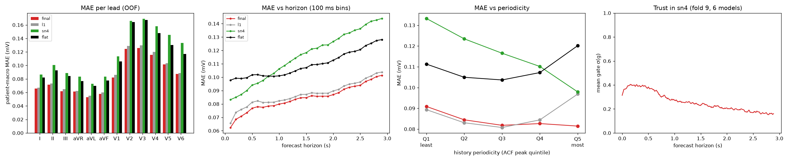

# Phase 15: error analysis by signal properties

*2026-11-24 · pre-registered in [PREREGISTRATION.md](PREREGISTRATION.md) · OOF, folds 1–9 · exploratory*

Reproduce: `uv run --locked python research/phase13_15_analysis.py`.

## Findings

- **Per lead:** final is better than L1 on all 12 leads (largest gains V1–V4,
  −3.8 to −4.3 µV). Worst lead V3 (0.126 mV), best aVL (0.053 mV): errors scale with
  lead amplitude.
- **Per horizon:** final MAE rises from 0.062 mV (first 100 ms) to 0.101 mV (last
  100 ms). It stays below L1 at every step; the gap is largest early (−5.2 µV in
  100–200 ms). `sn4`'s error grows fastest (0.083 → 0.144 mV) as its cycles drift.
- **History periodicity is the key moderator** (ACF peak quintiles, history only):

  | Quintile | Final MAE | L1 MAE | Gain vs L1 (µV) | Final timing | `sn4` timing |
  |---|---:|---:|---:|---:|---:|
  | Q1 least periodic | 0.0909 | 0.0894 | **−1.5 (worse)** | 175 | 141 |
  | Q2 | 0.0845 | 0.0830 | −1.4 (worse) | 145 | 115 |
  | Q3 | 0.0818 | 0.0808 | −1.1 (worse) | 119 | 91 |
  | Q4 | 0.0826 | 0.0844 | +1.8 | 84 | 61 |
  | Q5 most periodic | 0.0814 | 0.0969 | **+15.4** | 43 | 33 |

  The whole MAE gain over L1 comes from the most periodic 40% of records; in the least
  periodic 60% the final model is slightly *worse* than L1. Expected direction
  confirmed; the cost in Q1–Q3 was not expected.
- **The gate does what it was designed for, partly:** mean gate 0.26 (0.36 in the
  first 100 ms → 0.16 in the last 100 ms, trusting `sn4` less as cycles drift).
  Record-level gate correlates with periodicity (Spearman +0.47) but only weakly with
  `sn4`'s own error (−0.11). Limb and right-precordial leads get slightly higher gates
  (0.27–0.29) than V4–V6 (0.22–0.24).
- **Worst 1% of records** (by final MAE) vs the rest: high baseline wander 72% vs 33%,
  AF/flutter 26% vs 7%, paced 13% vs 1%, quality-flagged 37% vs 23%, larger true
  amplitude (lead-II p2p 1.26 vs 0.94 mV); CS-12 under-represented (12% vs 30%).

## Implications

A gate that cannot fully switch `sn4` off for irregular histories costs accuracy
there. Candidates for future work: gate inputs that explicitly encode periodicity
(e.g. the ACF peak), or a hard fallback to the L1 forecast below a periodicity
threshold. Neither was tested.
