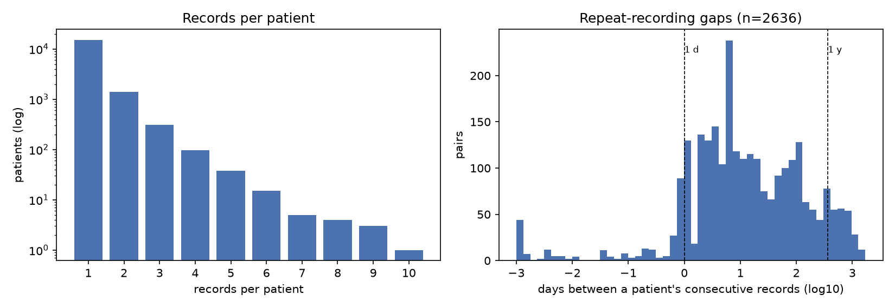
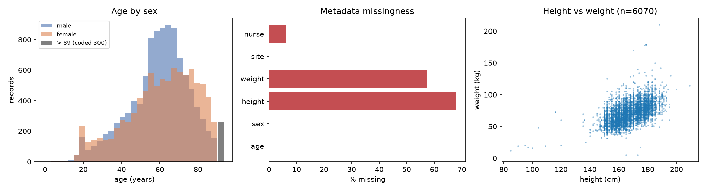
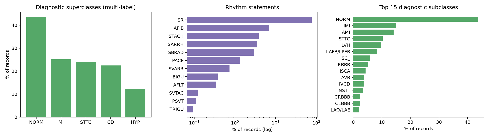
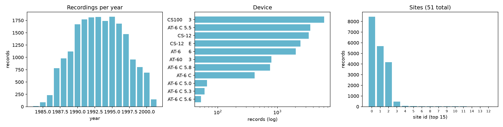
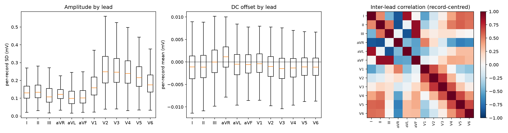
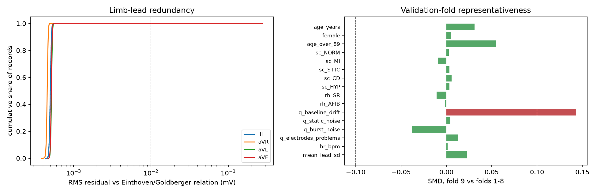
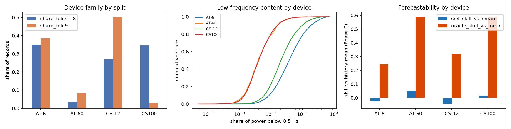

# Phase 2 report: dataset understanding

PTB-XL v1.0.3 · folds 1–9 (19,601 records, 16,965 patients) · raw 100 Hz signals in
mV · fold 10 sealed, not even its metadata examined. Questions and checks were fixed
in [PREREGISTRATION.md](PREREGISTRATION.md). Post-hoc analyses are marked
**[post hoc]**.

Reproduce (~30 s, deterministic; the device-forecastability columns need Phase 0's
output):

```sh
uv run python research/phase2_dataset.py
```

## 1. Verdict

| Check | Result | Outcome |
|---|---|---|
| R1 Fold 9 representative of folds 1–8 (all SMD < 0.1) | max \|SMD\| 0.143 (baseline-drift flag); 15 of 16 variables < 0.06 | **Fail** |
| R2 Limb leads are linear combinations of I and II (≥ 99% of records within 0.01 mV) | 99.92–99.95% per relation; median residual 0.0005 mV (quantization) | **Pass** |
| R3 At least 10% of records from patients with repeat recordings | 23.1% | **Pass** |

The most important findings were not pre-registered:

1. **Fold 9 is not representative of folds 1–8, and this is by design** [post hoc].
   - PhysioNet states that folds 9 and 10 "underwent at least one human evaluation"
     (100% human-validated in fold 9 vs 67% in folds 1–8).
   - The acquisition-**device mix differs strongly**: CS100 makes up 34.6% of folds
     1–8 but 2.9% of fold 9 (SMD −0.89); CS-12 makes up 26.9% vs 50.3% (+0.49).
   - Under the pre-registered list, R1 failed only on baseline drift. Device was not
     in that list, and its imbalance is about 6× larger.
2. **Device largely determines how forecastable a record is** [post hoc].
   - CS100 and AT-60 records have almost no power below 0.5 Hz (median share 0.4%
     vs 2–4%), consistent with high-pass filtering inside the device.
   - With perfect beat timing, forecast skill is 0.59 on those devices vs 0.24–0.32
     on the others.
   - The difficulty gap between fold 9 and folds 1–8 (flat-line forecast MAE 0.117
     vs 0.110 mV) is about 60% explained by the device mix.
3. **Only 8 of the 12 leads are independent.** III, aVR, aVL and aVF are exact
   functions of I and II (8 components hold 99.9999% of the variance).

**Decision (2026-11-22): GO to Phase 3** (D2.6), carrying the implications in §8.

## 2. Q1: patients and repeat recordings



- **Patients:** 16,965, with 1–10 records each. 15,082 patients (88.9%) have one
  record; 1,883 have two or more.
- **Records from repeat patients:** 23.1% (R3), so patient-clustered statistics are
  mandatory.
- **Time between a patient's consecutive records:** 2,636 gaps, median 10 days,
  90th percentile 336 days, maximum 4.7 years.
- **11.3% of gaps are shorter than a day and 3.6% shorter than an hour.** These are
  near-duplicate candidates for Phase 3. They can't leak across the official folds,
  because every patient is in exactly one fold (Phase 1.5).

## 3. Q2: demographics



| Variable | Summary |
|---|---|
| Age | No missing values; 259 records (1.3%) are "> 89" (coded 300); otherwise mean 59.4 years (SD 16.7), median 61 (IQR 50–72), range 2–89; 120 records are under 18 |
| Sex | 10,222 male (52.2%), 9,379 female (47.8%), none missing |
| Height | 68.0% missing; 12 values under 100 cm, of which only 4 are children (e.g. 6 cm at age 64) |
| Weight | 57.4% missing; 8 values under 20 kg, 4 over 180 kg |
| Height and weight both present | 6,070 records (31.0%) |

Only age (with a "> 89" category) and sex are complete enough to use as conditioning
inputs. Height and weight are mostly missing and contain implausible values.

## 4. Q3: labels



- **Diagnostic superclasses (multi-label):** NORM 43.6%, MI 25.1%, STTC 24.0%,
  CD 22.5%, HYP 12.2%.
- **Superclasses per record:** 74.5% have exactly one, 23.6% have two to four, and
  371 records (1.9%) have no diagnostic statement. Common combinations are in
  `table_superclass_combinations.csv`.
- **Rhythm:** SR 76.9%, AFIB 6.9%, STACH 3.8%, SARRH 3.5%, SBRAD 2.9%, PACE 1.4%.
  Six rhythms have 18–143 records each (SVARR, BIGU, AFLT, SVTAC, PSVT, TRIGU), too
  few for reliable per-group confidence intervals. 669 records have no rhythm
  statement.
- **Statement likelihoods:** 100 (22,004 statements), 80 (1,986), 50 (2,881),
  35 (362), 15 (1,584), 0 = unspecified (26,096, mostly rhythm and form statements),
  plus four one-off values (10, 14, 30, 34).
- **Label provenance:** 70.7% human-validated, 33.8% started from an automatic
  report, 2.5% had a second opinion. Heart axis is missing for 38.3%.

## 5. Q4: acquisition



- **Years:** 1984–2001, mostly 1990–1996.
- **Sites:** 51, with the top five covering 96.3% of records.
- **Staff:** 12 nurses.
- **Devices:** 11 device strings in four families: AT-6 (35.4%), CS100 (31.0%),
  CS-12 (29.5%), AT-60 (4.0%).
- **Folds 1–9:** 2,173–2,192 records each.

## 6. Q5: signal statistics



- **Amplitude:**
  - Median per-record SD is 0.10–0.13 mV for limb leads and 0.16–0.25 mV for
    precordial leads, so V2–V4 are about twice the limb leads.
  - Within a single record the largest lead SD is a median 4.6× the smallest (IQR
    3.5–6.3).
  - Globally, 98% of samples lie within −0.70 … 0.77 mV and 99.8% within
    −1.96 … 1.71 mV.
- **DC offset:** negligible. Per-record lead means have \|mean\| ≤ 0.009 mV at the
  95th percentile, so mean-centering is nearly a no-op.
- **Correlation:** the expected structure (I with aVL, II/III with aVF, aVR
  anti-correlated; neighbouring precordial leads correlated).
- **Heart rate:** median 71 bpm (IQR 63–83), range 30–194.
- **Anomalies for Phase 3** [post hoc]:
  - 1 record has a lead with SD < 0.01 mV, and 6 records have one under 0.02 mV.
  - 18 records break a limb-lead relation by up to 0.27 mV; 12 of them are CS100.
    Possible causes: lead errors or acquisition artifacts.



## 7. Fold 9 vs folds 1–8 (R1) and device effects [post hoc]

| Variable | Folds 1–8 | Fold 9 | SMD |
|---|---:|---:|---:|
| Age, female, superclasses, SR, AFIB, heart rate, amplitude | – | – | \|SMD\| ≤ 0.054 |
| Baseline-drift flag | 6.5% | 10.5% | **+0.143** |
| Human-validated [post hoc] | 67.0% | 100% | – |
| Device CS100 [post hoc] | 34.6% | 2.9% | **−0.89** |
| Device CS-12 [post hoc] | 26.9% | 50.3% | **+0.49** |
| Device AT-60 [post hoc] | 3.5% | 8.3% | **+0.21** |

For comparison, no individual training fold differs from the other training folds by
more than \|SMD\| 0.035.

The baseline-drift flag appears almost only on human-validated records: 8.8% of
those in folds 1–8 vs 1.9% of the rest. The flag rate therefore partly reflects the
annotation process, not only the signal.



| Device | Power below 0.5 Hz (median share) | Flat-line forecast MAE (mV) | Skill with perfect timing (Phase 0) |
|---|---:|---:|---:|
| AT-6 | 3.8% | 0.131 | 0.24 |
| CS-12 | 2.1% | 0.110 | 0.32 |
| CS100 | 0.4% | 0.092 | 0.59 |
| AT-60 | 0.4% | 0.080 | 0.59 |

## 8. Implications for later phases

| Phase | Implication |
|---|---|
| 3 Data quality | Investigate the 18 records breaking the limb-lead relations, the near-flat leads, same-day repeats as near-duplicates, and implausible heights/weights. Assess baseline drift from the signal, since the flag depends on annotation |
| 4/8 Leakage and validation | The official split is patient-safe. Fold 9 is deliberately harder and device-shifted; fold 10 is documented to be human-validated like fold 9, so fold 9 is probably closer to the test distribution than folds 1–8. Cross-validation over folds 1–8 would estimate an easier, differently mixed population. All results must be reported per device family as well as overall |
| 5 Preprocessing | Lead amplitudes differ about 2× between leads and 4–6× between records; offsets are negligible. Low-frequency content depends on the device, so a causal high-pass filter is a candidate for making devices comparable. It must be compared, not assumed |
| 6 Metrics | A 12-lead average counts the two independent limb signals four extra times. Report the 8 independent leads alongside the 12-lead metric |
| 9 Models | Predict the 8 independent leads (I, II, V1–V6) and derive III, aVR, aVL and aVF exactly. That guarantees Einthoven/Goldberger consistency (checked in Phase 13) and removes redundant outputs. To be tested against direct 12-lead prediction |
| 12/14 Statistics and errors | Patient-clustered bootstrap is mandatory. Subgroup axes: device family, rhythm (pool the rare ones), superclass, age band (with "> 89"), sex, quality flags |
| Conditioning | Age and sex are complete; height and weight are not usable. Device is known at recording time, so it is a legitimate candidate input |

## 9. Limitations

- R1 tested a pre-registered variable list. Device turned out to matter most and was
  analyzed post hoc, so its p-hacking protection is weaker. The effect, however, is
  large and has a physical mechanism (different low-frequency content).
- The "about 60% explained by device mix" figure is a simple reweighting by device
  family. It ignores within-family differences such as firmware versions.
- Heart rate comes from a single-lead detector. Phase 0 found under 3 detected beats
  in 0.25% of records.
