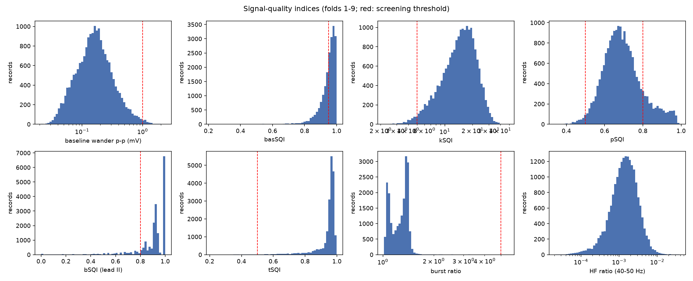
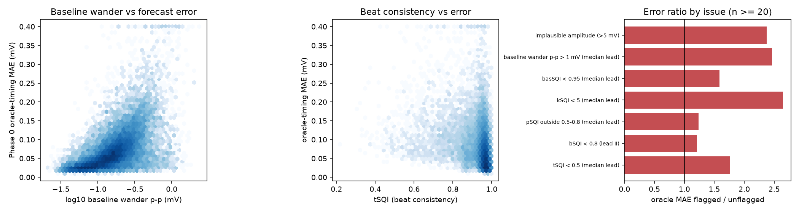
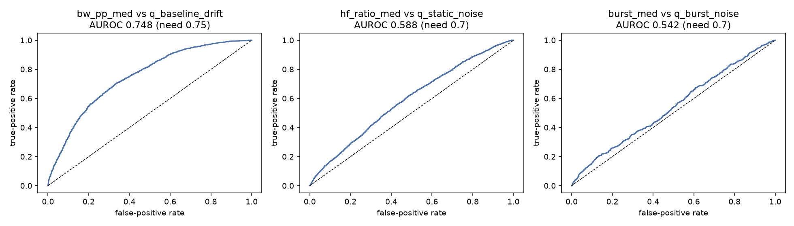
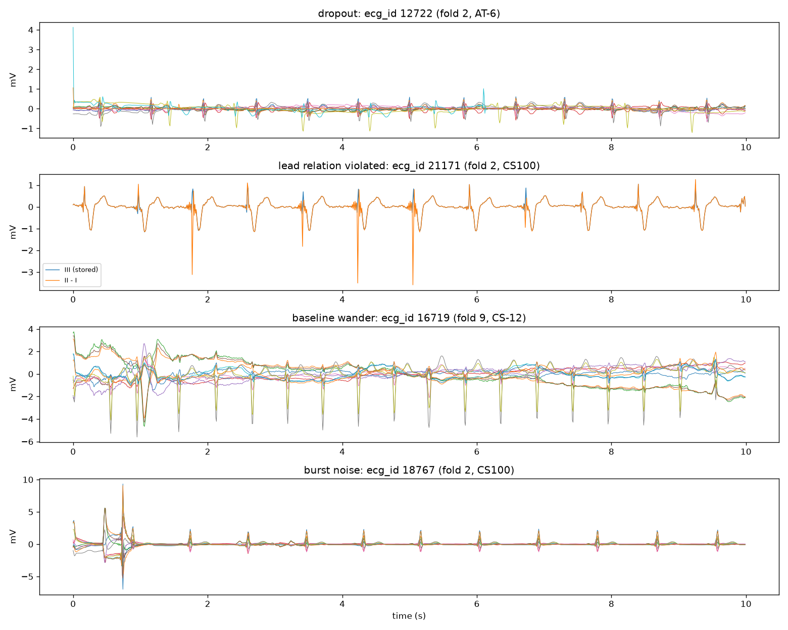
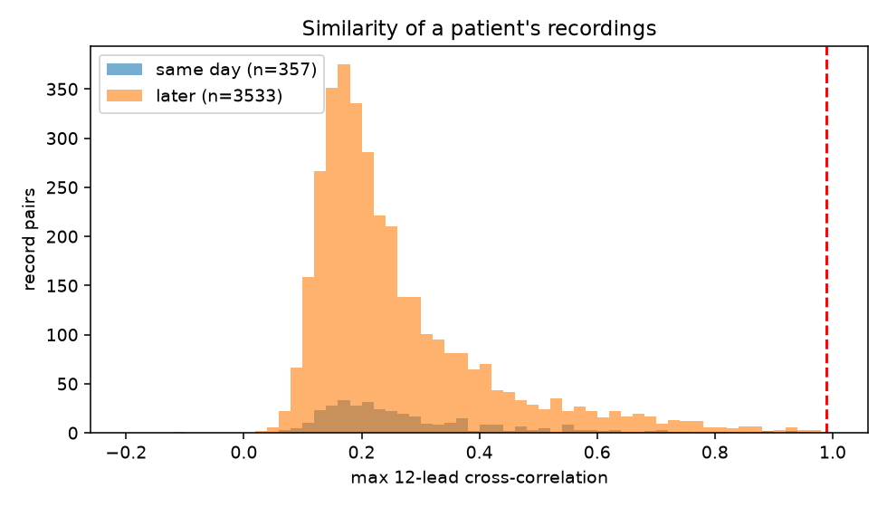
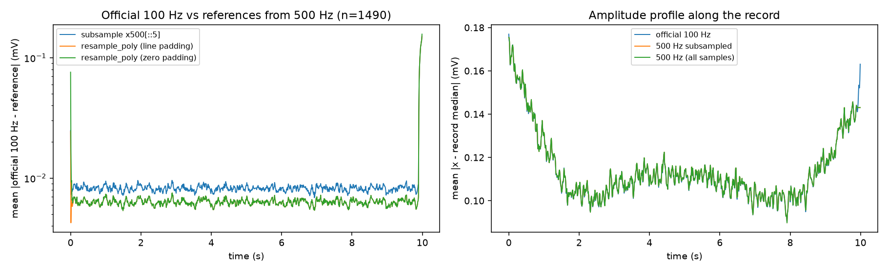

# Phase 3 report: data quality assessment

PTB-XL v1.0.3 · folds 1–9 (19,601 records) · raw 100 Hz signals · fold 10 sealed.
Definitions, hypotheses and the exclusion rule were fixed in
[PREREGISTRATION.md](PREREGISTRATION.md). Post-hoc work is marked **[post hoc]**.

Reproduce (about 40 s + 20 s on 38 cores; Phase 0 must have run for the difficulty
columns):

```sh
uv run python research/phase3_quality.py
uv run python scripts/download_ptbxl.py --include records500/00000/ --include records500/01000/
uv run python research/phase3_edge_artifact.py
```

## 1. Verdict

| | Hypothesis | Result | Outcome |
|---|---|---|---|
| H3.1 | Signal indices agree with the human quality flags (AUROC ≥ 0.75 / 0.70 / 0.70) | Baseline wander → drift flag **0.748**; high-frequency ratio → static-noise flag 0.588; burst index → burst flag 0.542 | **Rejected** (all three) |
| H3.2 | Baseline wander drives forecast difficulty (Spearman ρ ≥ 0.3 with Phase 0 oracle MAE) | ρ = **0.63** | **Accepted** |
| H3.3 | No exact or cross-patient near-duplicates | 0 exact; 0 pairs ≥ 0.99 within patients (3,890 pairs) or across patients (76,730 candidates) | **Accepted** |

**The data is clean at the defect level:**
- **Defects are rare.** 30 records (0.15%) meet the pre-registered exclusion rule.
- **Noise is common, and it matters.** Baseline wander is the strongest
  record-level predictor of forecast difficulty.
- **The human quality flags are poor proxies for 100 Hz signal quality** (H3.1). The
  study should rely on signal-derived indices.

Two findings need a decision (§7):

1. **The last 100 ms (10 samples) of every official 100 Hz record contain an artifact
   from the 500 → 100 Hz conversion** [post hoc, decision D0.9]. It sits at the end
   of the forecast target window.
2. **30 records are excluded** under the pre-registered rule (list in
   `excluded_ecg_ids.csv`).

## 2. Missing values and corrupted samples

| Issue | Records | % | Notes |
|---|---:|---:|---|
| NaN / non-finite samples | 0 | 0 | Phase 1.5 (C8) |
| 16-bit ADC saturation | 0 | 0 | Phase 1.5 (C8) |
| **Signal dropout** (≥ 0.5 s constant) | 4 | 0.02 | Constant runs of 85, 714, 927 and 1,000 samples; three records have a lead constant for 7–10 s |
| **Plateau at an extreme** (≥ 50 ms flat at the lead's max/min, ≥ 1 mV) | 8 | 0.04 | 50–60 ms flat QRS peaks at 1.8–4.5 mV, consistent with analog clipping; oracle MAE 2.1× higher |
| Amplitude > 5 mV | 277 | 1.41 | **Not a defect** [post hoc]: peaks are mostly in V2–V4; hypertrophy is enriched (30% vs 12%); pacemaker spikes 8% vs 1.4%; maximum 20 mV. A mix of physiology and artifacts |
| Missing metadata | – | – | height 68.0%, weight 57.4%, heart axis 38.3%, infarction stage 74.2%, `validated_by` 44.9%, nurse 6.4%, site 0.08%; age, sex and device complete |
| Implausible metadata | 15 | 0.08 | adults with height < 100 cm (8), adults with weight < 20 kg (3), weight > 180 kg (4) |

## 3. Noise and signal quality



Severity is measured as the mean Phase 0 oracle-timing MAE for flagged vs unflagged
records. That is the error left even with perfect beat timing.

| Index (record level) | Flagged | % | Oracle MAE flagged / unflagged (mV) |
|---|---:|---:|---|
| Baseline wander peak-to-peak > 1 mV | 147 | 0.75 | 0.178 / 0.072 (2.5×) |
| kSQI < 5 (not peaky, i.e. noise-dominated) | 380 | 1.94 | 0.188 / 0.071 (2.7×) |
| tSQI < 0.5 (inconsistent beats) | 89 | 0.45 | 0.128 / 0.073 (1.8×) |
| basSQI < 0.95 | 7,837 | 40.0 | 0.094 / 0.059 (1.6×) |
| pSQI outside 0.5–0.8 | 3,145 | 16.1 | 0.087 / 0.070 (1.2×) |
| bSQI < 0.8 (detectors disagree) | 2,559 | 13.1 | 0.086 / 0.071 (1.2×) |
| Burst ratio > 5 | 1 | 0.01 | – |

- **Literature thresholds do not transfer to 100 Hz, 10 s recordings.** basSQI flags
  40% and pSQI 16% of records, so they are only useful as continuous strata, not as
  exclusion rules (as pre-registered). With the median over leads, the burst index
  flags almost nothing.
- **Noise depends on the device.** basSQI < 0.95 affects about 50% of AT-6 and CS-12
  records but 17–23% of AT-60 and CS100 records, matching Phase 2's low-frequency
  finding.
- **What drives forecast difficulty** (Spearman with oracle MAE) [post hoc ranking]:
  baseline wander (ρ 0.63–0.66), basSQI (−0.52), tSQI (−0.50), kSQI (−0.45 to −0.48).
  Baseline wander is the dominant, fixable component.



### Human flags vs signal indices (H3.1)



- **Baseline drift:** the pre-registered index (median over leads) missed by 0.002
  (AUROC 0.748). The worst lead's wander reaches 0.857 [post hoc], so the flag marks
  drift in *some* lead.
- **Static and burst noise:** no index reaches 0.66. These flags were presumably
  annotated on the original signals and describe noise largely invisible or
  irrelevant at 100 Hz. Phase 0 already showed that static-noise records are *not*
  harder to forecast (oracle skill 0.42 vs 0.38 for unflagged records).
- **Consequence:** the human flags are kept as descriptive metadata, but quality
  strata and any quality-based decision use the signal indices.

## 4. Lead consistency

**18 records (0.09%)** break the limb-lead relations by more than 0.01 mV (up to
0.27 mV).
- **61% are paced** (vs 1.4% overall) and 12 come from CS100 devices.
- In the example (fig. 5) the stored lead III agrees with II − I everywhere *except
  at pacemaker spikes*, so the device apparently processed spikes separately per
  lead.
- Because Phase 2 proposed deriving III, aVR, aVL and aVF from I and II, these
  records would have inconsistent targets.



## 5. Duplicates (H3.3)

| Search | Pairs checked | ≥ 0.99 | ≥ 0.95 |
|---|---:|---:|---:|
| Exact (SHA-256 of the samples) | all 19,601 records | 0 | – |
| Within patient (every pair, all shifts) | 3,890 | 0 | 7 |
| Across patients (candidates, all shifts) | 76,730 | 0 | 9 (max 0.963) |

**Every pair ≥ 0.95 is two paced ECGs from CS100 devices**, recorded weeks to years
apart. That similarity is physiological, not duplication. Same-day repeats of a
patient are *not* near-duplicates (max 0.958).



**How the search was validated.** Synthetic copies of 300 random records were used:

| Component | Validation result |
|---|---|
| Zero-lag correlation over all 192 million pairs | found 100% of unshifted copies |
| Five nearest neighbours by median-beat template | found 99% of copies shifted by up to 2 s |
| Final cross-correlation check at ≥ 0.99 | 100% of noise-free copies; 98–99% with 0.01 mV noise |

**Disclosed method failure:** the pre-registered candidate generator (a spectral
fingerprint with cosine ≥ 0.995) failed its own validation, finding 0% of the
synthetic copies. It was replaced before any conclusion was drawn. A cross-correlation
normalization bug (scores above 1 at large shifts) was also found and fixed; the
corrected version was checked on known cases.

## 6. End-of-record artifact (decision D0.9) [post hoc]



1,490 training-fold records were compared against their 500 Hz originals:

- **The official 100 Hz signal is a downsampled 500 Hz signal.** In the interior it
  matches an anti-aliased downsampling to within **0.006 mV**.
- **The last 10 samples deviate from every 500 Hz-derived reference**, rising
  steadily from 0.035 to **0.15 mV** at the final sample (up to 24× the interior
  level). This matches the edge response of a filter in the conversion. Only the very
  first sample is affected at the start.
- **The elevated first and last seconds seen in Phase 0 are mostly genuine.** The
  500 Hz originals show the same U-shaped profile, which is what baseline drift
  produces when measured against the record median.

**Consequence:** samples 990–999, the final 100 ms of the 3 s target window, contain a
conversion artifact of 0.035–0.15 mV. That is comparable to the forecast errors
being measured (about 0.07–0.11 mV). It is not ECG, and models should neither be
trained nor scored on it.

## 7. Recommendations (applied in Phase 5, subject to your decision)

| Issue | Action | Basis |
|---|---|---|
| Dropout (4), extreme plateau (8), lead-relation violation (18) | **Exclude these 30 records** (0.15%) from training and evaluation in all folds; report results with and without them | Pre-registered rule: data defects, each < 1% |
| Amplitude > 5 mV (277) | Keep; report as a stratum | Mostly physiological and > 1% |
| Baseline wander, low SQI | Keep; stratify all results by signal-derived quality; compare baseline handling in Phase 5 | Realistic noise; strongest difficulty driver |
| Human quality flags | Descriptive only | H3.1 rejected |
| **Last 10 target samples** | **Recommended: train and score on the first 2.9 s of the target (samples 700–989) and report the final 100 ms separately.** Alternative: rebuild 100 Hz from 500 Hz. Both need your approval | Conversion artifact, not ECG (§6) |
| Implausible height/weight | Set to missing if those fields are ever used | – |

**Decision (2026-11-22): GO to Phase 4** (D3.5). See §9 for how the decisions were
applied.

## 8. Limitations

- SQI thresholds come from literature on higher sampling rates. They were used as
  strata, not as ground truth.
- The edge-artifact analysis uses 1,490 records from two folders (ecg_id 1–1999), not
  all records. The effect is systematic (the same shape in every average), so it is
  unlikely to differ elsewhere.
- The duplicate search across patients relies on candidate generators with 99–100%
  measured recall on synthetic copies. A duplicate altered in ways the synthetic
  tests did not cover (e.g. re-filtered) could be missed.
- Severity is measured against Phase 0's oracle forecast, not a learned model.

## 9. Decisions applied (2026-11-22)

**D3.4 — Trim the end of every record.**
- The last 10 samples are removed from every record before windowing, as a fixed,
  configurable preprocessing rule (`data.trim_end: 10`).
- The task becomes **7 s observed → 2.9 s forecast** (`data.horizon: 290`).
- `data.trim_end=0 data.horizon=300` reproduces the unmodified records for
  comparison.

**D3.1 — Exclude the 30 defect records.**
- The exclusion is a deterministic rule in `ptbxl_forecast.quality`, applied on load
  (`data.exclude_defects: true`). It therefore applies identically to fold 10 when
  that fold is opened, even though fold 10 was never inspected.
- The package rules reproduce the Phase 3 list exactly: 30 records (4 dropouts,
  8 plateaus, 18 lead-relation violations).
- The reasons are recorded per record in `excluded_ecg_ids.csv` (IDs) and
  `.cache/data/phase3_per_record.csv` (all indices).

**Dataset after cleaning (folds 1–9),** reproduced by
`uv run python research/phase3_cleaned_dataset.py`:

| | Before | After |
|---|---:|---:|
| Records | 19,601 | **19,571** |
| Patients | 16,965 | **16,945** (20 lose all their records) |
| Training folds 1–8 | 17,418 records | 17,392 records |
| Validation fold 9 | 2,183 records | 2,179 records |
| Signal shape | 1000 × 12 | **990 × 12** |

Per-fold counts are in `table_cleaned_counts.csv`.

**Effect of trimming on Phase 0 baselines** (cleaned records). Unmodified means all
300 target samples; trimmed means the first 290. The last column compares the error
on the final 10 samples with the error on the first 290.

| Forecast | MAE, 300 samples | MAE, 290 samples | Last 10 vs first 290 |
|---|---:|---:|---:|
| History median | 0.1103 | 0.1094 | 1.25× |
| History mean | 0.1151 | 0.1143 | 1.21× |
| Seasonal naive (`sn4`) | 0.1172 | 0.1160 | 1.31× |
| Oracle timing | 0.0729 | 0.0714 | **1.64×** |

The artifact inflates error most for the *best* forecast (oracle MAE −2.1% after
trimming). That is the expected pattern: a good model would have been penalized for
not predicting a conversion artifact.
