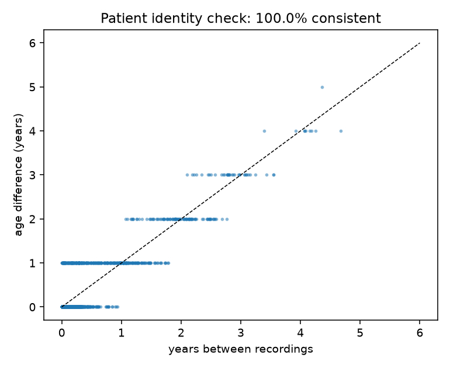
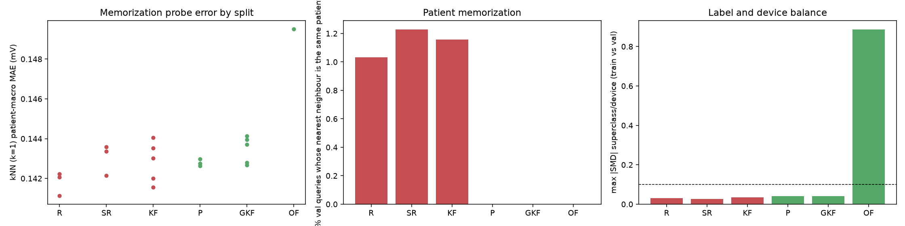
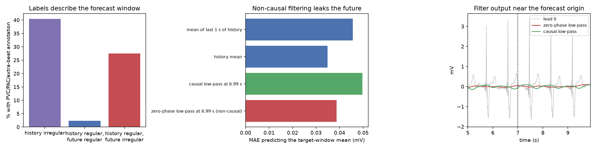

# Phase 4 report: data leakage prevention

Cleaned folds 1–9 (19,571 records, 16,945 patients, 990 samples; D3.1/D3.4). For
fold 10 only identifiers (`ecg_id`, `patient_id`, `strat_fold`) were read. The
hypotheses were fixed in [PREREGISTRATION.md](PREREGISTRATION.md).

Reproduce (~80 s on 38 cores): `uv run python research/phase4_leakage.py`. Guards are
tested in `tests/test_leakage.py` and `tests/test_data.py`.

## 1. Verdict

| | Hypothesis | Result | Outcome |
|---|---|---|---|
| H4.1 | Folds are patient-disjoint; IDs credible | 0 of 18,869 patients in more than one of train/val/test; sex constant 100%; age vs date consistent 100% (2,602 pairs) | **Accepted** |
| H4.2 | Patient overlap biases validation optimistically | Record-level split 0.98 µV (0.7%) lower kNN MAE than patient-level (SD 0.46 µV over 3 seeds; mean > 2 SD) | **Accepted** (small effect) |
| H4.3 | Full-record labels leak the future | Extra-beat annotations 27.5% vs 2.4% (**11.6×**) | **Accepted** |
| H4.4 | Non-causal preprocessing leaks the future | Zero-phase low-pass predicts the target-window level **22%** better than the causal version | **Accepted** |

**Selected strategy: patient-level splits only, with the official folds (train 1–8,
validate 9, test 10).** Five leakage channels exist in this task, and each now has a
code-level guard (§6).

The two channels that matter most here are not the classic patient overlap:

1. **Labels and reports describe the forecast window**, so they can never be inputs.
2. **Non-causal per-record preprocessing**, which is very common in ECG pipelines,
   leaks the future into the history.

**Decision (2026-11-22): GO to Phase 5** (D4.5).

## 2. Patient identifiers and fold disjointness (H4.1)

| Check | Result |
|---|---|
| `ecg_id` unique (all 21,799 records) | yes |
| Patients appearing in more than one of train (1–8) / val (9) / test (10) | **0** |
| Patients per partition (before cleaning) | train 15,023 · val 1,942 · test 1,904 |
| Sex constant within patient (1,883 multi-record patients, folds 1–9) | 100% |
| \|Δage − Δyears between recordings\| ≤ 1.5 (2,602 pairs, ages > 89 excluded) | 100% |
| Cross-patient near-duplicates (Phase 3) | 0 |

`patient_id` is a reliable grouping key, and no record of the same person appears
under a different ID at the waveform level.

## 3. Split strategies compared (H4.2)

The memorization probe is a nearest-neighbour forecaster. It matches the 2 s before
the last R peak of the history (detected on the history only) against R-peak-anchored
segments of training records, then copies the neighbour's continuation. It can only
do well by finding similar recordings. Query coverage was 99.7%.

| Strategy | Validation records whose patient is in training | Nearest neighbour = same patient | kNN MAE k=1 (mV, mean ± SD) | Max \|SMD\| superclass/device | Runs |
|---|---:|---:|---:|---:|---:|
| R random, record-level | 20.1% | 1.03% | 0.1418 ± 0.0006 | 0.03 | 3 |
| SR stratified, record-level | 20.1% | 1.23% | 0.1430 ± 0.0008 | 0.03 | 3 |
| KF 5-fold, record-level | 20.0% | 1.16% | 0.1428 ± 0.0010 | 0.04 | 5 |
| **P patient holdout** | **0%** | **0%** | 0.1428 ± 0.0002 | 0.04 | 3 |
| **GKF patient 5-fold** | **0%** | **0%** | 0.1435 ± 0.0007 | 0.04 | 5 |
| **OF official folds (1–8 / 9)** | **0%** | **0%** | 0.1495 | **0.89** (device) | 1 |

- **Record-level splits put about 20% of validation records alongside their own
  patient in training.** That is optimistic by 0.7% on average. In all 11
  record-level runs (R, SR, KF), those records scored better than the rest: 3.2%
  lower MAE on average (0.1389 vs 0.1435 mV).
- **The effect is small *for this probe*** because each forecast depends mostly on
  the record's own history; only about 1% of queries actually retrieve their own
  patient. A higher-capacity network can memorize far more. Phase 0/Week 5 symptoms
  ("predictions resembled training signals") are exactly that risk. Patient-level
  splitting removes the channel completely, so its size need not be known.
- **Label stratification does not reduce leakage.** SR leaks as much as R.
- **The official folds are the only option with a large train/validation
  imbalance**, from the device shift (Phase 2) and human validation by design. Fold 9
  is therefore harder (0.150 vs 0.143 mV) and probably resembles fold 10.

| Strategy | Advantages | Disadvantages | Leakage risk |
|---|---|---|---|
| Random (record) | simple, balanced | patient overlap | **high** |
| Stratified (record) | balanced labels | patient overlap is unchanged | **high** |
| Patient holdout | no overlap, balanced | one random split; not comparable with the literature | none |
| GroupKFold (patient) | no overlap; uses all data; variance estimate | k × cost; folds mix human-validated and automatic labels | none |
| **Official folds** | no overlap; label-stratified; standard benchmark; matches the test fold's design | validation is device-shifted vs training | none |

## 4. Metadata leakage (H4.3)

The analysis used 15,592 records whose history has regular RR intervals:

| Group | Records | PVC/PAC/extra-beat annotated |
|---|---:|---:|
| Regular history, regular target window | 14,802 | 2.4% |
| **Regular history, irregular target window** | 790 | **27.5%** |
| (For reference) irregular history | – | 40.4% |

The SCP statements, `extra_beats`, quality flags, `report` text and heart axis were
all produced by reading the **whole 10 s**. A model given them as inputs would be told
about events in the window it must predict. These fields are now on a deny-list
(`FULL_RECORD_DERIVED`).

**Allowed conditioning inputs** (`ALLOWED_INPUT_METADATA`) are the fields known at
recording time: age (and "> 89"), sex, height, weight, device. Anything else needs an
explicit decision. Labels may still be used to **stratify evaluation** (Phase 14);
that is not an input.

## 5. Preprocessing leakage (H4.4)

Predicting each lead's mean over the target window from information at 6.99 s:

| Predictor | MAE (mV) |
|---|---:|
| 0.67 Hz low-pass at 6.99 s, **zero-phase over the whole record** | 0.0387 |
| Same filter, **causal** | 0.0497 |
| History mean | 0.0349 |
| Mean of the last 1 s of history | 0.0456 |

The zero-phase filter is 22% better than its causal twin only because it averages
in samples *after* 7 s.

Change in the history caused by altering only the future, on one example record:

| Transform | Max change in the history output | Leaks? |
|---|---:|---|
| Causal low-pass (`sosfilt`) | 0 | no |
| History-only z-score | 0 | no |
| Zero-phase low-pass (`sosfiltfilt`) on the whole record | 0.23 mV | **yes** |
| NeuroKit2 `ecg_clean` on the whole record | 0.15 mV | **yes** |
| Whole-record z-score | 5.19 (z units) | **yes** |

R peaks detected on the whole record differ in the history region for 1.4% of records.

Earlier work audited against this rule:
- Phase 0's `sn4` baseline detected peaks on the history only, so it is causal.
- Phase 0's "oracle" deliberately uses the future and is labelled as such.
- The Week 5 pipeline filtered the observed history causally.

## 6. Guards put in place ("leakage eliminated" means enforced, not assumed)

| Channel | Guard | Test |
|---|---|---|
| Test fold | `SealedFoldError` unless `data.allow_test` (part of the config hash) | `test_test_fold_is_sealed`, `test_load_dataset_excludes_defects_and_trims` |
| Patient overlap | Only patient-level splitters exist (`splits.official_split`, `patient_holdout`, `group_kfold`); each calls `assert_disjoint` | `test_patient_splits_are_disjoint_and_complete`, `test_assert_disjoint_detects_shared_patient` |
| Future → history (within a record) | `data.split_window` is the single place where history and target are separated; every per-record transform must pass `causality_violation == 0` | `test_causality_check_separates_causal_from_zero_phase_filters` |
| Validation/test → fitted statistics | Every fitted transform records the IDs it was fitted on and calls `assert_fitted_on(fit_ids, train_ids)` | `test_fit_and_metadata_guards` |
| Metadata | `check_input_columns` allows only recording-time fields | `test_fit_and_metadata_guards` |
| Defects / end artifact | Deterministic rules on load, identical for every fold (D3.1/D3.4) | `test_defect_rules` |

**Binding rules for Phase 5 and later:**

1. Each preprocessing step is either
   - a **per-record function of the history only** (causal, or zero-phase applied
     to the 700 history samples), or
   - a **statistic fitted on training records only**.
2. The **target stays raw mV** for evaluation. Any target transform used in training
   must be inverted before scoring.
3. No PTB-XL statement, flag or report is a model input.

## 7. Limitations

- The kNN probe is one memorizer. Its small effect is a lower bound on what deep
  models could exploit; the patient-level split makes the magnitude irrelevant.
- `patient_id` reliability was checked through sex/age/date consistency and the
  absence of cross-patient near-duplicates. A person registered under two IDs with
  different-looking ECGs cannot be detected from the data.
- Holdout (official folds) vs GroupKFold for validation, and how to handle fold 9's
  device shift, are Phase 8 decisions.
