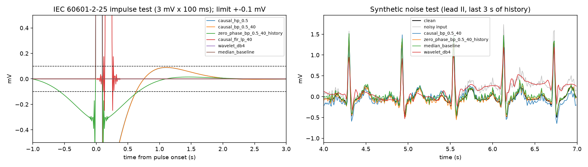
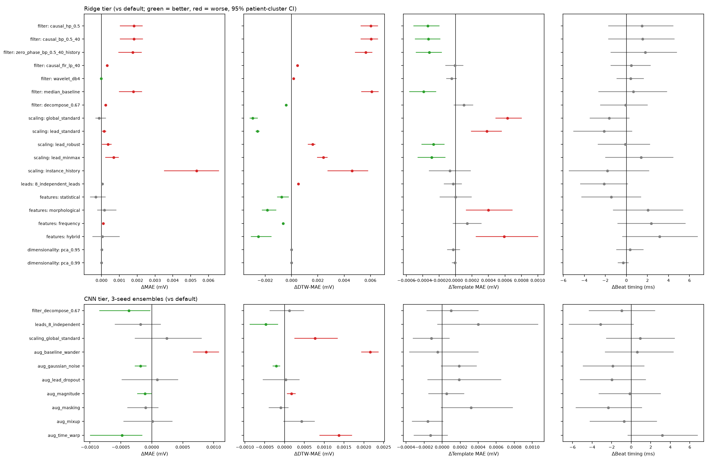
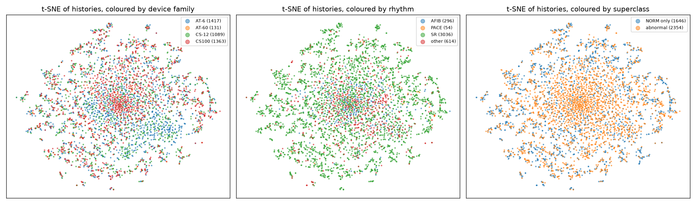

# Phase 5 report: preprocessing comparison

Training: cleaned folds 1–8 (17,392 records). Comparison: fold 9 (2,179). Task 7 s →
2.9 s, raw-mV target. Plan, candidates and decision rule:
[PREREGISTRATION.md](PREREGISTRATION.md). Scoring: Phase 6 suite and rule (D6.2).
Every per-record transform sees the history only (D4.3); every fitted statistic is
fitted on training records only (`assert_fitted_on`, D4.4).

Reproduce (CPU, 38 cores; the cache makes reruns cheap):

```sh
uv run python research/phase5_signal_level.py              # S1/S2, ~1 min
uv run python research/phase5_ridge.py                     # 20 ridge variants + t-SNE, ~25 min without contention
uv run python research/phase5_cnn.py --stage augment       # 8 variants x 3 seeds, ~16 min
uv run python research/phase5_cnn.py --stage shortlist     # 4 variants x 3 seeds, ~6 min
uv run python research/phase5_figures.py
uv run python research/phase5_replication.py               # §10, 9 runs, ~6 min
```

> **Revision (Phase 7, D7.1).** Before the fix, `train_forecaster` did not seed the
> CNN's initial weights. All CNN results in §4–§6 are therefore from a **seeded
> re-run**; the original, unseeded results are kept in
> [`unseeded_replicate/`](unseeded_replicate/). Two verdicts changed and were tested
> with three further seeds (§10). The ridge tier and signal-level tests are
> deterministic and unaffected.

## 1. Verdict

**Adopted pipeline: raw-mV target, no scaling, 12 leads, no engineered features, no
dimensionality reduction, no augmentation, and the input decomposed into a causal
0.67 Hz baseline and residual (D5.11, adopted 2026-11-22 after the Phase 7 re-run).**
The decomposition passed the rule and its pre-specified replication, with a very small
gain (−0.34 µV, 0.4% of MAE). Every other candidate failed the pre-registered rule.

| Category | Outcome | Main evidence |
|---|---|---|
| Missing values | not applicable (D5.2) | 0 missing samples; defect records excluded |
| Noise / baseline filters | **all rejected**; lossless input decomposition **adopted** (D5.11) | No filter preserves morphology (S2: best template correlation 0.980 vs ≥ 0.99 required); every 0.5 Hz Butterworth fails the IEC impulse test; with ridge, every baseline filter raises MAE (+1.8 µV). The decomposition (input = causal baseline + residual; target unchanged) gains 0.34–0.39 µV in two seeded replicates (§10), but not in the unseeded run |
| Scaling | **none adopted** | No scaler beats raw mV with ridge or with the CNN; per-record (history) normalization is clearly worse (+5.3 µV with ridge) |
| Feature engineering | **none adopted** | No feature set lowers MAE significantly (ridge) |
| Dimensionality | **none adopted**; autoencoder and UMAP not built (rule 5) | PCA is neutral (95% of variance needs 1,113 components); 8 independent leads: MAE n.s., better DTW, template MAE worse (significant in the unseeded run, +0.4 µV n.s. in the seeded run) |
| Augmentation | **none adopted** | Gaussian noise passed the rule in the seeded run but **failed replication** (§10); time warping lowers MAE (−0.5 µV) but worsens DTW (+1.4 µV); the rest are neutral or worse |

**The most important finding is not about preprocessing.** The CNN reference beats
the flat line on everything, but it **does not beat `sn4`** (§6). It has much lower
MAE but worse shape, morphology and rhythm: a blurred average forecast, as Phases 0
and 6 predicted. **Preprocessing is not the bottleneck; the learning objective and
the model's handling of beat timing are.**

**Decision (2026-11-22): GO to Phase 7** (D5.10).

## 2. Filters at signal level (S1, S2)

500 low-noise training records, with synthetic baseline wander (0.5 mV) and EMG-like
noise (0.05 mV RMS):

| Filter | S1 displacement (mV; limit 0.1) | S1 | Template correlation (≥ 0.99) | ST error (mV; ≤ 0.05) | RMSE vs clean (mV) | ms/record | S2 |
|---|---:|:-:|---:|---:|---:|---:|:-:|
| none (noisy input) | 0 | ✓ | 0.917 | 0.050 | 0.252 | 0 | ✗ |
| causal high-pass 0.5 Hz | 1.17 | ✗ | 0.941 | 0.067 | 0.099 | 0.1 | ✗ |
| causal band-pass 0.5–40 Hz | 1.71 | ✗ | 0.927 | 0.070 | 0.101 | 0.1 | ✗ |
| zero-phase band-pass, history only | 0.57 | ✗ | **0.980** | **0.024** | **0.057** | 0.2 | ✗ |
| causal FIR low-pass 40 Hz | 0 | ✓ | −0.05 (150 ms delay) | 0.071 | 0.346 | 0.3 | ✗ |
| wavelet db4 | 0 | ✓ | 0.767 | 0.052 | 0.258 | 1.7 | ✗ |
| median baseline removal | 0 | ✓ | 0.964 | 0.038 | 0.061 | 10.4 | ✗ |



- **0.5 Hz Butterworth high-passes distort the ST segment.** This is the known reason
  diagnostic ECG standards specify 0.05 Hz or specially designed filters.
- **The FIR's 15-sample delay misaligns the most recent beats,** the ones that matter
  most for forecasting.
- **Universal-threshold wavelet denoising erodes QRS energy** at 100 Hz.
- **No filter meets S2's 0.99 threshold**, so none can be adopted (rule 3), whatever
  its effect on error.
- The decomposition (baseline + residual) is lossless and so exempt from S1/S2. It
  was still judged on learning performance.

## 3. Ridge tier (all variants)

Fold 9, patient-macro, Δ vs the default ridge (MAE 0.1106 mV), 95% patient-cluster
bootstrap CI:

| Category | Variant | MAE | ΔMAE (µV) [CI] | Beats default? |
|---|---|---:|---|:-:|
| – | default (raw mV) | 0.1106 | – | – |
| filter | causal HP / BP / zero-phase BP / median | 0.1124 | +1.8 [+1.0, +2.3] | ✗ |
| filter | FIR low-pass 40 Hz | 0.1109 | +0.3 [+0.3, +0.3] | ✗ |
| filter | wavelet db4 | 0.1106 | −0.03 [−0.03, −0.03] | ✗ (DTW worse; S2 fail) |
| filter | decomposition 0.67 Hz | 0.1108 | +0.2 [+0.2, +0.3] | ✗ |
| scaling | global standard | 0.1105 | −0.1 [−0.3, +0.2] | ✗ |
| scaling | lead standard / robust / min-max | 0.1108–0.1113 | +0.2 to +0.7 | ✗ |
| scaling | per-record (history) z-score | 0.1160 | +5.3 [+3.5, +6.6] | ✗ |
| leads | 8 independent (derive 4) | 0.1107 | +0.05 [−0.0, +0.1] | ✗ |
| features | statistical / morphological / frequency / hybrid | 0.1103–0.1108 | −0.3 to +0.2 (all CIs include 0 or > 0) | ✗ |
| dimensionality | PCA 95% (1,113 comp.) / 99% (2,158) | 0.1106 | 0.0 | ✗ |

Per-variant numbers: `table_ridge.csv`. λ was chosen on an internal patient holdout of
the training folds; the default selected λ = 3.2·10⁴, i.e. strong shrinkage.



**Why ridge cannot tell scalings apart.** A linear model with a strong penalty
converges to a damped average forecast. An affine rescaling of its inputs changes
little besides the effective penalty. That is why the CNN tier was pre-registered for
sequence transforms.

## 4. CNN tier: shortlist

The shortlist follows the pre-registered rule: up to two filters that pass S1/S2 or
are lossless (only the decomposition qualifies), the best scaler by ridge (global
standard), and 8 leads. Results are 3-seed ensembles; Δ vs the default CNN:

| Variant | Ensemble MAE | ΔMAE (µV) [CI] | ΔDTW (µV) | ΔTemplate (µV) | ΔTiming (ms) | Beats default? |
|---|---:|---|---|---|---|:-:|
| default | 0.0955 | – | – | – | – | – |
| decomposition 0.67 Hz | 0.0951 | **−0.37** [−0.84, −0.03] | +0.1 (n.s.) | +0.1 (n.s.) | −1.0 (n.s.) | ✓ (replicated, §10) |
| global standard scaling | 0.0957 | +0.2 [−0.3, +0.8] | **+0.8** [+0.3, +1.3] | n.s. | +0.9 (n.s.) | ✗ |
| 8 independent leads | 0.0953 | −0.2 [−0.6, +0.1] | **−0.5** [−0.9, −0.2] | +0.4 [−0.1, +1.1] | −3.1 (n.s.) | ✗ (MAE n.s.) |

Seed-to-seed SD of MAE is 0.2–0.3 µV, the same size as every effect above. In the
unseeded run the decomposition was +0.0 µV (n.s.), and 8 leads had a significantly
worse template MAE.

## 5. CNN tier: augmentation

Same CNN, default pipeline, 3 seeds each; Δ vs no augmentation:

| Augmentation | ΔMAE (µV) [CI] | Gatekeepers | Beats none? |
|---|---|---|:-:|
| Gaussian noise | **−0.18** [−0.27, −0.09] | DTW −0.2 (better) | ✓ here; **failed replication** (§10) |
| Magnitude scaling | −0.11 [−0.23, −0.01] | DTW +0.2 (worse) | ✗ |
| Baseline-wander injection | +0.9 [+0.7, +1.1] | DTW +2.2 (worse) | ✗ |
| Time warping (slowing only) | **−0.48** [−0.99, −0.16] | **DTW +1.4 (worse)**; timing +3 ms (n.s.) | ✗ |
| Masking | −0.1 [−0.4, +0.1] | n.s. | ✗ |
| Mixup | +0.0 [−0.5, +0.3] | n.s. | ✗ |
| Lead dropout | +0.1 [−0.5, +0.4] | n.s. | ✗ |

The CNN barely overfits (default: training L1 0.093 vs holdout 0.096; best epoch 9–37
across all runs), so regularizing augmentation has little to fix. Time warping gives
the largest MAE gain in both replicates, and in both it is bought with worse DTW. That
fits a model that profits from blurring beats. In the unseeded run Gaussian noise was
significantly *worse* (+0.3 µV); the sign of effects this small depends on the
training run.

Training time without CPU contention: 2.9–7.6 min per run (4 threads). (The unseeded
augmentation runs shared the CPU with the ridge tier and took 13–50 min.)

## 6. Reference CNN vs baselines (D6.2 rule, fold 9)

| Default CNN vs | ΔMAE (mV) [CI] | ΔDTW (mV) | ΔTemplate (mV) | ΔBeat timing (ms) | Beats it? |
|---|---|---|---|---|:-:|
| Flat (history median) | **−0.020** [−0.022, −0.017] | −0.026 | +0.00001 (n.s.) | −39 | **yes** |
| `sn4` (repeat cycles) | **−0.027** [−0.029, −0.023] | **+0.009** | **+0.040** | **+170** | **no** |

The CNN's ensemble beat timing is 259 ms (0.2% of records within 50 ms), against 89 ms
(43%) for `sn4`. Its template MAE (0.105 mV) equals the flat line's. It predicts the
level and the average shape, not beats. (Unseeded run: the same verdicts, with
differences of at most 1 ms and 0.5 µV.)

**Lead consistency.** 19% of the CNN's 12-lead forecasts break the limb-lead relations
by more than 0.01 mV (median 0.007 mV, vs 0.0005 mV in real ECGs). The measure is,
per record, the largest RMS violation of III = II − I, aVR = −(I + II)/2,
aVL = I − II/2 and aVF = II − I/2 (`phase5_cnn.py`, `limb_residual`). Predicting 8 leads
and deriving 4 prevents this by construction at no MAE cost. It was not adopted here
because it does not beat the default (MAE n.s.; template MAE worse in the unseeded
run). Phase 9 should revisit it (Phase 13 checks lead consistency).

## 7. t-SNE (analysis only)



4,000 training histories (8 leads, per-record normalized):
- **AFIB and abnormal records concentrate in the dense centre.** Sinus/NORM records
  form many small peripheral clusters, probably histories that look alike in heart
  rate and beat phase.
- **Device families overlap widely,** with only partial concentration (CS100 toward the
  centre). Phase 2's device effect is therefore mostly a low-frequency or level
  difference rather than a distinct waveform shape.
- **t-SNE distances are not globally meaningful;** this view is descriptive only.

## 8. Disclosures and limitations

- **Ridge λ grid:** the robust-scaling variant chose λ at the top edge of the grid.
  The grid now extends automatically when the optimum is at an edge (reusing the
  eigendecomposition). Only that variant was refitted; every other variant had an
  interior λ and is unaffected by construction.
- **S1 test harness corrections:** for linear-phase FIR filters the pulse region was
  shifted by the group delay and the filter's support (otherwise the delayed pulse
  and its ringing counted as "displacement"). The wavelet function now skips
  thresholding when the noise estimate is 0 (previously a NaN on flat input).
- **Time warping only slows** the record (factor 0.95–1); speeding up would need
  samples beyond the 10 s record.
- **Results are for two reference learners** (ridge; a 1.8 M-parameter CNN with L1
  loss). LSTMs or Transformers may respond differently to scaling or augmentation.
  Phase 18 ablations re-check this with the selected model.
- **The synthetic noise in S2 is one noise model.** Filters were rejected on
  morphology criteria that hold regardless of their effect on error.

## 9. Implications for later phases

| Phase | Implication |
|---|---|
| 7 Data efficiency | Use the default pipeline; the CNN reference costs about 4.5 min per run on 4 threads |
| 8 Validation | Comparisons of 3-seed ensembles can change verdict between training runs for effects ≤ 0.5 µV (§10). The comparison protocol must account for training randomness |
| 9 Models | Every model must beat **both** flat (MAE) and `sn4` (gatekeepers). An L1-trained CNN does not. Shape- and timing-aware objectives and explicit rhythm modelling are the levers; 8-lead output is a strong candidate (lead consistency, 32% fewer parameters) |
| 10/11 Training | Training is short (best epoch 9–37), and small CNNs barely overfit, so capacity and objective matter more than regularization |

## 10. Addendum: initialization fix and replication

**What went wrong.** `train_forecaster` seeded the RNGs *after* the model had been
built. PyTorch seeds each new process randomly, so every CNN's initial weights were
random and unrecorded; the seed fixed only the batch order and augmentation. Phase 7's
bitwise check exposed it: the 100% runs could not reproduce Phase 5. The fix (D7.1)
re-initializes every layer after seeding, with a regression test
(`test_initial_weights_depend_only_on_seed`). All CNN runs were repeated with seeds
42/123/999. The script that wrote `cnn_vs_baselines.json` was also missing; it is now
`vs_baselines()` in `phase5_cnn.py`, checked to reproduce the original file exactly
from the original predictions.

**Replication.** Two verdicts changed between the unseeded and seeded runs. Both were
tested with three new seeds (7/2024/31337) under a criterion written before the runs
([REPLICATION_PREREGISTRATION.md](REPLICATION_PREREGISTRATION.md);
`replication.json`). ΔMAE vs default in µV [95% CI]:

| Variant | Unseeded | Seeds 42/123/999 | Seeds 7/2024/31337 | 6-seed ensembles | Verdict |
|---|---|---|---|---|---|
| Gaussian noise | +0.31 [+0.08, +0.71] | −0.18 [−0.27, −0.09] | +0.15 [−0.07, +0.35]; DTW +0.4 (worse) | +0.04 [−0.06, +0.12] | **not robust → not adopted** |
| Decomposition 0.67 Hz | +0.01 [−0.26, +0.36] | −0.37 [−0.84, −0.03] | **−0.39** [−0.66, −0.20]; DTW −0.4 (better) | **−0.34** [−0.67, −0.12]; gatekeepers n.s. | **replicates → adopted (D5.11)** |

**Interpretation.**
- The decomposition's gain is small but consistent in both seeded replicates. The
  unseeded run showed no gain (+0.01 µV), so 2 of 3 independent 3-seed replicates
  show it. It gives the network an explicit causal baseline estimate. It does not
  change the target and loses no information.
- At 0.4% of MAE the gain is practically small. It was adopted because the criterion
  was fixed in advance (D5.11, user decision); Phase 18 ablates it.
- **General lesson:** the D6.2 bootstrap resamples patients, not training runs. For
  effects ≤ 0.5 µV, run-to-run variance decides the verdict. Phase 8 must set a
  comparison protocol that includes it.
