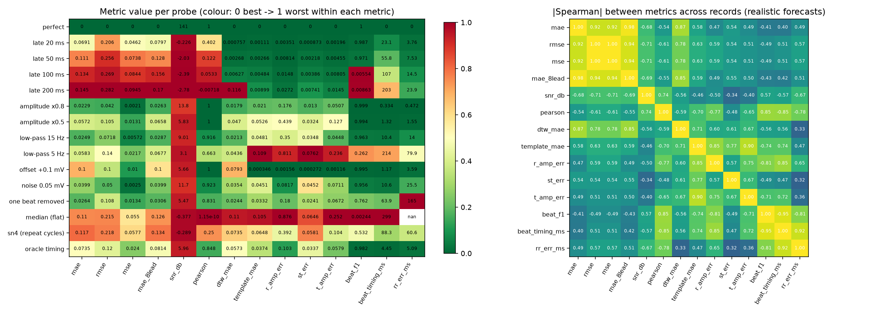
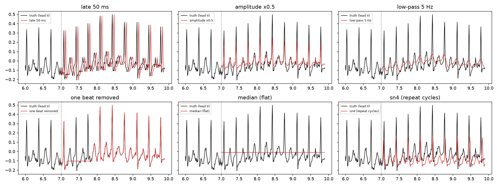

# Phase 6 report: evaluation framework

Cleaned folds 1–9 (19,571 records), task 7 s → 2.9 s, raw-mV target. No model was
trained. The axioms and suite rule were fixed in
[PREREGISTRATION.md](PREREGISTRATION.md). One metric was added post hoc and is marked
**[post hoc]**.

Reproduce (~90 s on 38 cores): `uv run python research/phase6_metrics.py`. The metrics
live in `ptbxl_forecast.metrics` (tests: `tests/test_metrics.py`); aggregation and
bootstrap in `ptbxl_forecast.stats`.

## 1. Verdict

**Pointwise metrics alone cannot evaluate this task.** A perfectly shaped forecast that
is only **50 ms late** scores **worse** than a flat line on MAE (0.1106 vs 0.1097 mV),
RMSE, MSE, 8-lead MAE and SNR (axiom A1 fails for all five).

This is the formal reason MAE/MSE-trained forecasters drift towards flat or blurred
outputs (Phase 0, §4). It is also why earlier models could "win" on MAE while being
physiologically useless.

**Final suite** (pre-registered rule: family axioms → redundancy → coverage):

| Role | Metric | Unit | Aspect |
|---|---|---|---|
| **Primary** | MAE, 12 leads, patient-macro | mV | pointwise accuracy |
| **Gatekeeper** | DTW-MAE (±100 ms band) | mV | timing-tolerant shape |
| **Gatekeeper** | Beat-template MAE | mV | morphology |
| **Gatekeeper** | Beat-timing error **[post hoc]** | ms | rhythm |
| Diagnostic | R / ST / T amplitude errors | mV | clinical morphology |
| Diagnostic | Pearson r, SNR | –, dB | shape correlation, energy |
| Reported only | RMSE, 8-lead MAE, beat F1, RR error, MAE per lead time | – | comparability with the literature |

**Decision rule.** Model A beats B (or a baseline) only if **both** of these hold:
- the patient-cluster bootstrap 95% CI of the paired MAE difference is entirely below 0;
- for **each gatekeeper**, the CI of the paired difference is not entirely on the
  worse side.

Everything is reported overall, per device family and per signal-quality stratum.

**Decision (2026-11-22): beat-timing gatekeeper approved (D6.3); GO to Phase 5 (D6.5).** Thresholds: §8 (D6.6).

## 2. Candidate metrics compared

| Metric | What it measures | What it misses | Clinical relevance | Engineering relevance | Family axioms | Discrimination (`sn4` vs flat) | ms/record |
|---|---|---|---|---|---|---:|---:|
| **MAE** | average absolute deviation | timing tolerance; prefers flat lines (A1 fails) | low; mV not tied to findings | robust, interpretable, MAE-optimal constant = median | pass | +0.18 (flat better) | 0.1 |
| RMSE / MSE | squared error, outlier-sensitive | as MAE; dominated by QRS misalignment | low | matches the MSE loss | pass; redundant with MAE (ρ 0.92) | +0.04 | 0.1 |
| SNR (dB) | error energy relative to signal | as MAE; the raw-signal energy includes baseline | low | common in denoising work | pass | −0.03 | 0.1 |
| Pearson r | linear shape agreement | amplitude (scale-invariant), level | moderate | standard, bounded | pass | −0.84 | 0.1 |
| **DTW-MAE** | shape with ±100 ms timing tolerance | rhythm errors under 100 ms; equals MAE for flat forecasts | moderate | robust to phase jitter | pass (all) | −0.86 | 0.7 |
| **Template MAE** | median-beat morphology, baseline-independent | timing/rhythm; beat-to-beat variation | **high** (P-QRS-T shape) | needs beat detection | pass (0.4% undefined: no full true beat) | −0.74 | ~6.5 (cached truth) |
| R / ST / T amplitude errors | QRS voltage, ST deviation, T-wave amplitude | durations (10 ms resolution at 100 Hz) | **high** (LVH, ischemia, T-wave abnormalities) | interpretable in mV | pass; ST weakly discriminative (−0.07) | −1.55 / −0.07 / −0.96 | incl. |
| Beat F1 (±50 ms) | beat detection agreement | saturates beyond 50 ms (non-monotone) | moderate | standard detection metric | **fails A2** | −1.30 | incl. |
| RR error | mean heart-rate error | undefined without beats (NaN for flat) | moderate | – | **fails A1, A6** | – | incl. |
| **Beat-timing error** [post hoc] | symmetric distance between beats, capped at 300 ms | morphology | **high** (rhythm, HRV) | defined for every forecast | **pass (all)** | **−2.70** (strongest) | incl. |

Discrimination is the standardized paired difference (per patient) between `sn4`
and the flat median forecast. Negative means `sn4` (a real ECG shape) scores better.
Oracle vs `sn4` discrimination is −0.33 to −1.92 on every metric
(`table_discrimination.csv`).

## 3. What each metric rewards (probe matrix)

Selected rows (patient-macro, folds 1–9):

| Probe | MAE | DTW | Template | Beat timing (ms) | Pearson |
|---|---:|---:|---:|---:|---:|
| Perfect | 0 | 0 | 0 | 0 | 1 |
| 20 ms late | 0.069 | 0.001 | 0.001 | 23 | 0.40 |
| **50 ms late** | **0.111** | 0.003 | 0.003 | 56 | 0.12 |
| 200 ms late | 0.145 | 0.116 | 0.009 | 203 | −0.01 |
| Amplitude ×0.5 | 0.057 | 0.047 | 0.053 | 1.3 | 1.00 |
| Low-pass 5 Hz | 0.058 | 0.044 | 0.109 | 214 | 0.66 |
| One beat removed | 0.026 | 0.024 | 0.033 | 64 | 0.83 |
| **Flat (history median)** | **0.110** | 0.110 | 0.105 | 299 | 0 |
| `sn4` (repeat cycles) | 0.117 | 0.074 | 0.065 | 88 | 0.25 |
| Oracle timing | 0.074 | 0.057 | 0.037 | 4 | 0.85 |

How to read it:
- **MAE ranks the flat line ahead of a correctly shaped ECG** that is 50 ms late,
  and ahead of `sn4`.
- **DTW and the template forget timing** within ±100 ms, but not amplitude or
  blurring.
- **Beat timing catches what the others forgive:** a 5 Hz low-pass (blurred QRS, so
  beats become undetectable: 214 ms) and a missing beat (64 ms).
- **No single metric is sufficient,** which is why the primary metric comes with
  gatekeepers.

## 4. Redundancy (realistic forecasts, |Spearman| across records)

- **RMSE and MSE** duplicate MAE (0.92) and were dropped from decisions.
- **Every gatekeeper is clearly distinct from MAE:** DTW 0.87, template 0.58,
  beat timing 0.40.
- **Beat timing and beat F1** overlap (0.95). F1 was excluded by its axiom failure,
  not by redundancy.

## 5. Baselines every model must beat (fold 9, validation)

95% patient-cluster bootstrap CIs, 2,179 records:

| Forecast | MAE (mV) | DTW-MAE (mV) | Template MAE (mV) | Beat timing (ms) |
|---|---|---|---|---|
| Flat (history median) | **0.1156** [0.1130, 0.1182] | 0.1156 | 0.1046 | 298 |
| `sn4` (repeat cycles) | 0.1220 [0.1193, 0.1249] | **0.0799** [0.0774, 0.0826] | **0.0643** [0.0621, 0.0666] | **89** [86, 93] |
| Oracle timing (uses the future; a reference ceiling, not a baseline) | 0.0827 | 0.0655 | 0.0386 | 5 |

The strongest baseline differs by metric: flat for MAE, `sn4` for all gatekeepers.
A useful model must beat the flat line on MAE **without** being worse than `sn4` on
shape, morphology and rhythm. The full table (all metrics, also for folds 1–9) is in
`table_baseline_reference.csv`.

## 6. Disclosures

- **The beat-timing error was added after seeing that no pre-registered rhythm
  metric satisfied the axioms.** Beat F1 fails A2 because it saturates beyond its
  tolerance. RR error is undefined for beatless forecasts. The new metric was
  evaluated on the same probes and passes everything. Its use as a gatekeeper needs
  your approval (D6.3).
- **My first implementation of the suite rule applied only the redundancy filter,
  not the axiom filter.** It kept beat F1 and dropped beat timing. This was corrected
  so the pre-registered order holds.

## 7. Limitations and implications

- Beat-based metrics depend on R-peak detection (NeuroKit2) on forecasts.
  Unrealistic forecasts can confuse the detector; that is part of what they measure.
- At 100 Hz (10 ms resolution), QRS duration and QT interval are not reliably
  measurable and are excluded.
- Probabilistic metrics (CRPS) do not apply to point forecasts. They become relevant
  only if the project moves to probabilistic forecasting (Phase 0, §9).
- **For Phase 9/10:** a pure MAE/MSE loss optimizes the metric that fails A1.
  Shape-aware training objectives become candidates to be compared then.

## 8. What counts as an acceptable beat-timing error? (D6.6)

**The binding rule is relative (D6.2).** A model must not be significantly worse than
its comparator, and the floor is `sn4` (fold 9 mean 89 ms). An absolute gate would
be inappropriate because the achievable level depends on rhythm: for `sn4`, AFIB
averages 159 ms vs 79 ms for SR.

For interpretation, error analysis and the Phase 13 plausibility review, per-record
values are reported in bands, grounded in these fold 9 measurements:

| Forecast | Median | ≤ 25 ms | ≤ 50 ms | ≤ 150 ms |
|---|---:|---:|---:|---:|
| Perfect | 0 | 100% | 100% | 100% |
| Perfect + 0.05 mV noise (detector jitter) | 0 | 85% | 95% | 99% |
| Oracle timing | 0 | 92% | 98% | 99% |
| Perfect, 50 ms late | 50 | 0.3% | 82% | 99.8% |
| Repeat cycles with the **true future mean heart rate** | 38 | 41% | 57% | 85% |
| `sn4` (naive repeat cycles) | 65 | 27% | 43% | 78% |
| Flat line | 300 | 0.5% | 0.5% | 0.5% |

| Band | Meaning | Basis |
|---|---|---|
| ≤ 25 ms | within measurement noise | 85–92% of correctly timed forecasts land here; 2–3 samples at 100 Hz |
| ≤ 50 ms | **acceptable** | beats match under the ±50 ms tolerance; beat F1 collapses between 50 and 100 ms |
| 50–150 ms | misaligned | 150 ms is the AAMI EC57 beat-matching window |
| > 150 ms | rhythm failure | 300 ms = no beats |

Every model reports the patient-macro mean **and the share of records ≤ 50 ms**.
**Reference target:** ≥ 57% of records ≤ 50 ms means a model times beats better than
a forecaster that knows the exact future average heart rate. That would show
beat-level timing skill, which Phase 0 identified as the main obstacle.

Limitations:
- the values depend on NeuroKit2 R-peak detection on lead II (detector jitter has
  p90 ≈ 37 ms even when the timing is right);
- the 300 ms cap makes the metric insensitive beyond about half an RR interval.
