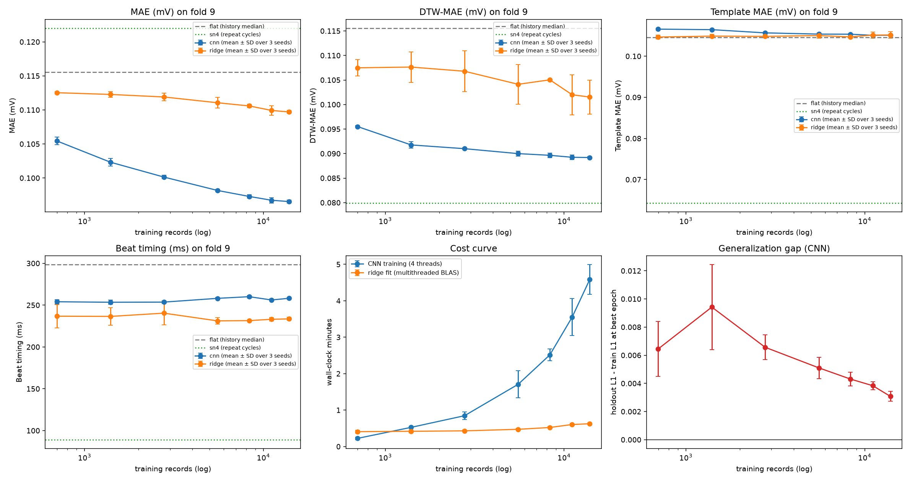

# Phase 7 report: data efficiency

Question: how much training data does the reference forecaster need, and does more
data fix its weaknesses? Design, definitions and hypotheses were fixed before any
computation: [PREREGISTRATION.md](PREREGISTRATION.md). Pool: cleaned folds 1–8 minus
the fixed internal patient holdout (13,904 records). Nested patient subsets of 5–100%,
3 seeds. Learners: the Phase 5 reference CNN (1.85 M parameters, L1) and ridge.
Evaluation: fold 9 (2,179 records) with the Phase 6 suite and the D6.2 rule.

Reproduce (CPU, about 30 min including ridge):

```sh
uv run python research/phase7_data_efficiency.py
```

**Decision (2026-11-22): GO to Phase 8** (D7.5). The learning curves use the raw-input
pipeline that was the default when the phase was pre-registered; D5.11 changes the
default for later phases.

Outputs: `table_runs.csv` (42 runs), `table_ensembles.csv` (3-seed CNN ensembles per
fraction), `summary.json`, `fig1_learning_curves.png`.

## 1. Verdict

| Item | Result | Robust? |
|---|---|---|
| Reproducibility check (100% runs bitwise equal to Phase 5) | **Failed at first.** This exposed a seeding bug (§5, D7.1). After the fix: **passed** for all 3 seeds | – |
| H7.1 MAE saturates (60% within 1% of 100%) | **Accepted:** +0.57% | yes (unseeded run: +0.22%) |
| H7.2 more data does not fix rhythm | **Accepted:** timing 20→100% changes by −0.5% (slightly worse); the 100% CNN is 170 ms worse than `sn4` | yes (unseeded: 0.9%, 167 ms) |
| H7.3 small data overfits more | **Accepted, narrowly:** gap 0.0064 at 5% vs 0.0031 at 100% (2.1×) | yes (unseeded: 2.1×) |
| Minimum useful size (beats flat under D6.2) | 20% (2,773 records) | **no** (unseeded: 80%) |
| Saturation point (within 1% and ΔMAE CI ∋ 0) | 80% (11,095 records) | **no** (unseeded: 60%) |
| First doubling with < 1% gain | 40→80% | **no** (unseeded: none) |

**Main conclusion. More data improves the CNN's MAE steadily but with diminishing
returns, and it does nothing for rhythm.** A power-law fit puts the MAE floor of this
model and objective at about 0.094 mV, 1.4 µV below the full pool. Beat timing is
about 258 ms at every size from 700 to 13,904 records. **Data quantity is not the
bottleneck;** the objective and the architecture are (confirms D5.9).

## 2. Learning curves



CNN 3-seed ensembles on fold 9 (patient-macro; Δ vs the 100% ensemble with 95%
patient-cluster bootstrap CI):

| Patients | Records | Ensemble MAE | ΔMAE vs 100% (µV) [CI] | DTW-MAE | Template MAE | Beat timing (ms) | Beats flat? | Beats `sn4`? |
|---:|---:|---:|---|---:|---:|---:|:-:|:-:|
| 5% | 699 | 0.1029 | +7.4 [+6.7, +8.1] | 0.0967 | 0.1051 | 256 | ✗ (template +0.5 µV) | ✗ |
| 10% | 1,395 | 0.0996 | +4.1 [+3.1, +4.8] | 0.0927 | 0.1050 | 259 | ✗ (template +0.4 µV) | ✗ |
| 20% | 2,773 | 0.0980 | +2.5 [+2.0, +3.0] | 0.0918 | 0.1047 | 258 | ✓ | ✗ |
| 40% | 5,537 | 0.0965 | +1.0 [+0.7, +1.3] | 0.0906 | 0.1048 | 259 | ✓ | ✗ |
| 60% | 8,320 | 0.0960 | +0.5 [+0.3, +0.7] | 0.0901 | 0.1045 | 259 | ✓ | ✗ |
| 80% | 11,095 | 0.0956 | +0.1 [−0.1, +0.3] | 0.0896 | 0.1047 | 257 | ✓ | ✗ |
| 100% | 13,904 | 0.0955 | – | 0.0894 | 0.1046 | 259 | ✓ | ✗ |
| *flat* | – | *0.1156* | | *0.1156* | *0.1046* | *298* | | |
| *`sn4`* | – | *0.1220* | | *0.0799* | *0.0643* | *89* | | |

- **MAE and DTW improve monotonically.** Each doubling gains 3.2%, 1.6%, 1.5% and
  then 0.96% (40→80%).
- **Even 5% (700 records) beats flat clearly on MAE (−12.7 µV), DTW and timing.** The
  CNN fails the flat comparison at 5–10% only through template MAE, where it is
  0.4–0.5 µV worse. At every size its template MAE is within ±0.5 µV of the flat
  line's. In other words, the CNN never learns beat morphology at any data size.
  "Minimum useful size" therefore depends on noise in one gatekeeper and is not a
  stable quantity (20% here, 80% in the unseeded run).
- **Beat timing is flat:** 253–260 ms at every size, against 89 ms for `sn4` and
  298 ms for flat. Only 0.1–0.2% of records are within 50 ms.
- **Ensembling is worth more than the last 40% of data.** At 100%, the seed-mean
  single-model MAE is 0.0965 and the 3-seed ensemble's is 0.0955 (−1.1 µV). Going from
  60% to 100% of the data gains 0.5 µV.
- **Ridge:** MAE 0.1125 → 0.1097 (−2.5%) from 5 to 100%, always well behind the CNN on
  MAE and DTW. Its beat timing (231–240 ms) is better than the CNN's at every size,
  although neither is close to `sn4`. Ridge's DTW varies a lot between seeds (SD up to
  4 µV), because λ is chosen on a small internal holdout.

**Power-law extrapolation (descriptive).** MAE(n) = 0.0941 + 0.515·n^−0.62 fits the
ensemble curve within 0.2 µV. It predicts 0.0953 mV when training on all of folds 1–8
(17,392 records, −0.2 µV) and 0.0950 mV at twice the pool (−0.5 µV). Both are well
inside the seed-to-seed spread (SD 0.2–0.3 µV). For reference, the timing oracle's
MAE is 0.0827 mV (Phase 6). Most of the remaining gap to it is unreachable by adding
data under this model and objective.

## 3. Overfitting

| Patients | 5% | 10% | 20% | 40% | 60% | 80% | 100% |
|---|---:|---:|---:|---:|---:|---:|---:|
| Gap (holdout L1 − train L1 at best epoch), seed mean | 0.0064 | 0.0094 | 0.0066 | 0.0051 | 0.0043 | 0.0038 | 0.0031 |
| Best epoch (mean) | 12 | 17 | 15 | 17 | 18 | 20 | 21 |

The gap shrinks with data from 10% upwards and halves between 5% and 100% (H7.3). The
5% value is below the 10% value: with only 700 records, early stopping halts at about
epoch 12, before the model can fit the training set closely. Even at 5% the gap is
6 µV, which is small next to MAE differences between sizes. Small data mainly costs
**fit**, not generalization.

## 4. Cost

| Patients | 5% | 20% | 40% | 100% |
|---|---:|---:|---:|---:|
| CNN training (min, 4 threads) | 0.2 | 0.8 | 1.7 | 4.6 |
| Ridge fit (min, multithreaded BLAS) | 0.4 | 0.4 | 0.5 | 0.6 |

CNN cost grows roughly linearly with the number of records and the number of epochs. On
this 40-core CPU, 9 runs in parallel train 21 CNNs (all fractions × 3 seeds) in
5.6 min.

## 5. Disclosures

- **Seeding bug (D7.1), found by this phase's pre-registered check.**
  `train_forecaster` set the seed after the model had been built, so the initial
  weights were unseeded in Phases 5 and 7. Fix: re-initialize every layer after
  seeding (`reinit=True` by default; `reinit=False` for fine-tuning), with a
  regression test that fails without the fix. Phase 5's CNN tier and this phase were
  re-run. The pre-fix results are kept as an independent replicate in
  [`unseeded_replicate/`](unseeded_replicate/), and §1's "Robust?" column compares
  against them.
- **Consequence for Phase 5:** two verdicts changed. A pre-specified replication
  showed that Gaussian-noise augmentation is not robust, and that the 0.67 Hz input
  decomposition is (−0.34 µV; adopted as D5.11; Phase 5 report §10).
- **The figure was corrected before reporting.** The first version joined individual
  seed points instead of plotting per-fraction means.
- **Columns added after the first run** (no change to any pre-registered quantity):
  per-metric differences vs flat (to explain the gatekeeper behaviour in §2) and the
  power-law fit.
- **Scope.** The results are for one CNN with an L1 objective and for ridge. Models
  with a timing-aware objective may have different data needs; Phase 9 should re-check
  the slope for its selected model.
- **Subsets are by patient** and nested, so a size effect is not confounded with a
  different patient mix. Device and diagnosis mix were not stratified; at 5% (600
  patients) the mix varies by seed.

## 6. Implications for later phases

| Phase | Implication |
|---|---|
| 8 Validation | (1) Use the full pool; the learning curve is not flat at 80–100% for MAE. (2) Training randomness changes verdicts for effects ≤ 0.5 µV (Phase 5 §10; "minimum useful size" here). The comparison protocol must include run-to-run variance, e.g. a seed-and-patient bootstrap or a replication requirement |
| 9 Models | More data will not fix rhythm. The levers are the objective (shape/timing-aware losses) and architecture (explicit rhythm or phase modelling). The bar stays: beat flat on MAE **and** `sn4` on the gatekeepers |
| 9/10 Screening | Training on 20% (≈ 0.8 min per run) keeps 88% of the full CNN's MAE gain over flat (60%: 97%). It could serve for cheap early screening, but whether it preserves model rankings is untested |
| 10/11 Training | 3-seed ensembles gain about 1 µV, more than the last 40% of data; report single-model and ensemble results separately |
