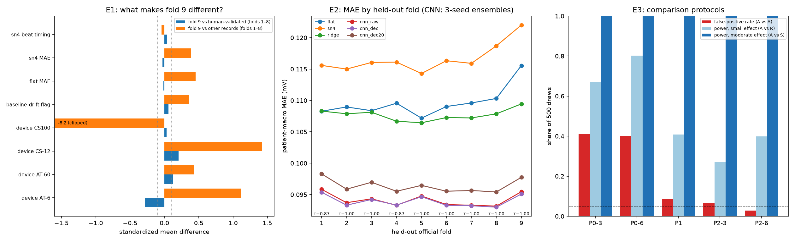
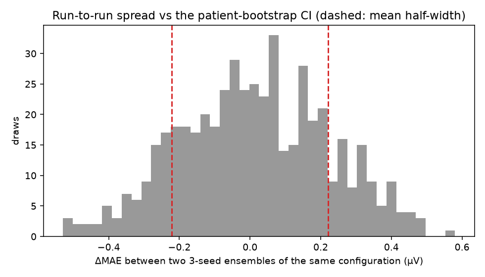

# Phase 8 report: validation strategy

Design, hypotheses and decision rules were fixed before any computation:
[PREREGISTRATION.md](PREREGISTRATION.md). Folds 1–9 only; fold 10 (signals and
metadata) stays sealed.

Reproduce (CPU, about 1 h on 40 cores; reruns use the cache):

```sh
uv run python research/phase8_validation.py
```

Outputs: `table_e1_representativeness.csv`, `table_cv.csv` (6 models × 9 folds, full
suite), `table_cv_pairs.csv`, `table_protocols.csv`, `summary.json`,
`fig1_validation.png`, `fig2_null_spread.png`. 130 CNN runs (118 new, 12 reused from
Phase 5 after a bitwise check), 9 ridge fits.

## 1. Verdict

| Hypothesis | Result | Key evidence |
|---|---|---|
| H8.1 fold-9 shift explained by human validation | **Rejected** (as pre-registered) | max \|SMD\| fold 9 vs validated records = 0.28 (AT-6 share) > 0.1. But the dominant shift (CS100) **is** explained: every non-validated record in folds 1–8 is CS100, and fold 9's difficulty matches the validated records (\|SMD\| ≤ 0.04) |
| H8.2 fold-9 holdout suffices for model selection | **Accepted** | Kendall τ(fold 9, CV mean) = 1.00; all 15 pairs significant across folds, and fold 9 agrees on all 15 |
| H8.3 fold 9 is out of range for every learned model | **Rejected** | True for ridge only. For the CNNs, fold 9 is about as hard as fold 1 (within 2 SD of folds 1–8) |
| H8.4 current comparison protocol anti-conservative | **Accepted, strongly** | False-positive rate **41%** (nominal 5%) |

**Main finding: the comparison rule used so far (D6.2: patient-cluster bootstrap
on 3-seed ensembles) declares two identically configured CNNs "significantly
different" in 41% of cases.** The patient bootstrap ignores run-to-run variance, and
for small effects that variance is as large as the CI. The pre-registered selection
rule picks **P2-6**: 6 independently trained runs per arm and a hierarchical bootstrap
over runs and patients. Its false-positive rate is 2.8%. It is now
`stats.compare_runs` (D8.3).

**Earlier decisions still stand.** Under P2-6, the decomposition (D5.11) still beats
raw input, and Gaussian noise still does not (§5). Effects against the baselines
(≥ 20 µV MAE, ≥ 40 ms timing) are far beyond the run-to-run spread.

**Decisions (2026-11-22):**
- fold 9 for selection (D8.1);
- P2-6 for MAE **and** the gatekeepers (D8.3);
- **GO to Phase 9** (D8.5).

Added by the user (D8.6): fold 9 is used for **screening**. A final winner among model
families must also win a multi-fold evaluation (9-fold CV if feasible, otherwise a
reduced multi-fold check).

## 2. E1 — What makes fold 9 different? (Q1, D2.3)

| Variable | Fold 9 (2,179) | Human-validated, folds 1–8 (11,662) | Other, folds 1–8 (5,730) | SMD 9 vs validated | SMD 9 vs other |
|---|---:|---:|---:|---:|---:|
| Device CS100 | 2.9% | 2.4% | **100%** | +0.03 | −8.2 (degenerate) |
| Device CS-12 | 50.3% | 40.2% | 0% | **+0.21** | +1.42 |
| Device AT-6 | 38.5% | 52.2% | 0% | **−0.28** | +1.12 |
| Device AT-60 | 8.3% | 5.2% | 0% | +0.12 | +0.43 |
| Baseline-drift flag | 10.5% | 8.8% | 1.9% | +0.06 | +0.36 |
| Flat MAE (mV) | 0.116 | 0.117 | 0.092 | −0.01 | +0.45 |
| `sn4` MAE (mV) | 0.122 | 0.124 | 0.098 | −0.03 | +0.39 |
| `sn4` beat timing (ms) | 89 | 86 | 93 | +0.04 | −0.04 |

- **Human validation explains the CS100 shift completely.** In folds 1–8, all records
  without human validation come from CS100 devices, and almost no validated record
  does. Fold 9 (100% validated by design) therefore has almost no CS100 records.
  Phase 2's main finding (CS100 SMD −0.89) is a consequence of this.
- **Difficulty matches as well.** Fold 9 and the validated records of folds 1–8 have
  the same flat MAE, `sn4` MAE and `sn4` timing (|SMD| ≤ 0.04).
- **What is not explained** is the split between the AT-6 and CS-12 devices among
  validated records (SMD −0.28 / +0.21). That is why H8.1 fails its pre-registered
  0.1 threshold. AT-6 records are harder on average than CS-12 records (Phase 2), yet
  the difficulty variables still match. Differences within the device families must
  therefore offset the mix difference; this was not examined further.
- **For fold 10** (also human-validated by design), this predicts no CS100 records and
  fold-9-like difficulty. Its AT-6/CS-12 mix cannot be predicted from folds 1–9.

## 3. E2 — Holdout vs cross-validation (Q2, D4.1)



Patient-macro MAE (mV) by held-out official fold (CNNs: 3-seed ensembles):

| Model | Folds 1–8 mean ± SD | Fold 9 | Fold 9 rank among the 9 folds |
|---|---|---:|---:|
| flat | 0.1089 ± 0.0010 | 0.1156 | hardest |
| `sn4` | 0.1160 ± 0.0013 | 0.1220 | hardest |
| ridge | 0.1075 ± 0.0007 | 0.1094 | hardest |
| CNN raw | 0.0940 ± 0.0009 | 0.0955 | 2nd (fold 1: 0.0958) |
| CNN decomposition | 0.0938 ± 0.0009 | 0.0951 | 2nd (fold 1: 0.0954) |
| CNN decomposition, 20% data | 0.0962 ± 0.0010 | 0.0978 | 2nd (fold 1: 0.0983) |

- **Rankings are stable across folds.** Seven of nine folds reproduce the CV-mean
  ranking exactly (τ = 1.00), including fold 9. Folds 1 and 4 each swap one close pair
  (τ = 0.87).
- **Every pair differs significantly across the 9 folds**, and fold 9 shows the same
  sign for all 15 (`table_cv_pairs.csv`).
- **The smallest pair is decomposition vs raw.** Its mean is −0.20 µV across folds; the
  decomposition is better in 8 of 9 folds (p = 0.008). Each fold has its own training
  set, so this is independent evidence for D5.11.
- **Absolute levels depend on the fold.** Compared with the mean of folds 1–8, fold 9
  raises MAE by 6–7 µV for flat and `sn4`, 1.9 µV for ridge and 1.3–1.5 µV for the
  CNNs. Absolute numbers from one fold must not
  be quoted as "the" performance. The ranking, however, is the same.
- **Gatekeepers behave the same in every fold:** CNN template MAE ≈ flat, CNN timing
  254–261 ms, `sn4` timing 85–92 ms (`table_cv.csv`).

**Cost.** 9-fold CV costs 9 times a holdout evaluation (for 3 seeds: 27 instead of 3
CNN trainings per configuration).

**Nested CV** was not run (pre-registered). Its purpose, an unbiased estimate when
there is no independent test set, is served by the sealed fold 10. Its cost would be
72 trainings per configuration and seed.

## 4. E3 — Training randomness and the comparison protocol (Q3, D7.4)

18 independently seeded runs each of A (CNN, decomposition), R (raw input) and S
(decomposition, 40% fixed subset). Single-model MAE: seed SD 0.26–0.28 µV.

| Protocol | Runs per arm | FPR (A vs A) | Power, A vs S (−1.8 µV) | Power, A vs R (−0.33 µV) | Mean CI width (µV) |
|---|---:|---:|---:|---:|---:|
| P0-3: 3-seed ensembles, patient bootstrap (**D6.2 so far**) | 3 | **41.0%** | 100% | 67% | 0.44 |
| P0-6: 6-seed ensembles, patient bootstrap | 6 | **40.2%** | 100% | 80% | 0.31 |
| P1: replication (2 × P0-3, same sign) | 6 | 8.6% | 100% | 41% | – |
| P2-3: hierarchical bootstrap (runs, patients) | 3 | 6.8% | 100% | 27% | 0.97 |
| **P2-6: hierarchical bootstrap** | **6** | **2.8%** | **100%** | **40%** | 0.75 |



- **Why P0 fails.** Two 3-seed ensembles of the same configuration differ by
  ΔMAE SD 0.21 µV, purely from training randomness. The patient-bootstrap CI has a
  mean half-width of 0.22 µV. The CI therefore excludes 0 whenever the two runs
  happen to differ by more than about 1 SD. Larger ensembles (P0-6) shrink both
  numbers equally and do not help (40%).
- **Replication (P1)** cuts the FPR to 8.6%, still above 5%. D5.11 was decided with
  P1; §5 re-checks it.
- **Selection (pre-registered rule):** only P2-6 has FPR ≤ 5%, so it is selected.
- **The power criterion did not discriminate.** The moderate effect turned out larger
  than expected (−1.8 µV, not ≈ −1 µV), and every protocol detects it in 100% of
  draws.
- **Price of calibration:** a 0.33 µV effect is detected 40% of the time with 6 runs
  per arm (P2-6), versus 67% for P0-3. Effects this small (0.3% of MAE) are below
  what the project can reliably resolve without many more runs.
- **Wrong-sign claims:** 1% for P0-3, 0 for every other protocol.

## 5. E4 — Phase 5 decisions re-tested with P2-6

`stats.compare_runs` on single-model scores, all four suite metrics (µV; timing in ms):

| Comparison | ΔMAE [95% CI] | ΔDTW | ΔTemplate | ΔTiming | Beats reference? |
|---|---|---|---|---|:-:|
| Decomposition vs raw, 18 vs 18 runs | **−0.34** [−0.71, −0.08] | −0.21 (n.s.) | −0.06 (n.s.) | −0.4 (n.s.) | **yes** |
| Decomposition vs raw, 6 vs 6 (Phase 5 seeds) | **−0.37** [−0.92, −0.02] | −0.16 (n.s.) | −0.07 (n.s.) | +1.1 (n.s.) | **yes** |
| Gaussian noise vs raw, 6 vs 6 (Phase 5 seeds) | −0.12 [−0.46, +0.18] | −0.01 (n.s.) | −0.04 (n.s.) | −0.8 (n.s.) | no |

D5.11 (adopt the decomposition) and D5.8 (no augmentation) stand. The other Phase 5/7
"significant" differences of a few tenths of a µV were made with P0-3 and are
unreliable individually. None of them led to an adoption.

## 6. Disclosures

- **The pre-registered rules for D8.1 and D8.2 point in different directions.**
  - H8.1 failed, which by its stated implication "favours CV".
  - H8.2, which tests selection agreement directly, passed.
  - My recommendation follows H8.2, because H8.1 was a proxy for an unobservable
    question (fold 10's distribution). It is presented as a decision (D8.1).
- **Gatekeepers in `compare_runs` are also tested with the hierarchical bootstrap.**
  The pre-registration said the gatekeeper *logic* is unchanged, but did not specify
  their *inference*. Applying the same calibrated inference is consistent. Patient-only
  CIs would over-flag gatekeepers as "worse" for the same reason they over-flag MAE.
  This is a post-hoc choice, presented as part of D8.3.
- **E3 calibrated the MAE criterion only** (pre-registered). Gatekeeper false-positive
  rates under P2-6 were not measured.
- **S used a fixed 40% subset (seed 0)**, so its effect (−1.8 µV) differs from
  Phase 7's average over subsets (+1.0 µV for the raw pipeline).
- **Correlated draws.** The 500 draws reuse 18 runs per arm, so FPR estimates are
  correlated and approximate (stated in the pre-registration). P2-6's 2.8% vs 5% is
  not a precise margin.
- **Figure correction:** the first version of the E1 panel was dominated by the
  degenerate CS100 SMD; the axis is now clipped and labelled.

## 7. Implications for later phases

| Phase | Implication |
|---|---|
| 9–11 Model, objective and training choices | Select on the fold-9 holdout (D8.2). Train **6 seeds per configuration** and compare with `compare_runs` (D8.3). A CNN-size configuration costs about 28 CPU-min, about 6 min wall-clock with 6 parallel workers. Deterministic learners (ridge, baselines) can keep `compare` |
| 9 Screening | Coarse screening can use fewer runs or 20% data (Phase 7). Every adoption claim must pass `compare_runs` with 6 vs 6 runs |
| 12 Robustness | Re-evaluate the final shortlist with 9-fold CV over folds 1–9 and report per device family; absolute levels depend on the fold |
| 13/14 Error analysis, fold 10 | Expect no CS100 records in fold 10 and fold-9-like difficulty; its AT-6/CS-12 mix is unknown, so report per device |
