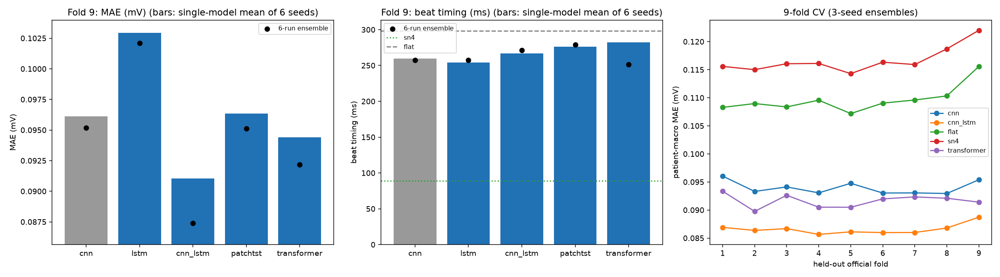
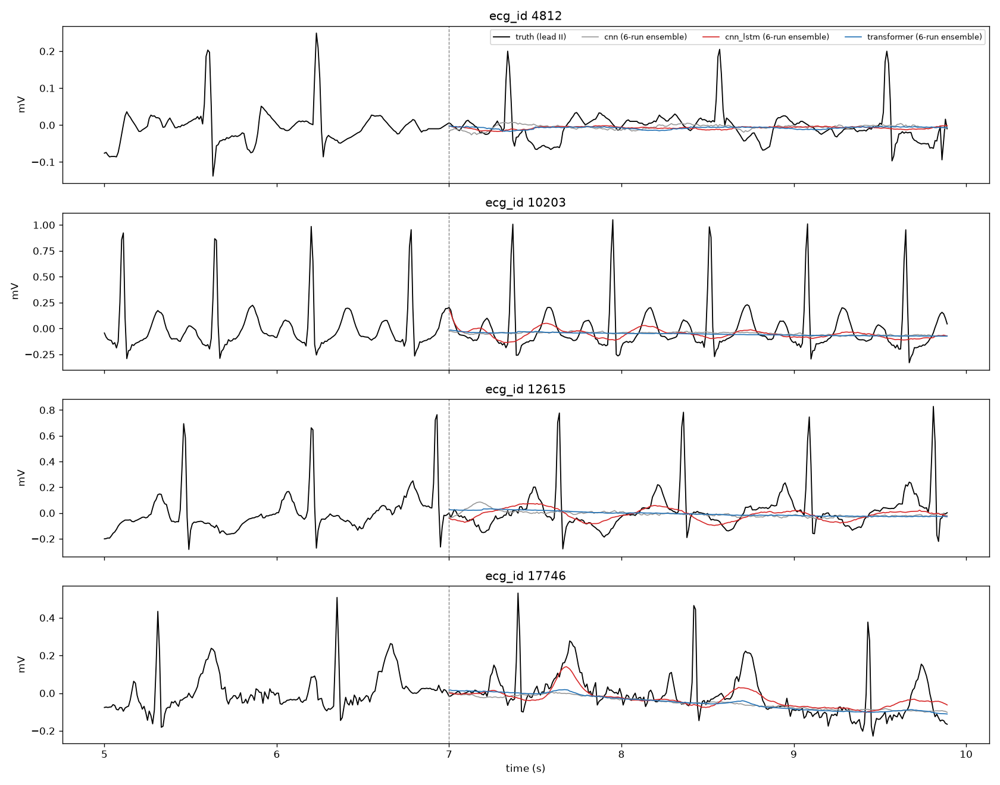

# Phase 9 report: model families under a fixed L1 objective

Design, hypotheses and decision rules: [PREREGISTRATION.md](PREREGISTRATION.md),
including one amendment (epoch cap 40 → 100, D9.1). Training pool: folds 1–8 minus the
internal holdout. Screening: fold 9. Confirmation: 9-fold CV over folds 1–9. Fold 10
sealed. Comparisons: `stats.compare_runs`, 6 vs 6 seeds, bootstrap over runs and
patients, MAE and gatekeepers (D8.3).

Reproduce (CPU, 40 cores; about 18 h wall-clock in total, cached):

```sh
uv run python research/phase9_models.py --stage A   # learning rate, ~2.5 h
uv run python research/phase9_models.py --stage B   # fold-9 screening, ~3.5 h
uv run python research/phase9_models.py --stage C   # 9-fold CV of the shortlist, ~8 h
uv run python research/phase9_models.py --stage D   # 8-lead output, ~1 h
uv run python research/phase9_models.py --stage report
```

## 1. Verdict

| Hypothesis | Result | Key evidence |
|---|---|---|
| H9.1 Architecture does not fix rhythm under L1 | **Accepted** | No family beats `sn4`; best 6-run ensemble timing 252 ms (`sn4` 89 ms); under 1% of records within 50 ms for every family |
| H9.2 Architecture has a small (≤ 2%) effect on MAE | **Rejected** | CNN-LSTM is 5.3% better than the CNN on fold 9 and 7.9% better across 9 folds (better in 9 of 9) |
| H9.3 Fold 9 ranks the shortlist as CV does | **Accepted** | CNN-LSTM < Transformer < CNN on fold 9 and on the 9-fold mean |
| H9.4 8-lead output is non-inferior | **Rejected** | ΔMAE +2.9 µV [+0.9, +5.1] for CNN-LSTM (margin +0.5) |

**Main findings.**

1. **No best family is declared under L1** (pre-registered rule, D8.6). CNN-LSTM has
   clearly the lowest MAE (0.0866 mV, 9-fold mean) and DTW-MAE (0.0757 mV, close to
   `sn4`'s 0.0735). But its beat-template MAE is **worse than a flat line in all 9
   folds** (0.131 vs 0.105 mV), and its beat timing is 12 ms worse than the CNN's. The
   Transformer improves MAE by 2.4 µV but is also significantly worse on template MAE.
   Under the rule, a gatekeeper that gets worse blocks a win.
2. **What CNN-LSTM learns:** the slow components (T waves, baseline swings) in phase
   near the forecast origin, fading over the horizon. **No family forecasts a QRS
   complex** (fig. 2). This is the same objective problem as in Phases 5 and 7, in
   milder form: the L1 objective rewards whatever slow structure is predictable and
   blurs the rest.
3. **Carried into Phase 10** (pre-registered rule: the two CV families with the lowest
   9-fold mean MAE): **CNN-LSTM and Transformer**. 12-lead output is kept.

## 2. Stage A: learning rate (internal holdout only)

| Family | Chosen learning rate | Best holdout L1 (other rate) | Best epoch / run | Minutes |
|---|---|---|---|---:|
| CNN | 3e-4 | 0.09599 (1e-3: 0.09601, a tie) | 28 / 33 | 7 |
| LSTM | 1e-3 | 0.09989 (3e-4: 0.10006) | 37 / 42 | 25 |
| CNN-LSTM | 1e-3 | **0.08986** (3e-4: 0.09273, capped at 100) | 79 / 84 | 52 |
| PatchTST | 3e-4 | 0.09282 (1e-3: 0.09344) | 82 / 87 | 148 |
| Transformer | 3e-4 | 0.09449 (1e-3: 0.09473) | 43 / 48 | 80 |

With the original 40-epoch cap, PatchTST would have used 1e-3, and CNN-LSTM's holdout
L1 would have been 0.0921 instead of 0.0899 (`table_stage_a_lr_cap40.csv`).

## 3. Stage B: fold-9 screening (6 seeds each)



| Family | Parameters | MAE, single model (mean ± SD) | MAE, 6-run ensemble | DTW-MAE | Template MAE | Beat timing (ms) | Min/run |
|---|---:|---|---:|---:|---:|---:|---:|
| CNN (reference) | 1.85 M | 0.0961 ± 0.0001 | 0.0952 | 0.0900 | 0.1050 | 259 | 8 |
| LSTM | 0.25 M | 0.1030 ± 0.0002 | 0.1021 | 0.0978 | 0.1045 | 254 | 33 |
| **CNN-LSTM** | 0.72 M | **0.0911 ± 0.0006** | **0.0874** | **0.0781** | 0.1288 | 267 | 53 |
| PatchTST (reduced) | 0.74 M | 0.0963 ± 0.0002 | 0.0951 | 0.0844 | 0.1160 | 276 | 160 |
| Transformer | 1.18 M | 0.0944 ± 0.0012 | 0.0922 | 0.0911 | 0.1090 | 283 | 110 |
| *flat* | – | 0.1161 | – | 0.1161 | 0.1048 | 298 | – |
| *`sn4`* | – | 0.1218 | – | 0.0796 | 0.0642 | 89 | – |

Single-model values are seed means of patient-macro scores.

`compare_runs`, Δ in µV (timing in ms), 95% CI:

| Family | vs CNN: ΔMAE | ΔDTW | ΔTemplate | ΔTiming | Beats CNN? | Beats flat? | Beats `sn4`? |
|---|---|---|---|---|:-:|:-:|:-:|
| LSTM | +6.8 [+4.3, +8.4] | +7.8 | −0.5 | −5 (n.s.) | ✗ | ✓ | ✗ |
| CNN-LSTM | **−5.1** [−7.6, −3.6] | **−11.9** | **+23.8** [+21.5, +26.2] | +7 [+4, +10] | ✗ | ✗ (template +24) | ✗ (DTW −1.8, n.s.) |
| PatchTST | +0.2 (n.s.) | −5.5 | +11.0 | +17 | ✗ | ✗ (template +11) | ✗ |
| Transformer | −1.7 [−4.2, −0.1] | +1.1 (n.s.) | +4.0 (n.s.) | +23 [+5, +34] | ✗ | ✓ | ✗ |

- **Against flat,** only LSTM and Transformer pass every gatekeeper. The CNN reference
  itself now fails, by 0.4 µV on template MAE [+0.04, +1.05]. That is because
  `compare_runs` judges single models, and single models score slightly worse than
  ensembles. Under Phase 5's 3-seed-ensemble comparison the difference was not
  significant.
- **Ensembling matters most for CNN-LSTM** (−3.7 µV, vs −0.9 µV for the CNN). Its
  seeds disagree more, so averaging helps more.
- **The Transformer has the largest seed-to-seed spread** (SD 1.2 µV). Its timing
  ranges from near-flat to beat-like between runs.

## 4. Stage C: 9-fold cross-validation (D8.6)

Shortlist by the pre-registered rule: CNN-LSTM and Transformer, plus the CNN
reference. 3 seeds per fold; 3-seed ensembles scored per fold:

| Family | MAE (9-fold mean) | DTW-MAE | Template MAE | Beat timing (ms) | Better MAE than CNN in |
|---|---:|---:|---:|---:|---|
| **CNN-LSTM** | **0.0866** | **0.0757** | 0.1310 | 270 | 9 / 9 folds |
| Transformer | 0.0916 | 0.0890 | 0.1080 | 272 (244–296) | 9 / 9 folds |
| CNN | 0.0940 | 0.0889 | 0.1050 | 258 | – |
| *flat* | 0.1097 | 0.1097 | 0.1049 | 299 | |
| *`sn4`* | 0.1167 | 0.0735 | 0.0648 | 88 | |

Paired across folds (mean difference, t-test):

| Pair | ΔMAE (µV) | ΔDTW (µV) | ΔTemplate (µV) | ΔTiming (ms) | Rule verdict |
|---|---|---|---|---|---|
| CNN-LSTM − CNN | −7.4 (p < 0.001) | −13.3 (p < 0.001) | **+26.0 (p < 0.001)** | **+11.8 (p < 0.001)** | no win (gatekeepers worse) |
| Transformer − CNN | −2.4 (p = 0.001) | +0.1 (n.s.) | **+3.0 (p = 0.04)** | +14.2 (n.s.) | no win (template worse) |
| CNN-LSTM − Transformer | −5.0 (p < 0.001) | −13.4 (p < 0.001) | **+23.1 (p < 0.001)** | −2.4 (n.s.) | no win (template worse) |

Fold 9 agrees with the CV on every pair, and on fold 9 no pair passes `compare_runs`
either. **Result: no best family under L1.** Carried into Phase 10: **CNN-LSTM**
(0.0866) and **Transformer** (0.0916).

## 5. What the models predict



- **CNN and Transformer** forecast the level and almost nothing else.
- **CNN-LSTM** reproduces the slow waves (T waves, baseline) of the first one or two
  beats in phase, then fades towards the mean.
- **No model forecasts QRS complexes.**
- **Wave-level errors (fold 9, ensembles):** CNN-LSTM's R amplitude error is slightly
  lower than the CNN's (0.842 vs 0.867 mV), but its ST error (0.082 vs 0.065 mV) and
  T error (0.286 vs 0.248 mV) are higher.
- **Where the detector finds "beats"** in CNN-LSTM forecasts (57% of records), the
  template MAE is 0.149 mV, against 0.102 mV where it finds none.

The template gatekeeper is therefore working as designed: misshapen beats are rated
worse than no beats.

## 6. Stage D: 8-lead output (CNN-LSTM, 6 seeds)

| | 12-lead output | 8-lead output (III, aVR, aVL, aVF derived) |
|---|---:|---:|
| MAE, 6-run ensemble | 0.0874 | 0.0898 |
| `compare_runs` ΔMAE (8 − 12) | – | **+2.9 µV [+0.9, +5.1]** |
| ΔDTW / ΔTemplate / ΔTiming | – | +3.0 µV (worse) / +1.2 µV (n.s.) / −2.2 ms (n.s.) |
| Records breaking a limb relation by > 0.01 mV | 2.2% (median 0.003 mV) | 0% (by construction) |

**H9.4 is rejected; 12-lead output is kept.** CNN-LSTM's 12-lead forecasts are already
far more consistent than the CNN's (2.2% vs 19% of records, Phase 5). The remaining
benefit of 8-lead output is small, and it costs measurable accuracy. A plausible
explanation, not tested here: with 8 outputs, errors in I and II propagate twice into
the derived limb leads.

## 7. Disclosures

- **Amendment D9.1:** the epoch cap was raised from 40 to 100 after stage A (user
  decision). It was decided before any fold-9 result existed and applied to all
  families. Of the runs used, 2 still reached 100 epochs (CNN-LSTM fold 3 seed 999;
  Transformer fold 2 seed 999), and so did the unchosen CNN-LSTM at 3e-4 in stage A
  (3 of 106 runs in total). Those models might improve slightly with longer training.
- **PatchTST was reduced for CPU** (100 ms patches, width 64, 2 layers). The published
  size costs about 6 h per run. Its result is for this reduced configuration only.
- **The CNN reference changed learning rate** (3e-4, by a stage-A difference of
  0.00002), so it was retrained rather than reused. The reuse path was nonetheless
  verified bitwise.
- **Code changes made for this phase, all with tests:**
  - re-initialization now also covers attention layers and learned embeddings
    (PatchTST and Transformer would otherwise have had unseeded weights; the CNN of
    Phases 5–8 has no such layers and is unaffected);
  - the pipeline selects leads before filtering, which is equivalent for the earlier
    configurations and allows 8 leads with the decomposition;
  - `compare_runs` accepts a single run for a deterministic reference.
- **Families were compared at similar CPU cost, with one configuration each.**
  Parameter counts differ up to 7×. A family's result is not its best possible result.
- **9-fold CV uses 3 seeds per fold.** Seed noise therefore enters the between-fold
  variance; the p-values are conservative.

## 8. Implications for later phases

| Phase | Implication |
|---|---|
| 10 Objectives | Carry CNN-LSTM and Transformer. The target is clear: keep CNN-LSTM's slow-wave tracking, and produce QRS complexes with correct timing and morphology. Candidates are shape/timing-aware losses (e.g. DTW-type losses, beat-aligned or derivative/frequency terms) and explicit rhythm conditioning. Every candidate must beat flat on MAE and not be worse than `sn4` on the gatekeepers |
| 10–12 Protocol | Fold-9 screening is validated again (H9.3). Keep 6 seeds per comparison and 9-fold CV for finalists |
| Cost | CNN-LSTM ≈ 53 min and Transformer ≈ 110 min per run on 4 CPU threads under load. One objective × 2 families × 6 seeds ≈ 2 h wall-clock; final CV ≈ 8 h. A GPU would shorten this greatly |
| 13 Plausibility | Report lead consistency for the final model; for CNN-LSTM it is 2.2% of records > 0.01 mV, without 8-lead output |
| Ensembling | CNN-LSTM gains 3.7 µV from 6-run ensembling. Single-model and ensemble results must be reported separately |
